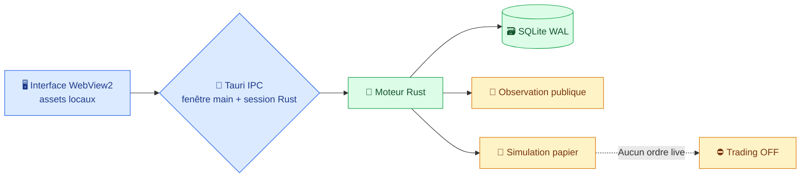

# 🛰️ PRAVDA-BOT

### Terminal de marché et centre de diagnostic Windows

**Local · Rust · Tauri 2 · WebView2 · SQLite**

**[⬇️ Exécutables](#-téléchargements-windows)** · **[🟢 État actuel](#-situation-vérifiée)** · **[🔐 Sécurité](SECURITY.md)** · **[📚 Guide complet](docs/PRAVDA-GUIDE.md)** · **[🚦 Limites](#-limites-et-critères-de-livraison)**

---

## 🎯 Le produit en 30 secondes

Pravda-Bot est une application Windows native pour **observer des données de marché**, conserver leur historique local et réaliser des **simulations papier**. L'interface WebView2 utilise des commandes **Tauri IPC authentifiées en Rust** ; elle n'héberge pas de serveur HTTP pour son usage normal.

| 🟢 En place | 🟠 Encore à qualifier | 🔴 Interdit / non livré |
|:---|:---|:---|
| Desktop Rust/Tauri, authentification, SQLite WAL, tests Windows, Doctor et Harness | Recette sur VM sans WebView2 ni Internet, installation réellement personnalisable, validation PC externe | Ordres réels, retraits, certification de sécurité non démontrée, édition Enterprise signée non attestée |

> [!IMPORTANT]
> **Une CI verte est une preuve de tests sur un commit précis, pas une homologation générale.** Cible de livraison : **30 novembre 2026**. Le [plan de livraison #106](https://github.com/suvorovpravda/Pravda-Bot/issues/106) a été fermé ; les critères non prouvés restent des conditions indépendantes de publication.

## 🟢 Situation vérifiée

Photographie du **5 novembre 2026** — réexaminer le commit de main avant chaque téléchargement.

| Contrôle | État observé | Preuve |
|:---|:---|:---|
| **Source** | 🟢 `main` à `b2fb618b` | [Commit exact](https://github.com/suvorovpravda/Pravda-Bot/commit/b2fb618b53408b0fd5fd2c4265cdfe0a05ffc898) |
| **CI Rust + CodeQL + packaging** | 🟢 **11/11** contrôles réussis | [Actions sur main](https://github.com/suvorovpravda/Pravda-Bot/actions?query=branch%3Amain) |
| **MSI / NSIS / onboarding GUI** | 🟢 Tests de runner Windows réussis | [Run #41972245070](https://github.com/suvorovpravda/Pravda-Bot/actions/runs/41972245070) |
| **Centre de recette unifié** | 🟠 Nouveau téléchargement en qualification | [PR #139](https://github.com/suvorovpravda/Pravda-Bot/pull/139) |
| **Signature Authenticode Enterprise** | 🔴 Non attestée | [Issue #90](https://github.com/suvorovpravda/Pravda-Bot/issues/90) |
| **Trading réel / retrait** | 🔴 Désactivé / non homologué | [Issue #89](https://github.com/suvorovpravda/Pravda-Bot/issues/89) |

## ⬇️ Téléchargements Windows

**Objectif du parcours utilisateur : un seul programme, aucun outil de développement à installer.**

| Archive GitHub Actions | Rôle | Lancement |
|:---|:---|:---|
| **🛡️ `pravda-windows-oneclick-report`** | Centre de recette unifié qui **embarque le desktop, Doctor et Harness** ; rapport HTML coloré + TXT | Extraire le ZIP, puis **double-cliquer sur `pravda-production-center.exe`**. **Disponible seulement après validation de la PR #139.** |
| 🪟 `pravda-windows-unsigned-candidate-installers` | MSI et NSIS, exécutable desktop, manifeste SHA-256 et preuve de provenance | Installation Windows de test |
| 🩺 `pravda-windows-troubleshooting` | Doctor indépendant | Double-clic ; diagnostic passif |
| 🧪 `pravda-windows-production-test` | Harness indépendant | Lancement en mode `--smoke` ; simulation locale |

**Dernier run du socle vérifié :** [packaging Windows #41972245070](https://github.com/suvorovpravda/Pravda-Bot/actions/runs/41972245070), SHA `b2fb618b`. La nouvelle archive **oneclick** ne doit pas être présentée comme disponible sur ce run antérieur : elle sera publiée par un workflow ultérieur lorsque la PR correspondante aura passé la CI.

### 🧭 Fonctionnement du centre unifié

1. Un **rapport HTML** s'ouvre automatiquement et indique la progression.
2. L'outil lance **Doctor** et **Harness** avec leurs tests locaux, puis contrôle le démarrage d'une **fenêtre Tauri** dans un profil temporaire séparé.
3. Il laisse sur le Bureau ou dans Documents un rapport **HTML coloré** et un fichier **`Pravda-Production-Report.txt`** détaillé, à joindre volontairement à la conversation d'assistance.

> [!NOTE]
> Aucun mot de passe ni clé de compte n'est demandé. L'outil **n'installe rien**, n'effectue aucun ordre et **n'envoie pas automatiquement** le rapport. Il ne remplace **pas** la recette des installateurs ou les tests d'une installation réellement hors réseau. Sur une build non signée, ne pas désactiver Windows Defender, UAC ou SmartScreen pour faire passer le test.

Les installateurs MSI/NSIS incorporent le prérequis officiel WebView2 : configuration `offlineInstaller` + `silent=true`. Le scénario machine **sans WebView2 préexistant et sans Internet** n'est pas encore validé. Les archives GitHub Actions sont temporaires ; l'ancienne [préversion v0.3.4](https://github.com/suvorovpravda/Pravda-Bot/releases/tag/v0.3.4) ne contient pas automatiquement les dernières corrections.

## 🧩 Fonctions et périmètre

| Module | Comportement livré | Limite |
|:---|:---|:---|
| **🖥️ Desktop Tauri** | Ressources locales, fenêtre native WebView2, IPC Rust | Windows x64 |
| **🔐 Authentification** | Mot de passe local (minimum 15 caractères), PBKDF2-SHA256, révocation des sessions | Pas d'accès aux secrets depuis JavaScript |
| **📊 Marchés** | Observation, fraîcheur et indisponibilité des cotations publiques | Pas de prix d'exécution garanti |
| **🗂️ SQLite** | Données locales, WAL, consultation et export d'historique | Recette de restauration utilisateur à compléter |
| **🛡️ Sécurité** | Contrôles authentifiés et rapport Doctor | `SKIP` n'est jamais `PASS` |
| **🧪 Simulation** | Scénarios papier et Harness synthétique | Aucun ordre réel |
| **🌐 Connecteurs optionnels** | Lecture publique avec consentement explicite lorsqu'il est requis | Pas de privilège broker implicite |

Les extensions on-chain, flux whales/stablecoins/DeFi et moteur événementiel avancé sont étudiés dans les issues [#121](https://github.com/suvorovpravda/Pravda-Bot/issues/121) et [#123](https://github.com/suvorovpravda/Pravda-Bot/issues/123) ; **ne pas les annoncer comme déjà livrés**.

### 🏗️ Architecture en bref

## 🚦 Limites et critères de livraison

- 🟠 **VM air-gapped** : installer MSI et NSIS sur Windows propre, **WebView2 absent au départ**, réseau physiquement/logiquement coupé, puis tester la première connexion.
- 🟠 **Standard / Personnalisé** : choix de modules véritablement appliqués aux permissions, au réseau et aux fichiers, pas seulement à l'affichage.
- 🟠 **Recette utilisateur** : tests sur PC indépendant, mise à jour/réinstallation, persistance et restauration cohérente des données.
- 🔴 **Enterprise signé** : Authenticode, horodatage, chaîne de confiance et preuve par artefact ; [issue #90](https://github.com/suvorovpravda/Pravda-Bot/issues/90).
- 🔴 **Trading live** : bloqueur distinct, sans raccourci par l'interface ou l'installateur ; [issue #89](https://github.com/suvorovpravda/Pravda-Bot/issues/89).

## 📍 Suivi historique des neuf chantiers

Les fractions ci-dessous sont les **jalons de référence du guide central**, conservés synchronisés par le test de documentation. Elles ne sont ni un indicateur de sécurité ni un pourcentage d'homologation du build actuel.

| Priorité | Chantier | Jalons documentaires | Progression de référence |
|:---|:---|:---|:---|
| **P0** | Séparation du Python de production | 6/6 | **100 %** |
| **P0** | Sécurité IPC Windows | 2/4 | **50 %** |
| **P0** | Parité métier Rust | 3/8 | **38 %** |
| **P0** | CI et gouvernance | 3/5 | **60 %** |
| **P1** | Historique / migration SQLite | 3/4 | **75 %** |
| **P1** | Expérience desktop | 2/4 | **50 %** |
| **P1** | Packaging Enterprise signé | 0/4 | **0 %** |
| **P2** | Observabilité et charge | 1/4 | **25 %** |
| **P2** | Fonctions facultatives et LLM | 0/4 | **0 %** |

Pour la preuve technique actualisée, utiliser le **SHA de main et ses workflows** ; pour les dossiers complets, consulter [SECURITY.md](SECURITY.md) et le [guide central](docs/PRAVDA-GUIDE.md).

## 🔗 Développement et signalements

La compilation depuis les sources (qui **nécessite** la chaîne Rust/MSVC) et les procédures avancées sont documentées dans [docs/PRAVDA-GUIDE.md](docs/PRAVDA-GUIDE.md). Les utilisateurs des exécutables distribués **n'ont pas besoin** de ces outils.

Pour signaler une vulnérabilité, consulter [GitHub Security](https://github.com/suvorovpravda/Pravda-Bot/security) et la [politique de divulgation](SECURITY.md). **Ne jamais publier** de mots de passe, tokens, bases SQLite, journaux bruts ou fichiers de signature.

---

### English

Pravda-Bot is a local Windows Rust/Tauri market-observation and paper-simulation desktop. **Live orders are disabled.** Download release candidates from the **exact successful GitHub Actions run**; unsigned artifacts are for testing, not signed Enterprise distribution. The one-click production center, once independently validated, embeds the App, Doctor and Harness and generates local HTML/TXT reports. Consult [Security](SECURITY.md) for limitations.

### Русский

Pravda-Bot — локальное приложение Windows на Rust/Tauri для мониторинга рынков и бумажного моделирования. **Реальные ордера отключены.** Скачивайте артефакты только из успешного запуска GitHub Actions с проверкой SHA-256. Объединённый диагностический центр должен создавать локальные отчёты HTML/TXT. Подробнее: [Security](SECURITY.md).
