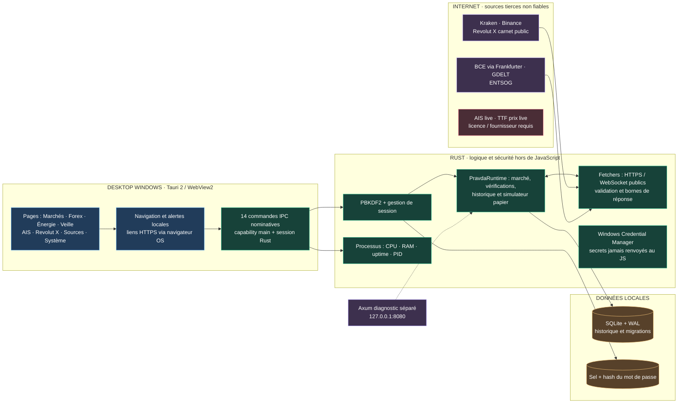
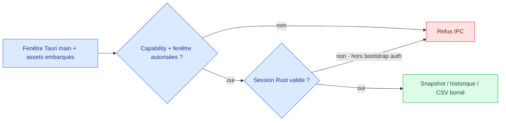

<div align="center">

# 🛰️ PRAVDA-BOT
### Observatoire de marché local · Rust + Tauri 2 · Windows

**Marchés en temps réel · historique SQLite · simulation papier · interface native IPC**

[](https://github.com/suvorovpravda/Pravda-Bot/actions/workflows/rust.yml)
[](https://github.com/suvorovpravda/Pravda-Bot/actions/workflows/codeql.yml)


**[Démarrage](#-démarrage-rapide--windows)** · **[Architecture](#-architecture-actuelle)** · **[Fonctions](#-périmètre-réel)** · **[Sécurité](SECURITY.md)** · **[Guide central](docs/PRAVDA-GUIDE.md)** · **[Avancement](#-avancement-par-priorité)**

[Français](#français) · [Русский](#русский) · [English](#english)

</div>

---

## Français

## Référence du client final : NautilusTrader et Crypto-Hunter v3 (travaux proposés)

Le financeur a transmis [NautilusTrader](https://nautilustrader.io/) comme **référence d'architecture**, en complément du mandat on-chain Crypto-Hunter v3. **Il ne s'agit pas de fonctionnalités livrées actuellement** et l'application Windows conserve sa propre architecture Rust + Tauri, sans Python/Node à installer. Les travaux sont documentés dans [ADR-001 : benchmark NautilusTrader](docs/ADR-001-NAUTILUS-BENCHMARK.md), [#123 : moteur événementiel, risque et simulation](https://github.com/suvorovpravda/Pravda-Bot/issues/123), et [#121 : whales, stablecoins, DeFi et netflows](https://github.com/suvorovpravda/Pravda-Bot/issues/121).

**Priorités de conception :** journal d'événements et replay après crash, horloges contrôlées, types financiers à précision fixe, limites de risque fail-closed, simulation de latence/frais/fill partiel, métadonnées de provenance et qualité des données, indicateurs on-chain non directionnels, tests de déterminisme. Le module indépendant `pravda-engine::research_risk` est un **contrat de recherche/paper hors exécution**, non câblé au simulateur principal ni aux ordres réels. Les futures intégrations de code Nautilus sous licence LGPL-3.0 sont soumises à une revue légale/supply-chain avant distribution commerciale ; pour l'instant **aucune dépendance Nautilus** n'est ajoutée.

**Non-objectif immédiat :** aucune promesse de parité complète avec NautilusTrader, de performances HFT, de trading automatisé, de futures/options ou d'activation de compte broker. La priorité de release reste [#106](https://github.com/suvorovpravda/Pravda-Bot/issues/106) : installation Windows autonome, sécurité et contrôles P0, objectif 30/11/2026.

---

## Livraison Windows — situation vérifiée au 4 novembre 2026

**Source de vérité :** [plan directeur #106](https://github.com/suvorovpravda/Pravda-Bot/issues/106), code de la branche [main](https://github.com/suvorovpravda/Pravda-Bot/tree/main) et [workflow d'installation Windows](https://github.com/suvorovpravda/Pravda-Bot/actions/workflows/windows-package.yml). **Livraison cible : 30 novembre 2026** ; cette date ne remplace pas les barrières de sécurité.

| Livrable Windows x64 | Téléchargement dans le **même run** GitHub Actions | Portée réelle |
| --- | --- | --- |
| Application Tauri / installateurs | `pravda-windows-unsigned-candidate-installers` (EXE, MSI, NSIS, Doctor, Harness, SHA256SUMS et provenance) | Desktop avec IPC natif, authentification locale et SQLite ; **édition de test non signée** |
| Test préproduction indépendant | `pravda-windows-production-test` : `pravda-harness.exe` et `PRODUCTION-TEST.txt` | Replay/smoke synthétique et campagnes hors ligne ; **isolement réseau OS/VM obligatoire** |
| Dépannage indépendant | `pravda-windows-troubleshooting` : `pravda-doctor.exe` et `TROUBLESHOOTING.txt` | Diagnostic passif local ; aucun ordre, réparation automatique ou test interactif de connexion |

**À propos de GitHub Environments :** les entrées « Deployed » dans l'environnement `unsigned-test` décrivent le résultat d'un job GitHub Actions de packaging/test et ses artefacts éphémères. Elles **ne prouvent ni un déploiement chez l'utilisateur final, ni la publication d'une Release stable, ni une signature Authenticode Enterprise**. Une exécution `Failed to deploy` d'un ancien commit ne contredit pas le succès d'un commit corrigé ; vérifier le dernier SHA, tous les jobs du run et les fichiers réellement publiés.

**Téléchargement reproductible :** ouvrir [Actions → Windows installer packaging](https://github.com/suvorovpravda/Pravda-Bot/actions/workflows/windows-package.yml), sélectionner un run **réussi de `main` au SHA voulu**, puis récupérer les **trois artefacts de ce même run**. Sur chaque ZIP, extraire les fichiers avant exécution. Le manifeste `bundle/SHA256SUMS.txt` et `bundle/release-evidence.json` de l'archive principale lient les exécutables au commit et servent à vérifier les binaires indépendants. Les deux ZIP compagnons ne sont pas, à eux seuls, des installateurs MSI et ne contiennent pas chacun leur propre manifeste. Les artefacts GitHub Actions sont temporaires : **ce n'est pas encore une Release stable du 30 novembre**.

**Preuves intégrées :** [#112](https://github.com/suvorovpravda/Pravda-Bot/pull/112) démarrage du vrai EXE installé ; [#115](https://github.com/suvorovpravda/Pravda-Bot/pull/115) séparation et comparaison SHA-256 des trois artefacts ; [#116](https://github.com/suvorovpravda/Pravda-Bot/pull/116) installation/désinstallation/réinstallation et conservation de fichiers utilisateur ; [#117](https://github.com/suvorovpravda/Pravda-Bot/pull/117) prévalidation de syntaxe PowerShell ; [#111](https://github.com/suvorovpravda/Pravda-Bot/pull/111) redémarrage natif et persistance de l'authentification. **La vérification vaut seulement pour les runs verts et leur SHA exact**, pas automatiquement pour les commits ultérieurs.

**Travaux en cours :** [#118](https://github.com/suvorovpravda/Pravda-Bot/pull/118), test de snapshot/restauration SQLite WAL, reste à valider et fusionner. Le test de canaris MSI prouve la préservation de fichiers témoins, **pas** une restauration complète des lignes d'une base utilisateur. Tests d'acceptation sur PC utilisateur, VM réellement isolée du réseau, preuve de signature Authenticode Enterprise [#90](https://github.com/suvorovpravda/Pravda-Bot/issues/90) et homologation des ordres réels Revolut X [#89](https://github.com/suvorovpravda/Pravda-Bot/issues/89) restent distincts. **Trading réel OFF** ; ne jamais transmettre des clés ou mots de passe aux rapports.

**Sécurité visible — refus du modèle actuel :** la recette finale exige un centre de sécurité local après authentification avec **états et preuves** (auth/session, intégrité et sauvegarde SQLite, trafic public, signatures, permissions IPC, mode trading OFF, VPN). Tout résultat non contrôlable reste `NON VÉRIFIÉ`, jamais « sécurisé » par défaut. **Proton VPN** est une option facultative : l'utilisateur peut s'appuyer sur son abonnement et l'application officielle Windows, sans partager ses identifiants avec Pravda-Bot. L'ouverture du logiciel Proton ne prouve pas une connexion VPN ; aucun contrôle CLI Windows non documenté n'est promis. L'activation du kill switch doit rester explicite. **Ce centre de sécurité et le contrôle VPN sont à implémenter/recetter, non à présenter comme existants.** [Détails #106](https://github.com/suvorovpravda/Pravda-Bot/issues/106) et [SECURITY.md](SECURITY.md).

**Installation autonome et personnalisable — exigence P0 :** lancement d'un MSI/NSIS sans outils de développement ni prérequis à installer manuellement. L'utilisateur doit disposer d'un mode **Standard recommandé** et d'un mode **Personnalisé** pour les modules réellement facultatifs : observation publique, simulation, Doctor, Harness et, seulement après validation, lecture seule Revolut X. Le cœur Tauri/WebView2, l'authentification locale, SQLite nécessaire et les protections IPC/intégrité **ne sont jamais décochables** ; les ordres réels ne peuvent pas être sélectionnés. Les choix doivent retirer les fonctions et permissions correspondantes, pas seulement masquer une interface. `webviewInstallMode=downloadBootstrapper` silencieux est déjà configuré mais nécessite un téléchargement officiel si WebView2 manque ; échec sûr si impossible, sans désactiver SmartScreen/UAC. **La sélection modulaire MSI/NSIS et la matrice complète d'installation ne sont pas encore homologuées** : [plan #106](https://github.com/suvorovpravda/Pravda-Bot/issues/106).

**Guides opérationnels :** [Guide central](docs/PRAVDA-GUIDE.md), [Politique de sécurité](SECURITY.md), [Mode test](docs/windows/PRODUCTION-TEST.txt), [Dépannage](docs/windows/TROUBLESHOOTING.txt). Les tableaux de progression historiques plus bas sont conservés comme instantanés antérieurs et **ne sont pas le statut de release actuel**.

---

## Historique de livraison — état du 3 novembre 2026 (archive ; voir le suivi ci-dessus)

> **Niveau de sécurité visé : plateforme financière réglementée, défense en profondeur.** Il s'agit d'un **objectif d'architecture et de vérification**, et non d'une certification, d'une équivalence avec l'infrastructure de Revolut, ni d'une garantie d'aptitude à la négociation réelle. Les modules actuels sont expérimentaux; toute mise en production requiert des preuves indépendantes.

**Entrée de référence :** le desktop Windows est un client **Tauri 2 / Rust** avec ressources HTML/CSS/JavaScript locales et IPC typé. Il ne doit pas démarrer le serveur HTTP de compatibilité Axum : celui-ci est un exécutable/mode séparé. Le backend et les calculs de simulation sont en Rust; **le dépôt entier n'est pas 100 % Rust** tant que l'interface JS et les scripts de CI existent. Python ne doit pas être exécuté : ses anciennes sources sont confinées à `archive/python-legacy/`.

| Composant | Livré dans le code | Limite de livraison / preuve restante |
| --- | --- | --- |
| Desktop / historique / authentification locale | Tauri IPC, Rust, SQLite WAL, garde Host/Origin séparé pour Axum | Vérification de l'exécutable **du commit exact** sur Windows propre, sans socket UI ni ancien serveur |
| `pravda-doctor.exe` | PR [#98](https://github.com/suvorovpravda/Pravda-Bot/pull/98) intégrée : rapport texte expurgé, contrôles Windows / auth / SQLite, aucun appel DNS/TCP | Diagnostic passif : ne prouve pas qu'une interface ou un compte fonctionne; rapport utilisateur nécessaire |
| `pravda-harness.exe` | PR [#99](https://github.com/suvorovpravda/Pravda-Bot/pull/99) : orchestration Tokio, métriques Serde, tests N exécutions, refus des seuils | Vérifier la fusion et les artefacts du dernier commit; exiger un isolement réseau **OS/VM**; les fixtures synthétiques ne prouvent aucun PnL |
| Revolut X | Lecture de soldes privée encadrée, ordres préparés hors ligne et réconciliation simulée, PR [#94](https://github.com/suvorovpravda/Pravda-Bot/pull/94), [#96](https://github.com/suvorovpravda/Pravda-Bot/pull/96), [#97](https://github.com/suvorovpravda/Pravda-Bot/pull/97) | **Aucun POST d'ordre réel**, approbation, état durable et limites de risque par acteur à valider — [#89](https://github.com/suvorovpravda/Pravda-Bot/issues/89) |
| Distribution Windows | Build PE x64, contrôles CI, vérification SHA-256, workflow manuel MSI/NSIS | Certificat Authenticode, signature EXE/MSI/NSIS, horodatage et validation SmartScreen sur PC propre — [#90](https://github.com/suvorovpravda/Pravda-Bot/issues/90) |

### Téléchargement et démarrage Windows

1. Ne pas confondre **Release** et **Artifacts** : une archive `v0.3.4` n'intègre pas automatiquement les PR suivantes. Télécharger la build à partir du workflow **réussi sur le commit souhaité** dans [GitHub Actions](https://github.com/suvorovpravda/Pravda-Bot/actions). Vérifier l'empreinte SHA-256 et la signature lorsqu'elle est requise.
2. Avant toute compilation locale Rust MSVC, installer Visual Studio Build Tools avec la charge **Desktop development with C++** (MSVC, SDK Windows), puis ouvrir **Developer PowerShell for VS**. Si `link.exe not found`, la compilation a échoué et l'ancien `target/release/pravda-app.exe` **reste présent** : ne pas le prendre pour un nouveau build.
3. Dans le clone local, lancer `git status --short` puis `git pull --ff-only origin main`. Ne jamais supprimer automatiquement `%LOCALAPPDATA%\\Pravda-Bot`, ni `*.db-wal` / `*.db-shm` : fermer d'abord le logiciel, créer une copie cohérente avec l'API de sauvegarde SQLite et vérifier les restaurations.
4. Compiler le desktop : `cargo build --locked --release --manifest-path crates/pravda-app/Cargo.toml`. Attendre `Finished release profile`, puis exécuter `crates/pravda-app/target/release/pravda-app.exe`. Le mode normal ouvre une fenêtre **WebView2 native**, pas `http://127.0.0.1:8080`.

**Diagnostics :** lancer `pravda-doctor.exe` par double clic, copier le bloc `PRAVDA-DOCTOR REPORT` complet. Le rapport utilise `PASS / WARN / FAIL / SKIP`; **SKIP ne vaut pas PASS**. Un avertissement « adjacent_app_binary » signifie que le diagnostic ne trouve pas l'EXE à proximité, et non que l'application est compromise. La checklist de dépannage et la procédure de rapport sont dans le [guide unique](docs/PRAVDA-GUIDE.md).

### Architecture de sécurité cible — contrôle bancaire/fintech

Les fonctions financées par des actifs réels doivent être séparées en **plans indépendants** : (1) **replay air-gapped / simulation** sans clé ni socket, (2) **lecture seule** pour les soldes, (3) **routeur d'ordres** optionnel et bloqué par défaut, dans un processus avec privilèges réseau strictement limités, (4) **gestion des clés et approbations** hors WebView. Une requête Tauri venant de JavaScript ne constitue jamais une autorisation de trading.

Avant tout ordre réel : identité opérateur vérifiée; double confirmation du passage en live; permissions d'API minimales **sans retrait**; limites instrument, notionnel, exposition quotidienne, soldes et fraîcheur; identifiants idempotents persistés avant émission; kill switch local durable; réconciliation des états inconnus sans retransmission automatique; preuve de tests négatifs (timeouts, 429, déconnexion, fills partiels, crash, redémarrage). **Aucun ordre live n'est activé** par cette architecture cible.

Les engagements de sécurité de niveau institutionnel (gouvernance des identités, séparation des fonctions, audits, SBOM/provenance, vulnérabilités et dépendances, réponse à incident, restauration, exigences contractuelles et réglementaires) sont documentés dans [SECURITY.md](SECURITY.md) et détaillés opérationnellement dans le [guide complet](docs/PRAVDA-GUIDE.md). La date du **30 novembre 2026** est une cible de programme, pas une autorisation de contourner une barrière de publication.

---

> [!IMPORTANT]
> La [PR #88](https://github.com/suvorovpravda/Pravda-Bot/pull/88) a été **fusionnée dans `main`** au commit [`b2a6fc3`](https://github.com/suvorovpravda/Pravda-Bot/commit/b2a6fc399213e07504f8949ec4664bf0d3c5840d). La [CI Rust de ce commit](https://github.com/suvorovpravda/Pravda-Bot/actions/runs/41557110751) a réussi, notamment les contrôles Windows et WebView2 ; ces résultats ne valent que pour ce commit. Aucun MSI signé ni ordre réel n'est livré.

### 🔄 Intégration — PR #88 fusionnée

Le code **déjà fusionné sur `main`** est en Rust + Tauri 2 pour le desktop Windows, avec fichiers de frontend embarqués, IPC natif à permissions limitées, authentification locale et historique SQLite. Le serveur Axum reste un **mode diagnostic distinct**, et la simulation n'émet **aucun ordre de trading réel**. La migration de frontière Python/Rust (#72), l'abstraction de coffre Windows (#75) et la mise à niveau des GitHub Actions (#83) sont intégrées.

Les évolutions des six anciennes PR **#71, #77, #82, #84, #85 et #86** ont été regroupées dans **[la PR #88 fusionnée](https://github.com/suvorovpravda/Pravda-Bot/pull/88)**. Les PR sources ont été fermées sans fusion directe. La PR #88 contient :

- **Sécurité WebView2 :** vérifications natives de fenêtres concurrentes, refus IPC pour une fenêtre non privilégiée, politique CSP et navigation depuis une origine HTTPS hostile.
- **Coffre de secrets :** tests Rust/Win32 de rotation et suppression, refus d'accès depuis l'UI et audit par signatures de l'historique Git complet. Un scan de signatures ne prouve pas qu'aucun secret ne puisse exister.
- **Migrations Rust :** PBKDF2 0.13 + SHA2 0.11 avec vecteur de compatibilité des mots de passe précédents, `getrandom` 0.4, `rusqlite` 0.41, `thiserror` 2 et les **deux fichiers `Cargo.lock`**.
- **CI Windows :** tests natifs WebView2, analyse CodeQL, audit des secrets, exécutable `pravda-app.exe` compilé en release avec `--locked`, vérification PE/SHA-256 et démarrage isolé sans serveur HTTP, et annulation des anciens runs d'une même PR.

**Preuve datée :** les contrôles de #88 et la CI Rust de `main` à `b2a6fc3` ont réussi. Les commits ultérieurs nécessitent leur propre validation. **Aucun MSI signé ni certification de sécurité** ne résulte de ces tests.

### 📈 Avancement par priorité

**Référence des jalons : `main` au 3 novembre 2026.** Les pourcentages indiquent la **part des jalons identifiés**, pas des lignes de code migrées ; ils restent prudents en attendant une réévaluation des critères. La séparation Python/Rust est fusionnée ; cela ne prouve pas la parité de toutes les anciennes fonctions. Les critères et preuves sont expliqués dans le **[guide central unique](docs/PRAVDA-GUIDE.md#-tableau-de-bord-priorisé)**.

| Priorité | Chantier | Jalons validés ou préparés | Avancement |
|---|---|---:|---:|
| **P0** | Isoler définitivement Python hors production | 6/6, **fusionnée et contrôlée sur `main`** | **100 %** |
| **P0** | Sécurité IPC Windows | 2/4 | **50 %** |
| **P0** | Parité Rust des anciennes fonctionnalités | 3/8 | **38 %** |
| **P0** | CI et gouvernance de production | 3/5 | **60 %** |
| **P1** | Historique/migration SQLite | 3/4 | **75 %** |
| **P1** | Expérience desktop et robustesse | 2/4 | **50 %** |
| **P1** | Packaging Windows Enterprise signé | 0/4 | **0 %** |
| **P2** | Observabilité et charge | 1/4 | **25 %** |
| **P2** | Sources optionnelles, notifications et LLM | 0/4 | **0 %** |


> [!NOTE]
> Le Rust est déjà le **backend actif**. Les fichiers Python historiques restent consultables dans Git mais ne représentent **pas** du code exécuté en production. Les fonctionnalités Python non portées ne doivent pas être considérées comme livrées. Les détails et jalons de sortie sont regroupés dans [PRAVDA-GUIDE.md](docs/PRAVDA-GUIDE.md).

### 🎯 À quoi sert Pravda-Bot ?

Pravda-Bot observe des cours **publics** Kraken/Binance, évalue leur fraîcheur et des écarts avec garde-fous, conserve un historique local et permet d'explorer une **simulation papier**.

- **Aucun ordre réel**, retrait ou transaction bancaire.
- **Revolut X** : carnet public dans l'interface ; consultation privée du solde proposée séparément en console Windows, sans accès aux clés depuis la WebView ni ordre réel. L'accès à un vrai compte reste à vérifier par son propriétaire.
- La simulation papier est **en mémoire** : ses résultats ne sont pas un portefeuille réellement exécuté, ni une garantie de profit.
- Les cotations live nécessitent Internet et dépendent de la disponibilité des sources. Désactiver les flux n'invente pas des prix.
- Les anciens composants Python sont conservés à titre de **référence** sous `archive/python-legacy/` ; le chemin de production Rust ne les exécute pas.

### 🏗️ Architecture actuelle — vue fonctionnelle et technique

Le desktop Windows Tauri 2 garde **une séparation stricte** entre WebView2 (interface embarquée) et Rust (autorisation, réseau, calcul et stockage). Les pages navigables utilisent uniquement des commandes IPC autorisées pour la fenêtre principale ; les liens officiels sont ouverts dans le navigateur Windows, sans charger de contenu distant dans la WebView privilégiée.



**Ce qui est intégré par [#88](https://github.com/suvorovpravda/Pravda-Bot/pull/88) :** pages, connecteurs publics, carnet Revolut X public, **client privé de consultation des soldes signé Ed25519 en Rust**, et configuration d'un workflow MSI/NSIS avec **signature Authenticode manuelle optionnelle**. Les blocs AIS et TTF prix ne sont **pas** des flux actifs ; le coffre Windows n'autorise aucun ordre réel.

[Architecture et contrats](docs/PRAVDA-GUIDE.md) · [Modèle de menace](SECURITY.md).

### 🪟 Démarrage rapide — Windows

**Prérequis :** Windows x64 et WebView2, [Rust/Cargo](https://rustup.rs/) (outillage Windows MSVC), prérequis C++ requis par Tauri 2 et accès aux dépendances Cargo. L'application se **compile depuis les sources** ; les cibles NSIS/MSI sont configurées, mais aucun installateur signé ni installation propre validée n'est encore attesté.

```powershell
git clone https://github.com/suvorovpravda/Pravda-Bot.git
cd Pravda-Bot

# Vérifications du cœur Rust (workspace racine)
cargo test --locked --workspace

# Desktop natif : manifeste Cargo distinct
cargo run --release --locked --manifest-path .\crates\pravda-app\Cargo.toml
```

**Premier lancement :** création d'un mot de passe local d'au moins **15 caractères** → dashboard. Les lancements suivants demandent le mot de passe existant. Déconnexion et reconnexion restent dans la fenêtre native.

**Revolut X en lecture seule (Windows, console) :** une fois le mot de passe de l'application créé, lancer `pravda-app.exe --revolut-x-setup` suivi du chemin du fichier PEM Ed25519 privé. Le mot de passe local puis la clé API sont demandés sans écho à l'écran ; ne les transmettez pas dans une commande, une capture ou un message. La paire est conservée dans le Gestionnaire d'identifiants Windows ; le fichier PEM d'origine reste sur votre disque et doit être protégé. `pravda-app.exe --revolut-x-balances` demande le mot de passe local et affiche les soldes dans la console. Pour éviter qu'un appelant sélectionne un autre fichier d'authentification, ces commandes utilisent uniquement le profil Windows local par défaut, pas `PRAVDA_AUTH_PATH`. Elles ne créent pas d'ordre. Elles nécessitent une clé Revolut X autorisée en lecture et n'ont pas été validées sur un compte réel. Les sorties de console peuvent contenir des données financières privées.

**Données Windows par défaut :**

| Fichier | Chemin | Rôle |
|:--|:--|:--|
| SQLite | `%LOCALAPPDATA%\Pravda-Bot\pravda.db` | Ticks/historique et index |
| SQLite WAL | même dossier, suffixe `-wal` / `-shm` si présents | Journaux transactionnels |
| Authentification | `%LOCALAPPDATA%\Pravda-Bot\pravda_auth.json` | Sel et vérificateur de mot de passe, **pas** le mot de passe en clair |

Les variables `PRAVDA_DB_PATH` et `PRAVDA_AUTH_PATH` prennent le dessus si elles sont définies. **N'effacez pas ces fichiers pour résoudre une erreur de connexion.** Pour une migration d'ancienne installation, sauvegarder de façon cohérente SQLite/WAL et le fichier auth ; voir [migration SQLite dans le guide](docs/PRAVDA-GUIDE.md#-migration-et-sauvegarde-sqlite).

<details>
<summary><strong>🧪 Lancer un profil de test isolé, sans toucher aux données habituelles</strong></summary>

Depuis la racine du dépôt, dans **la même fenêtre PowerShell** :

```powershell
$test = Join-Path $env:TEMP ("Pravda-IPC-Test-" + (Get-Date -Format "yyyyMMdd-HHmmss"))
New-Item -ItemType Directory -Path $test | Out-Null
$env:PRAVDA_DB_PATH = Join-Path $test "pravda.db"
$env:PRAVDA_AUTH_PATH = Join-Path $test "pravda_auth.json"
$env:PRAVDA_MARKET_FEEDS_ENABLED = "false"
Remove-Item Env:PRAVDA_ADMIN_PASSWORD -ErrorAction SilentlyContinue
Remove-Item Env:PRAVDA_LEGACY_DB_PATH -ErrorAction SilentlyContinue
Remove-Item Env:MARKET_HISTORY_DB -ErrorAction SilentlyContinue
cargo run --release --locked --manifest-path .\crates\pravda-app\Cargo.toml
```

Pour tester la **persistance**, fermer l'application puis relancer la dernière commande **sans recréer `$test` ni changer les variables**. Le mot de passe déjà créé doit rester valable. Les variables d'environnement définies dans une fenêtre PowerShell ne sont pas automatiquement visibles depuis une autre.

</details>

<details>
<summary><strong>🌐 Mode diagnostic navigateur (distinct du desktop)</strong></summary>

```powershell
# À lancer séparément, avec ses propres fichiers de données
$env:PRAVDA_DB_PATH = Join-Path $env:TEMP "pravda-diagnostic.db"
$env:PRAVDA_AUTH_PATH = Join-Path $env:TEMP "pravda-diagnostic-auth.json"
cargo run --locked -p pravda-server
```

Puis ouvrir [http://127.0.0.1:8080](http://127.0.0.1:8080). Arrêt par `Ctrl+C`. `DASHBOARD_PORT` ne concerne **que l'écoute du serveur diagnostic** ; le desktop IPC n'utilise pas ce port pour ses vues. Ne jamais publier ce serveur par tunnel, proxy ou redirection de port.

</details>

### 📊 Périmètre réel

| Fonctionnalité | Desktop IPC | Statut / limite |
|:--|:--:|:--|
| Démarrage Windows sans port HTTP UI | ✅ | `frontendDist` local, WebView2, fenêtre `main` |
| Mot de passe, setup, login, logout | ✅ | PBKDF2 salé, session côté Rust |
| BTC / ETH / SOL et indicateurs marché | ✅ | Kraken/Binance publics ; dépendants du réseau |
| Contrôles de cours et de fraîcheur | ✅ | Prix finis positifs, 4 s et 2 s par défaut, écart brut 5 % |
| Historique SQLite récent et filtré | ✅ | Requêtes typées ; maximum **10 000** lignes retournées |
| Export historique CSV | ✅ | Texte borné, téléchargement depuis la WebView ; **vérification utilisateur de l'export à compléter** |
| Alertes d'événements du simulateur papier | ✅ | Consultation ; pas de création/suppression d'alertes personnalisées |
| Métriques runtime | 🔧 | Dans #88 : CPU échantillonné, RAM résidente Windows/Linux, uptime et PID ; absence de mesures signalée explicitement |
| Forex, énergie, géopolitique, actualités, AIS | 🔧 | Dans #88 : BCE/Frankfurter, GDELT et ENTSOG en HTTPS sans clé ; AIS non branché (droit fournisseur requis), TTF prix live non disponible |
| Revolut X public / solde privé / ordres réels | 🟡 | Carnet public disponible ; consultation privée des soldes en console Windows avec identifiants dans le coffre, à valider sur un compte réel. Aucune exposition des secrets à la WebView ; aucune méthode d'envoi d'ordre : **trading réel désactivé**. |
| Installateurs NSIS/MSI et signature Authenticode | 🟡 | Bundle Tauri 2 et workflow manuel de candidats NSIS/MSI dans #88 ; **mode signature Authenticode activable** avec certificat Windows du mainteneur, horodatage et vérification bloquante de l'EXE/MSI/NSIS. Aucun certificat fourni, aucune release signée publiée, validation installateur/rollback encore requise. |

> [!NOTE]
> **Provenance des données :** le ticker Kraken v1 est daté à sa **réception** côté client, pas à l'heure certifiée de la transaction sur l'exchange. Binance conserve un temps événement quand fourni. Les frais de simulation sont une estimation fixe de **0,36 %** ; aucun calcul ne reproduit toutes les contraintes d'exécution réelle.

### ⚙️ Configuration et garde-fous

Les variables sont lues depuis **l'environnement du processus**, sans chargement implicite de `.env`.

| Variable | Valeur par défaut | Usage / validation |
|:--|:--|:--|
| `PRAVDA_DB_PATH` | `pravda.db` dans le serveur ; AppData dans Tauri Windows | SQLite, chemin non vide ; `:memory:` refusé |
| `PRAVDA_AUTH_PATH` | `pravda_auth.json` dans le serveur ; AppData dans Tauri Windows | Vérificateur local ; chemin non vide |
| `PRAVDA_MARKET_FEEDS_ENABLED` | `true` | `true` ou `false` exclusivement |
| `MARKET_DATA_STALE_SECONDS` | `4` | > 0 et ≤ 3 600 secondes |
| `MAX_EXCHANGE_SKEW_SECONDS` | `2` | Entre 0 et 3 600 secondes |
| `MAX_ALLOWED_SPREAD_PERCENT` | `5` | Nombre fini > 0 et ≤ 100 |
| `PRAVDA_LEGACY_DB_PATH` | Non définie | Source SQLite Python **lecture seule**, si migration demandée |
| `MARKET_HISTORY_DB` | Non définie | Chemin legacy alternatif, priorité moindre |
| `DASHBOARD_PORT` | `8080` | **Serveur navigateur uniquement** ; 1 à 65 535 |

Un paramètre invalide interrompt le démarrage ; augmenter les seuils ne résout pas la provenance incertaine d'un cours. Pour `PRAVDA_ADMIN_PASSWORD` (provisionnement optionnel), préférer le setup interactif sur un poste utilisateur et éviter l'exposition de secrets dans les commandes et les journaux.

### 🔐 Modèle de sécurité, en résumé



- **Défense en profondeur :** capabilities Tauri restreintes à `main`, manifeste de commandes nommé, contrôle de session dans les handlers Rust.
- **Aucune permission IPC générale `shell` / `fs`**, aucun script distant, ressources JS/CSS locales et CSP spécifique au desktop.
- **Séparation des transports :** le desktop ne démarre pas de service HTTP ; le serveur diagnostic applique ses propres contrôles Host/Origin, cookies et en-têtes.
- **Limites non résolues :** un logiciel malveillant ayant les droits de l'utilisateur peut atteindre ses fichiers ; l'analyse de code, la CI verte et un mot de passe local **ne garantissent pas l'absence de vulnérabilités**.
- **Gouvernance solo :** le ruleset de `main` consulté le 2 novembre 2026 prévoit **zéro approbation extérieure**, mais exige une branche à jour, des discussions de revue résolues et trois contrôles : **CodeQL**, **Rust check (windows-latest)** et **Windows desktop build and startup**. Aucun acteur de contournement n'est configuré dans ce ruleset ; la sécurité de cette configuration ne remplace pas une revue indépendante.

➡️ **Lire la [politique SECURITY.md](SECURITY.md)** pour les menaces, les mesures vérifiées, les risques restants et le signalement privé.

### 🧪 Tests et vérification

```powershell
# Workspace Rust du serveur : Linux et Windows
cargo fmt --all -- --check
cargo clippy --locked --workspace --all-targets -- -D warnings
cargo test --locked --workspace
cargo build --locked --release --workspace

# Le desktop Tauri est un workspace Cargo distinct
cargo fmt --manifest-path .\crates\pravda-app\Cargo.toml -- --check
cargo test --locked --manifest-path .\crates\pravda-app\Cargo.toml
cargo build --locked --manifest-path .\crates\pravda-app\Cargo.toml

# Contrats JavaScript statiques (Node.js, idéalement v22)
node tools/test-dashboard.mjs
node tools/test-desktop-ipc.mjs
```

**CI GitHub :** Rust Linux/Windows, MSRV 1.95, smoke Windows desktop sans listener, serveur navigateur et CodeQL. **La PR #88 ajoute** audit complet d'historique Git, tests WebView2 multi-fenêtres et origine hostile, compilation Windows release et contrôle des deux workspaces avec `--locked`. Le badge est dynamique : un commit fusionné demande une **nouvelle vérification des jobs de `main`**, pas seulement des checks verts sur la PR.

**Recette Windows effectuée après Phase 2 :** lancement natif, setup/login, refus d'un mauvais mot de passe, logout/relogin, redémarrage, mode sans live, fichiers SQLite/auth et absence de socket TCP en écoute pour `pravda-app.exe`. **PR #67 :** 22 tests E2E natifs WebView2 réussis. Les tests complémentaires de fenêtres simultanées et d'origine hostile de #88 ont été validés sur `main` au commit `b2a6fc3` ; tout changement ultérieur doit être testé à son tour. Export CSV réel, reprise historique complexe et distribution signée restent hors preuve.

### 🚀 Réduction du délai de livraison : objectif client –50 %

La demande du client final est de **diviser par deux le délai initial**. Comme aucune durée de référence contractuelle n'est précisée dans le dépôt, ce **–50 % est un objectif de planification et non une date de livraison garantie**. Le chemin critique est réduit par quatre chantiers **en parallèle**, sans supprimer les contrôles :

| Chantier parallèle | Premier livrable testable | Bloque la mise en production tant que… |
|:--|:--|:--|
| **Revolut X** | Carnet public + GET de soldes signé Ed25519 dans Rust, hors UI | Enrôlement sécurisé des clés du client, tests API authentifiée, contrôle des risques et confirmation individuelle des ordres non validés |
| **Windows** | `pravda-app.exe` release et candidats MSI/NSIS, signature optionnelle contrôlée | Certificat Authenticode valide, horodatage et tests installation/mise à niveau/désinstallation manquants |
| **Sécurité** | CI Rust/CodeQL, WebView2 réel, audit des secrets, `Cargo.lock --locked` | Dernier commit de la PR et commit `main` non validés |
| **Recette utilisateur** | Profil Windows isolé, connexion/arrêt/redémarrage, sources indisponibles | Validation du client final avec données fictives et compte Revolut X autorisé non réalisée |

**Deux niveaux de livraison :** (1) *candidat desktop en lecture seule* après CI et recette ; (2) *trading réel et distribution Enterprise signée* uniquement après vérifications financières, configuration du certificat et approbation explicite du client. Les dépendances externes ne peuvent pas être « accélérées » en supprimant les barrières de sécurité.

**Configuration requise pour signer :** GitHub Actions → `Windows installer packaging` → `Run workflow`, option `signed=true`. L'environnement GitHub `windows-signing` doit contenir `WINDOWS_CERTIFICATE_BASE64` (PFX de signature de code encodé en base64) et `WINDOWS_CERTIFICATE_PASSWORD`. La signature est refusée si absente, non valide ou non horodatée. Ne jamais versionner le PFX, la clé Revolut X ou des tokens.

### 🗺️ Feuille de route

Le **[guide technique central](docs/PRAVDA-GUIDE.md#-tableau-de-bord-priorisé)** regroupe désormais tous les chantiers, pourcentages, jalons, critères de sortie, contrats architecturaux et historique des versions. La politique de sécurité et la divulgation privée restent dans **[SECURITY.md](SECURITY.md)**.

**Accélération de livraison :** interface interactive, sources publiques sans clé et packaging Windows sont développés en parallèle pour **viser une réduction de 50 % du délai initial**. Ce n'est pas un engagement de date sans référence de planning, recette Windows, clés API privées et certificat éditeur ; les tests de sécurité ne sont pas raccourcis.

### 🤝 Contribuer et obtenir de l'aide

1. Créer une branche dédiée, garder les modifications atomiques et ajouter des tests.
2. Exécuter les commandes adaptées au **workspace Rust** et au **desktop Tauri**.
3. Ouvrir une PR, faire revoir le modèle de menace/capabilities si une permission IPC change.
4. Contrôler les checks **du SHA exact**, documenter les essais Windows et respecter les règles de `main` ; aucune approbation extérieure n'est actuellement requise, contrairement aux contrôles CI et aux discussions de revue résolues.

[Issues](https://github.com/suvorovpravda/Pravda-Bot/issues) · [Pull requests](https://github.com/suvorovpravda/Pravda-Bot/pulls) · [Sécurité privée](SECURITY.md#-signaler-une-vulnérabilité)

---

## Русский

**Pravda-Bot** — локальный монитор публичных котировок Kraken/Binance, истории SQLite и **бумажной симуляции**, без реальных торговых ордеров и доступа к счетам. После [PR #64](https://github.com/suvorovpravda/Pravda-Bot/pull/64) Windows-приложение Tauri 2 использует **встроенный интерфейс и IPC** без локального HTTP-сервера для UI. `pravda-server` (Axum, `127.0.0.1:8080`) существует отдельно для диагностики.

**Windows:** `cargo run --release --locked --manifest-path .\crates\pravda-app\Cargo.toml`. При первом запуске требуется пароль от 15 символов; данные по умолчанию находятся в `%LOCALAPPDATA%\Pravda-Bot`. Для отключения биржевых потоков установите `PRAVDA_MARKET_FEEDS_ENABLED=false`. Firefox/Chrome не нужны для Tauri, но WebView2 необходим.

**Интеграция:** [PR #88](https://github.com/suvorovpravda/Pravda-Bot/pull/88) объединён с `main`; CI коммита `b2a6fc3` прошла. Проверки следующих изменений выполняются отдельно. **Ограничения:** реальных ордеров и подписанного MSI нет; зелёная CI не является сертификатом безопасности. См. [руководство](docs/PRAVDA-GUIDE.md) и [SECURITY.md](SECURITY.md).

## English

**Pravda-Bot** is a local observer of public Kraken/Binance prices with SQLite history and **paper-only simulation**. No real orders, account access or real portfolio execution. Since [PR #64](https://github.com/suvorovpravda/Pravda-Bot/pull/64), the Windows Tauri 2 desktop loads **bundled assets and typed IPC** with **no local HTTP listener for its UI**. The Axum `pravda-server` remains a **separate diagnostic CLI**, loopback-bound.

**Build/run on Windows:** `cargo run --release --locked --manifest-path .\crates\pravda-app\Cargo.toml`. Create a local password of at least 15 characters on first run. Default data storage: `%LOCALAPPDATA%\Pravda-Bot`. To disable feeds for testing, set `PRAVDA_MARKET_FEEDS_ENABLED=false`.

**Integration:** [PR #88](https://github.com/suvorovpravda/Pravda-Bot/pull/88) is merged into `main`, and CI passed on `b2a6fc3`. Subsequent commits require their own checks. Public Revolut X data and a private read-only balance client are present; a live account connection has not been verified. No real orders or signed Enterprise MSI have been delivered. CI is **not a security certification**. See the [technical guide](docs/PRAVDA-GUIDE.md) and [SECURITY.md](SECURITY.md).
