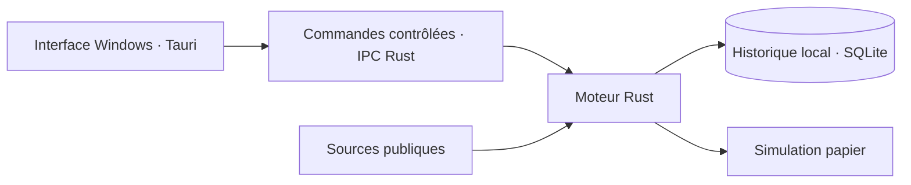

# Pravda-Bot
### Le poste de pilotage Windows pour les marchés numériques

**Suivre les marchés. Comprendre les données. Tester des règles de risque en simulation.**

Application desktop open source, conçue autour d’un moteur Rust, d’une interface Tauri et d’un stockage local SQLite.

[Découvrir les fonctions](#ce-que-pravda-bot-apporte) · [Architecture](#une-architecture-desktop-maîtrisée) · [Documentation](#documentation) · [Sécurité](SECURITY.md) · [Wiki](https://github.com/suvorovpravda/Pravda-Bot/wiki)

---

## Un outil de marché pensé pour Windows

Pravda-Bot rassemble dans une application desktop les outils de suivi, de simulation et de diagnostic souvent dispersés entre plusieurs fenêtres et scripts. Le cœur Rust prend en charge les traitements applicatifs ; l’interface Tauri présente les informations et les commandes destinées à l’utilisateur.

Le projet privilégie une expérience **locale, lisible et vérifiable** : données horodatées, historique SQLite, séparation entre observation et simulation, et contrôles de risque explicites.

## Ce que Pravda-Bot apporte

| Domaine | Fonction |
| --- | --- |
| **Cockpit de marché** | Interface Windows pour consulter les actifs suivis, les cours, les graphiques et l’activité du moteur. |
| **Sources de marché** | Adaptateurs de cotations publiques Kraken et Binance, avec traitement des données côté Rust. La disponibilité dépend du réseau et du service concerné. |
| **Paper Trading** | Simulation d’opérations fictives, séparée des comptes et des ordres réels. |
| **Risque et recherche** | Contrôles déterministes pour encadrer des scénarios de simulation et rendre leurs décisions examinables. |
| **Historique local** | Stockage SQLite/WAL pour les données et événements pris en charge par l’application. |
| **Diagnostic Windows** | Outils Doctor et Harness pour contrôler l’installation et exécuter des scénarios de recette sans envoyer d’ordres. |

Les fonctions progressent avec le dépôt. Consultez les [Issues](https://github.com/suvorovpravda/Pravda-Bot/issues), les [Pull Requests](https://github.com/suvorovpravda/Pravda-Bot/pulls) et les [versions publiées](https://github.com/suvorovpravda/Pravda-Bot/releases) pour connaître le contenu de chaque livraison.

## Une architecture desktop maîtrisée

- **Rust** exécute le cœur applicatif et ses contrôles.
- **Tauri 2 / WebView2** fournit l’application desktop Windows.
- **SQLite/WAL** conserve les données locales prises en charge.
- Les données de marché, les évaluations de risque et les résultats de simulation gardent des rôles distincts.
- La simulation papier n’envoie pas d’ordres aux plateformes.

Cette architecture vise une application installable, compréhensible et auditable. Elle ne prétend pas rendre un poste invulnérable : les protections Windows et la qualité du réseau restent importantes.

## Pour qui ?

Pravda-Bot s’adresse aux personnes qui veulent un environnement Windows cohérent pour :

- suivre des marchés numériques depuis un cockpit desktop ;
- examiner l’origine et l’actualité des données ;
- expérimenter des scénarios sans engager de fonds ;
- consulter les contrôles de risque et les diagnostics ;
- étudier et améliorer un projet open source organisé autour de Rust.

## État du projet

Pravda-Bot est en développement actif. Le dépôt contient l’application Windows, ses composants Rust, ses outils de diagnostic et ses workflows de validation. Les contrôles CI rendent les changements observables ; leur réussite ne remplace pas la recette d’une version publiée sur les postes visés.

**Le mode proposé ici est la consultation et la simulation. Les ordres de trading réel sont désactivés.** Pravda-Bot ne promet ni rendement, ni disponibilité permanente des prix, ni sécurité absolue. Les versions, fonctions et critères de publication sont documentés dans le dépôt.

## Documentation

- [Guide du projet](docs/PRAVDA-GUIDE.md) — architecture, modules et procédures de validation
- [Politique de sécurité](SECURITY.md) — protections, limites et signalement privé
- [Guide de contribution](docs/REVIEWING.md) — revue des changements et preuves attendues
- [Wiki Pravda-Bot](https://github.com/suvorovpravda/Pravda-Bot/wiki) — prise en main et repères utilisateurs
- [Roadmap et travail en cours](https://github.com/suvorovpravda/Pravda-Bot/projects)

## Contribuer

Les contributions sont les bienvenues. Avant d’ouvrir une Pull Request, consultez le [guide de revue](docs/REVIEWING.md), décrivez le comportement attendu et joignez les validations adaptées au changement. Pour signaler une faille, suivez la [politique de sécurité](SECURITY.md) au lieu de publier les détails dans une Issue publique.

---

**Windows · Rust · Données lisibles · Simulation contrôlée**

