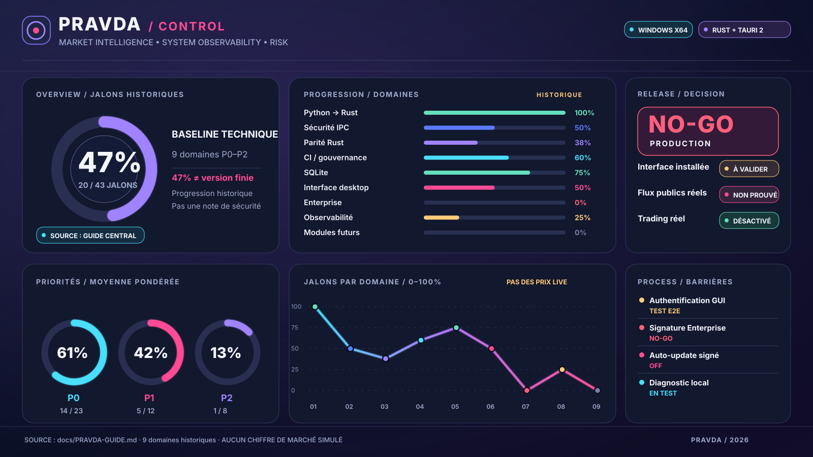

# 🛰️ PRAVDA-BOT
### MARKET INTELLIGENCE · WINDOWS CONTROL CENTER

**Surveillance des marchés · Simulation maîtrisée · Diagnostics natifs**

[**Dashboard**](#-control-dashboard) · [**Progression**](#-progression-historique) · [**Modules**](#-modules--état-réel) · [**Architecture**](#-architecture) · [**Security**](SECURITY.md) · [**Reviewing**](docs/REVIEWING.md)

---

## 🌌 Control dashboard

> **Lecture des chiffres.** Les jauges représentent la **baseline historique du guide technique**, et non un taux de disponibilité du produit. L'indicateur global **47 %** correspond à **20 jalons sur 43** dans les neuf domaines historiques. Il **ne signifie pas que Pravda-Bot fonctionne à 47 %**.

Les badges CI reflètent les workflows de **main** au moment de l'affichage. Ils ne prouvent **ni** que l'installation Windows marche sur le PC cible, **ni** une certification de sécurité.

## 📊 Progression historique

**Neuf domaines P0–P2, chiffres du [guide central](docs/PRAVDA-GUIDE.md), non assimilables à un score de sécurité ou à une préparation à la production.**

| Priorité / domaine | Progression | Barres visuelles | Limite |
| :--- | ---: | :--- | :--- |
| 🟣 P0 · Séparation Python → Rust | **100 %** | 🟪🟪🟪🟪🟪🟪🟪🟪🟪🟪 | Migration du périmètre actif |
| 🔵 P0 · Sécurité IPC | **50 %** | 🟦🟦🟦🟦🟦⬛⬛⬛⬛⬛ | Contrôles restants |
| 🟣 P0 · Parité des fonctions Rust | **38 %** | 🟪🟪🟪🟪⬛⬛⬛⬛⬛⬛ | Fonctions à compléter |
| 🔵 P0 · CI et gouvernance | **60 %** | 🟦🟦🟦🟦🟦🟦⬛⬛⬛⬛ | Recette release distincte |
| 🟢 P1 · SQLite / historique | **75 %** | 🟩🟩🟩🟩🟩🟩🟩🟩⬛⬛ | Restauration à qualifier |
| 🌸 P1 · Interface desktop | **50 %** | 🟪🟪🟪🟪🟪⬛⬛⬛⬛⬛ | Parcours Windows bloquant |
| 🔴 P1 · Packaging Enterprise | **0 %** | ⬛⬛⬛⬛⬛⬛⬛⬛⬛⬛ | Signature non livrée |
| 🟠 P2 · Observabilité / charge | **25 %** | 🟧🟧🟧⬛⬛⬛⬛⬛⬛⬛ | Extension à faire |
| ⚪ P2 · Sources et modules futurs | **0 %** | ⬛⬛⬛⬛⬛⬛⬛⬛⬛⬛ | Hors chemin critique |

<strong>📈 Déplier le graphique de progression des neuf domaines</strong>

~~~mermaid
xychart-beta
    title "Jalons historiques — non assimilables à la readiness"
    x-axis ["Rust","IPC","Parite","CI","SQLite","Desktop","Signing","Observ.","Extras"]
    y-axis "Jalons (%)" 0 --> 100
    bar [100,50,38,60,75,50,0,25,0]
~~~

**Agrégation pondérée des jalons historiques :** P0 **61 %** (14/23), P1 **42 %** (5/12), P2 **13 %** (1/8). La décision de publication dépend **exclusivement** des critères GO / NO-GO ci-dessous.

## 🚦 Release gate — état actuel

| Vérification | État | Preuve manquante |
| :--- | :---: | :--- |
| 🖥️ Bureau Windows installé | 🔴 **NO-GO** | Première connexion, chargement JS complet, redémarrage |
| 📦 MSI / NSIS | 🟠 **À QUALIFIER** | Installation, désinstallation et préservation des données |
| 📡 Flux Kraken / Binance | 🟠 **NON PROUVÉS SUR PC** | Cotations réelles horodatées, provenance et reconnexion |
| 🧪 Doctor / Harness | 🔵 **OUTILS DE TEST** | Les scénarios synthétiques ne prouvent pas les cours live |
| 🛡️ RustSec desktop | 🔴 **À TRAITER** | Vulnérabilités et dépendances historiques |
| 🔏 Signature Enterprise | 🔴 **NON LIVRÉE** | Authenticode, identité, timestamp |
| 🔄 Updater automatique | ⚪ **OFF** | Signature, anti-downgrade, rollback |
| 💳 Ordres réels | 🟢 **OFF** | Aucun trading live activé |

**Incident documenté :** le test Windows de l'application installée a échoué après la création du mot de passe avec une initialisation partielle du dashboard ([run 42290188079](https://github.com/suvorovpravda/Pravda-Bot/actions/runs/42290188079)). Les correctifs GUI / flux / diagnostics ont été réunis et fusionnés via la [PR #159](https://github.com/suvorovpravda/Pravda-Bot/pull/159) ; **cela ne valide pas le fonctionnement sur le poste utilisateur**.

L'installation Tauri utilise la configuration WebView2 **offlineInstaller**, mais son fonctionnement sur une VM vierge réellement isolée du réseau n'est **pas encore attesté**.

**Échéance cible : 30 novembre 2026**, sous réserve des preuves de l'[Issue #160 — Security / Déploiement](https://github.com/suvorovpravda/Pravda-Bot/issues/160).

## 🧩 Modules & état réel

| Composant | Situation | Rôle |
| :--- | :--- | :--- |
| **Market Radar** | 🟠 Validation | Prix publics observés, historique, graphiques |
| **Data Sources** | 🟠 Validation | Provenance et fraîcheur |
| **Paper Trading** | 🟣 Simulation | Exécution fictive isolée des comptes réels |
| **Risk Engine** | 🟠 Progressif | Contrôles et refus des données périmées |
| **Local Storage** | 🟢 Fondations | SQLite / WAL, intégrité locale |
| **System Doctor** | 🔵 Diagnostic | Contrôles Windows passifs sans extraction de secrets |
| **Continuous Test Agent** | 🟠 Recette | Contrôles périodiques isolés, rapport local |
| **Signed Updater** | 🔴 Désactivé | Aucune mise à jour signée homologuée |

**Aucun prix fictif ne doit apparaître comme une observation réelle.** Doctor et Harness ne prétendent pas tester la connectivité externe.

## 🧬 Architecture

~~~mermaid
flowchart LR
    UI["🖥️ Tauri / WebView2"]
    IPC["🔐 IPC session Rust"]
    CORE["⚙️ Rust Runtime"]
    WSS["📡 Kraken / Binance"]
    SQL[("🗄️ SQLite / WAL")]
    PAPER["🧪 Paper Simulation"]
    DIAG["🛡️ Doctor / Harness"]
    UI --> IPC --> CORE
    WSS --> CORE
    CORE --> SQL
    CORE --> PAPER
    CORE --> DIAG
~~~

L'interface ne reçoit pas les secrets, ne peut pas soumettre des ordres réels et n'exige pas de serveur HTTP local. Les modules optionnels sont contrôlés côté Rust.

## 🗺️ Roadmap

- [x] **P0** · Runtime Windows Rust / Tauri.
- [x] **P0** · Intégration des correctifs GUI, marché et diagnostics via #159.
- [ ] **P0** · Recette graphique complète sur le binaire Windows installé.
- [ ] **P0** · Flux publics réellement observés et diagnostic des pannes réseau.
- [ ] **P0** · RustSec desktop et barrières de provenance.
- [ ] **P1** · Tests airgap sur VM vierge et installation réellement personnalisée.
- [ ] **P1** · Chaîne Authenticode et mises à jour signées qualifiées.
- [ ] **P2** · Extensions on-chain, simulation avancée et observabilité.

Le trading réel [#89](https://github.com/suvorovpravda/Pravda-Bot/issues/89), l'on-chain [#121](https://github.com/suvorovpravda/Pravda-Bot/issues/121) et le moteur événementiel [#123](https://github.com/suvorovpravda/Pravda-Bot/issues/123) restent des chantiers indépendants, non déclarés livrés.

## 📚 Documentation

Le projet reste **NO-GO** pour une production complète ; pas de demande de téléchargement avant une recette Windows suffisamment probante.

---

**EN** — Windows market monitoring and paper simulation on Rust/Tauri 2. Progress percentages are **historical engineering milestones**, not release readiness. Production NO-GO; live trading OFF.

**RU** — Мониторинг рынков и симуляция для Windows на Rust/Tauri 2. Проценты — **исторические этапы разработки**, не готовность к релизу. Продакшен NO-GO, реальные ордера отключены.
