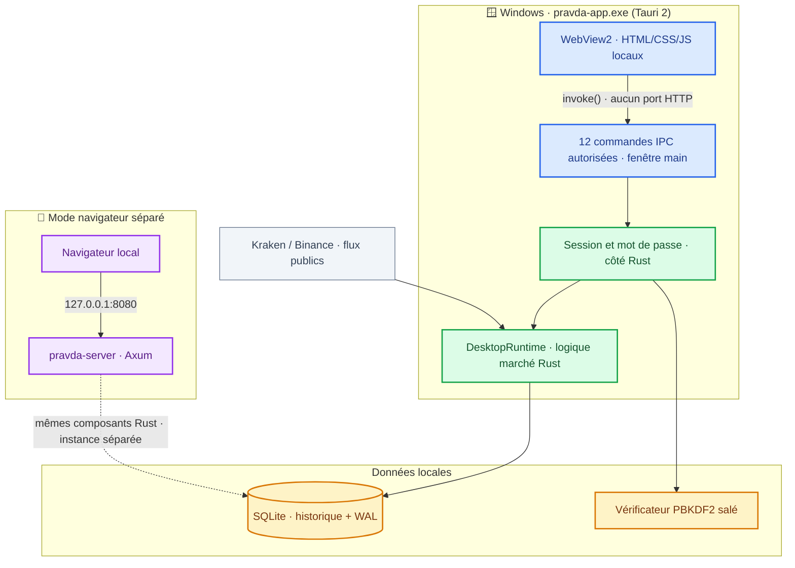
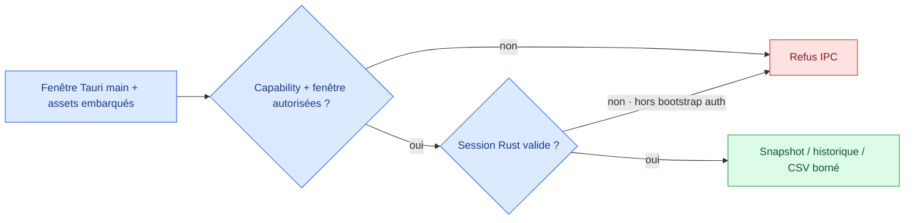

<div align="center">

# 🛰️ PRAVDA-BOT
### Observatoire de marché local · Rust + Tauri 2 · Windows

**Marchés en temps réel · historique SQLite · simulation papier · interface native IPC**

[](https://github.com/suvorovpravda/Pravda-Bot/actions/workflows/rust.yml)
[](https://github.com/suvorovpravda/Pravda-Bot/actions/workflows/codeql.yml)


**[Démarrage](#-démarrage-rapide--windows)** · **[Architecture](#-architecture-actuelle)** · **[Fonctions](#-périmètre-réel)** · **[Sécurité](SECURITY.md)** · **[Guide central](docs/PRAVDA-GUIDE.md)** · **[Avancement](#-avancement-par-priorité)**

[Français](#français) · [Русский](#русский) · [English](#english)

</div>

---

## Français

> [!IMPORTANT]
> **État après les fusions des [PR #72](https://github.com/suvorovpravda/Pravda-Bot/pull/72) et [#75](https://github.com/suvorovpravda/Pravda-Bot/pull/75), ainsi que des [PR #64](https://github.com/suvorovpravda/Pravda-Bot/pull/64) et [#67](https://github.com/suvorovpravda/Pravda-Bot/pull/67) (2 novembre 2026).** Desktop Windows Tauri 2 avec assets embarqués et **IPC natif sans serveur HTTP pour son UI**, plus serveur Axum de diagnostic séparé. La PR #67 a confirmé **8/8 checks verts et 22 assertions de sécurité IPC sous Windows WebView2 réel**. Ces vérifications portent sur **deux sessions natives successives**, pas sur deux fenêtres simultanées du même processus ni sur une origine distante. **Aucun MSI Enterprise signé n'est livré.**

### 🔄 Intégration en cours — PR unique #88

Le code **déjà fusionné sur `main`** est en Rust + Tauri 2 pour le desktop Windows, avec fichiers de frontend embarqués, IPC natif à permissions limitées, authentification locale et historique SQLite. Le serveur Axum reste un **mode diagnostic distinct**, et la simulation n'émet **aucun ordre de trading réel**. La migration de frontière Python/Rust (#72), l'abstraction de coffre Windows (#75) et la mise à niveau des GitHub Actions (#83) sont intégrées.

Les évolutions des six anciennes PR **#71, #77, #82, #84, #85 et #86** sont maintenant regroupées dans **[la seule PR ouverte #88](https://github.com/suvorovpravda/Pravda-Bot/pull/88)**. Les PR sources ont été **fermées sans fusion**, pas perdues. Cette PR contient :

- **Sécurité WebView2 :** vérifications natives de fenêtres concurrentes, refus IPC pour une fenêtre non privilégiée, politique CSP et navigation depuis une origine HTTPS hostile.
- **Coffre de secrets :** tests Rust/Win32 de rotation et suppression, refus d'accès depuis l'UI et audit par signatures de l'historique Git complet. Un scan de signatures ne prouve pas qu'aucun secret ne puisse exister.
- **Migrations Rust :** PBKDF2 0.13 + SHA2 0.11 avec vecteur de compatibilité des mots de passe précédents, `getrandom` 0.4, `rusqlite` 0.41, `thiserror` 2 et les **deux fichiers `Cargo.lock`**.
- **CI Windows :** tests natifs WebView2, analyse CodeQL, audit des secrets, exécutable `pravda-app.exe` compilé en release avec `--locked`, vérification PE/SHA-256 et démarrage isolé sans serveur HTTP, et annulation des anciens runs d'une même PR.

**Preuve datée :** au commit [`a7f822e`](https://github.com/suvorovpravda/Pravda-Bot/commit/a7f822ee56773e7c4870a1765d72881ecf268fd4), **10 contrôles de #88 étaient réussis**. Les ajouts de documentation modifient le SHA : leur [nouvelle validation](https://github.com/suvorovpravda/Pravda-Bot/pull/88/checks) et les contrôles sur `main` après fusion doivent être vérifiés indépendamment. **Aucun MSI signé ni certification de sécurité** ne résulte de ces tests.

### 📈 Avancement par priorité

**Référence des jalons : `main` au 2 novembre 2026.** Les pourcentages indiquent la **part des jalons identifiés**, pas des lignes de code migrées ; les travaux de #88 ne sont pas comptés comme livrés par la seule réussite de CI. La séparation Python/Rust est **fusionnée** et son contrôle de frontière a réussi sur `main` (`6b1b916`) ; cela ne prouve pas la parité de toutes les anciennes fonctions. Les critères et preuves sont expliqués dans le **[guide central unique](docs/PRAVDA-GUIDE.md#-tableau-de-bord-priorisé)**.

| Priorité | Chantier | Jalons validés ou préparés | Avancement |
|---|---|---:|---:|
| **P0** | Isoler définitivement Python hors production | 6/6, **fusionnée et contrôlée sur `main`** | **100 %** |
| **P0** | Sécurité IPC Windows | 2/4 | **50 %** |
| **P0** | Parité Rust des anciennes fonctionnalités | 3/8 | **38 %** |
| **P0** | CI et gouvernance de production | 3/5 | **60 %** |
| **P1** | Historique/migration SQLite | 3/4 | **75 %** |
| **P1** | Expérience desktop et robustesse | 2/4 | **50 %** |
| **P1** | Packaging Windows Enterprise signé | 0/4 | **0 %** |
| **P2** | Observabilité et charge | 1/4 | **25 %** |
| **P2** | Sources optionnelles, notifications et LLM | 0/4 | **0 %** |


> [!NOTE]
> Le Rust est déjà le **backend actif**. Les fichiers Python historiques restent consultables dans Git mais ne représentent **pas** du code exécuté en production. Les fonctionnalités Python non portées ne doivent pas être considérées comme livrées. Les détails et jalons de sortie sont regroupés dans [PRAVDA-GUIDE.md](docs/PRAVDA-GUIDE.md).

### 🎯 À quoi sert Pravda-Bot ?

Pravda-Bot observe des cours **publics** Kraken/Binance, évalue leur fraîcheur et des écarts avec garde-fous, conserve un historique local et permet d'explorer une **simulation papier**.

- **Aucun ordre réel**, retrait, transaction bancaire, gestion de compte exchange ou connexion à un portefeuille.
- **Revolut X** : adaptateur Rust de carnet public intégré via [PR #73](https://github.com/suvorovpravda/Pravda-Bot/pull/73), mais **non branché au dashboard** ; aucune clé privée, aucun solde ni ordre réel.
- La simulation papier est **en mémoire** : ses résultats ne sont pas un portefeuille réellement exécuté, ni une garantie de profit.
- Les cotations live nécessitent Internet et dépendent de la disponibilité des sources. Désactiver les flux n'invente pas des prix.
- Les anciens composants Python sont conservés à titre de **référence** sous `archive/python-legacy/` ; le chemin de production Rust ne les exécute pas.

### 🏗️ Architecture actuelle



**Deux modes, deux transports.** Le **desktop** charge `crates/pravda-app/frontend/` via `WebviewUrl::App`, utilise des commandes IPC typées et ne démarre **ni Axum ni WebSocket HTTP local**. Le **serveur de diagnostic** reste démarrable indépendamment avec `cargo run -p pravda-server`, écoute exclusivement sur `127.0.0.1` et sert une interface navigateur avec authentification HTTP. Ne pas faire tourner les deux modes simultanément sur les mêmes fichiers de données pour les tests.

Pour les décisions d'architecture, contrats IPC, modèle de menace et migration SQLite : **[guide technique central](docs/PRAVDA-GUIDE.md)** ; pour la politique de sécurité : **[SECURITY.md](SECURITY.md)**.

### 🪟 Démarrage rapide — Windows

**Prérequis :** Windows x64 et WebView2, [Rust/Cargo](https://rustup.rs/) (outillage Windows MSVC), prérequis C++ requis par Tauri 2 et accès aux dépendances Cargo. L'application se **compile depuis les sources** ; `bundle.active=false`, donc ce parcours **ne produit pas un MSI**.

```powershell
git clone https://github.com/suvorovpravda/Pravda-Bot.git
cd Pravda-Bot

# Vérifications du cœur Rust (workspace racine)
cargo test --locked --workspace

# Desktop natif : manifeste Cargo distinct
cargo run --release --locked --manifest-path .\crates\pravda-app\Cargo.toml
```

**Premier lancement :** création d'un mot de passe local d'au moins **15 caractères** → dashboard. Les lancements suivants demandent le mot de passe existant. Déconnexion et reconnexion restent dans la fenêtre native.

**Données Windows par défaut :**

| Fichier | Chemin | Rôle |
|:--|:--|:--|
| SQLite | `%LOCALAPPDATA%\Pravda-Bot\pravda.db` | Ticks/historique et index |
| SQLite WAL | même dossier, suffixe `-wal` / `-shm` si présents | Journaux transactionnels |
| Authentification | `%LOCALAPPDATA%\Pravda-Bot\pravda_auth.json` | Sel et vérificateur de mot de passe, **pas** le mot de passe en clair |

Les variables `PRAVDA_DB_PATH` et `PRAVDA_AUTH_PATH` prennent le dessus si elles sont définies. **N'effacez pas ces fichiers pour résoudre une erreur de connexion.** Pour une migration d'ancienne installation, sauvegarder de façon cohérente SQLite/WAL et le fichier auth ; voir [migration SQLite dans le guide](docs/PRAVDA-GUIDE.md#-migration-et-sauvegarde-sqlite).

<details>
<summary><strong>🧪 Lancer un profil de test isolé, sans toucher aux données habituelles</strong></summary>

Depuis la racine du dépôt, dans **la même fenêtre PowerShell** :

```powershell
$test = Join-Path $env:TEMP ("Pravda-IPC-Test-" + (Get-Date -Format "yyyyMMdd-HHmmss"))
New-Item -ItemType Directory -Path $test | Out-Null
$env:PRAVDA_DB_PATH = Join-Path $test "pravda.db"
$env:PRAVDA_AUTH_PATH = Join-Path $test "pravda_auth.json"
$env:PRAVDA_MARKET_FEEDS_ENABLED = "false"
Remove-Item Env:PRAVDA_ADMIN_PASSWORD -ErrorAction SilentlyContinue
Remove-Item Env:PRAVDA_LEGACY_DB_PATH -ErrorAction SilentlyContinue
Remove-Item Env:MARKET_HISTORY_DB -ErrorAction SilentlyContinue
cargo run --release --locked --manifest-path .\crates\pravda-app\Cargo.toml
```

Pour tester la **persistance**, fermer l'application puis relancer la dernière commande **sans recréer `$test` ni changer les variables**. Le mot de passe déjà créé doit rester valable. Les variables d'environnement définies dans une fenêtre PowerShell ne sont pas automatiquement visibles depuis une autre.

</details>

<details>
<summary><strong>🌐 Mode diagnostic navigateur (distinct du desktop)</strong></summary>

```powershell
# À lancer séparément, avec ses propres fichiers de données
$env:PRAVDA_DB_PATH = Join-Path $env:TEMP "pravda-diagnostic.db"
$env:PRAVDA_AUTH_PATH = Join-Path $env:TEMP "pravda-diagnostic-auth.json"
cargo run --locked -p pravda-server
```

Puis ouvrir [http://127.0.0.1:8080](http://127.0.0.1:8080). Arrêt par `Ctrl+C`. `DASHBOARD_PORT` ne concerne **que l'écoute du serveur diagnostic** ; le desktop IPC n'utilise pas ce port pour ses vues. Ne jamais publier ce serveur par tunnel, proxy ou redirection de port.

</details>

### 📊 Périmètre réel

| Fonctionnalité | Desktop IPC | Statut / limite |
|:--|:--:|:--|
| Démarrage Windows sans port HTTP UI | ✅ | `frontendDist` local, WebView2, fenêtre `main` |
| Mot de passe, setup, login, logout | ✅ | PBKDF2 salé, session côté Rust |
| BTC / ETH / SOL et indicateurs marché | ✅ | Kraken/Binance publics ; dépendants du réseau |
| Contrôles de cours et de fraîcheur | ✅ | Prix finis positifs, 4 s et 2 s par défaut, écart brut 5 % |
| Historique SQLite récent et filtré | ✅ | Requêtes typées ; maximum **10 000** lignes retournées |
| Export historique CSV | ✅ | Texte borné, téléchargement depuis la WebView ; **vérification utilisateur de l'export à compléter** |
| Alertes d'événements du simulateur papier | ✅ | Consultation ; pas de création/suppression d'alertes personnalisées |
| Métriques runtime | 🟡 | Uptime/PID ; CPU/RSS **indisponibles** |
| Forex, énergie, géopolitique, actualités, AIS | ⏳ | Parties d'UI visibles possibles, **pas de source opérationnelle garantie** |
| Véritable trading / ordres / solde exchange | ❌ | Hors périmètre |
| MSI Enterprise et signature Authenticode | ❌ | **Non livrés** ; barrière de publication à respecter |

> [!NOTE]
> **Provenance des données :** le ticker Kraken v1 est daté à sa **réception** côté client, pas à l'heure certifiée de la transaction sur l'exchange. Binance conserve un temps événement quand fourni. Les frais de simulation sont une estimation fixe de **0,36 %** ; aucun calcul ne reproduit toutes les contraintes d'exécution réelle.

### ⚙️ Configuration et garde-fous

Les variables sont lues depuis **l'environnement du processus**, sans chargement implicite de `.env`.

| Variable | Valeur par défaut | Usage / validation |
|:--|:--|:--|
| `PRAVDA_DB_PATH` | `pravda.db` dans le serveur ; AppData dans Tauri Windows | SQLite, chemin non vide ; `:memory:` refusé |
| `PRAVDA_AUTH_PATH` | `pravda_auth.json` dans le serveur ; AppData dans Tauri Windows | Vérificateur local ; chemin non vide |
| `PRAVDA_MARKET_FEEDS_ENABLED` | `true` | `true` ou `false` exclusivement |
| `MARKET_DATA_STALE_SECONDS` | `4` | > 0 et ≤ 3 600 secondes |
| `MAX_EXCHANGE_SKEW_SECONDS` | `2` | Entre 0 et 3 600 secondes |
| `MAX_ALLOWED_SPREAD_PERCENT` | `5` | Nombre fini > 0 et ≤ 100 |
| `PRAVDA_LEGACY_DB_PATH` | Non définie | Source SQLite Python **lecture seule**, si migration demandée |
| `MARKET_HISTORY_DB` | Non définie | Chemin legacy alternatif, priorité moindre |
| `DASHBOARD_PORT` | `8080` | **Serveur navigateur uniquement** ; 1 à 65 535 |

Un paramètre invalide interrompt le démarrage ; augmenter les seuils ne résout pas la provenance incertaine d'un cours. Pour `PRAVDA_ADMIN_PASSWORD` (provisionnement optionnel), préférer le setup interactif sur un poste utilisateur et éviter l'exposition de secrets dans les commandes et les journaux.

### 🔐 Modèle de sécurité, en résumé



- **Défense en profondeur :** capabilities Tauri restreintes à `main`, manifeste de commandes nommé, contrôle de session dans les handlers Rust.
- **Aucune permission IPC générale `shell` / `fs`**, aucun script distant, ressources JS/CSS locales et CSP spécifique au desktop.
- **Séparation des transports :** le desktop ne démarre pas de service HTTP ; le serveur diagnostic applique ses propres contrôles Host/Origin, cookies et en-têtes.
- **Limites non résolues :** un logiciel malveillant ayant les droits de l'utilisateur peut atteindre ses fichiers ; l'analyse de code, la CI verte et un mot de passe local **ne garantissent pas l'absence de vulnérabilités**.
- **Gouvernance solo :** le ruleset de `main` consulté le 2 novembre 2026 prévoit **zéro approbation extérieure**, mais exige une branche à jour, des discussions de revue résolues et trois contrôles : **CodeQL**, **Rust check (windows-latest)** et **Windows desktop build and startup**. Aucun acteur de contournement n'est configuré dans ce ruleset ; la sécurité de cette configuration ne remplace pas une revue indépendante.

➡️ **Lire la [politique SECURITY.md](SECURITY.md)** pour les menaces, les mesures vérifiées, les risques restants et le signalement privé.

### 🧪 Tests et vérification

```powershell
# Workspace Rust du serveur : Linux et Windows
cargo fmt --all -- --check
cargo clippy --locked --workspace --all-targets -- -D warnings
cargo test --locked --workspace
cargo build --locked --release --workspace

# Le desktop Tauri est un workspace Cargo distinct
cargo fmt --manifest-path .\crates\pravda-app\Cargo.toml -- --check
cargo test --locked --manifest-path .\crates\pravda-app\Cargo.toml
cargo build --locked --manifest-path .\crates\pravda-app\Cargo.toml

# Contrats JavaScript statiques (Node.js, idéalement v22)
node tools/test-dashboard.mjs
node tools/test-desktop-ipc.mjs
```

**CI GitHub :** Rust Linux/Windows, MSRV 1.95, smoke Windows desktop sans listener, serveur navigateur et CodeQL. **La PR #88 ajoute** audit complet d'historique Git, tests WebView2 multi-fenêtres et origine hostile, compilation Windows release et contrôle des deux workspaces avec `--locked`. Le badge est dynamique : un commit fusionné demande une **nouvelle vérification des jobs de `main`**, pas seulement des checks verts sur la PR.

**Recette Windows effectuée après Phase 2 :** lancement natif, setup/login, refus d'un mauvais mot de passe, logout/relogin, redémarrage, mode sans live, fichiers SQLite/auth et absence de socket TCP en écoute pour `pravda-app.exe`. **PR #67 :** 22 tests E2E natifs WebView2 réussis, dont refus `UNAUTHORIZED` sans session/après logout, refus des IPC depuis `security-probe` et blocage shell/fs avec absence d'écriture. **Limites de la preuve historique #67 :** origine distante et deux fenêtres simultanées ; des tests complémentaires ont réussi sur le commit `a7f822e` de #88, mais doivent encore être réexécutés après modification et vérifiés sur `main` après fusion. Export CSV réel, reprise historique complexe et distribution signée restent hors preuve.

### 🗺️ Feuille de route

Le **[guide technique central](docs/PRAVDA-GUIDE.md#-tableau-de-bord-priorisé)** regroupe désormais tous les chantiers, pourcentages, jalons, critères de sortie, contrats architecturaux et historique des versions. La politique de sécurité et la divulgation privée restent dans **[SECURITY.md](SECURITY.md)**.

**Ordre :** P0 séparation Python/Rust et sécurité IPC → parité des modules Rust → tests avancés → distribution Windows signée. La compilation d'un EXE ne prouve pas la disponibilité d'un MSI Enterprise.

### 🤝 Contribuer et obtenir de l'aide

1. Créer une branche dédiée, garder les modifications atomiques et ajouter des tests.
2. Exécuter les commandes adaptées au **workspace Rust** et au **desktop Tauri**.
3. Ouvrir une PR, faire revoir le modèle de menace/capabilities si une permission IPC change.
4. Contrôler les checks **du SHA exact**, documenter les essais Windows et respecter les règles de `main` ; aucune approbation extérieure n'est actuellement requise, contrairement aux contrôles CI et aux discussions de revue résolues.

[Issues](https://github.com/suvorovpravda/Pravda-Bot/issues) · [Pull requests](https://github.com/suvorovpravda/Pravda-Bot/pulls) · [Sécurité privée](SECURITY.md#-signaler-une-vulnérabilité)

---

## Русский

**Pravda-Bot** — локальный монитор публичных котировок Kraken/Binance, истории SQLite и **бумажной симуляции**, без реальных торговых ордеров и доступа к счетам. После [PR #64](https://github.com/suvorovpravda/Pravda-Bot/pull/64) Windows-приложение Tauri 2 использует **встроенный интерфейс и IPC** без локального HTTP-сервера для UI. `pravda-server` (Axum, `127.0.0.1:8080`) существует отдельно для диагностики.

**Windows:** `cargo run --release --locked --manifest-path .\crates\pravda-app\Cargo.toml`. При первом запуске требуется пароль от 15 символов; данные по умолчанию находятся в `%LOCALAPPDATA%\Pravda-Bot`. Для отключения биржевых потоков установите `PRAVDA_MARKET_FEEDS_ENABLED=false`. Firefox/Chrome не нужны для Tauri, но WebView2 необходим.

**Интеграция:** [единый PR #88](https://github.com/suvorovpravda/Pravda-Bot/pull/88) объединяет тесты безопасности Windows, миграцию зависимостей Rust и release-CI. Перед выпуском требуется проверка нового коммита и слияния в `main`. **Ограничения:** FX, энергетика, новости и AIS реализованы не полностью. Готового подписанного Enterprise MSI нет; зелёная CI не подтверждает безопасность выпуска. Полные инструкции и проценты выполнения находятся в [едином руководстве](docs/PRAVDA-GUIDE.md), а политика безопасности — в [SECURITY.md](SECURITY.md).

## English

**Pravda-Bot** is a local observer of public Kraken/Binance prices with SQLite history and **paper-only simulation**. No real orders, account access or real portfolio execution. Since [PR #64](https://github.com/suvorovpravda/Pravda-Bot/pull/64), the Windows Tauri 2 desktop loads **bundled assets and typed IPC** with **no local HTTP listener for its UI**. The Axum `pravda-server` remains a **separate diagnostic CLI**, loopback-bound.

**Build/run on Windows:** `cargo run --release --locked --manifest-path .\crates\pravda-app\Cargo.toml`. Create a local password of at least 15 characters on first run. Default data storage: `%LOCALAPPDATA%\Pravda-Bot`. To disable feeds for testing, set `PRAVDA_MARKET_FEEDS_ENABLED=false`.

**Integration in progress:** [single PR #88](https://github.com/suvorovpravda/Pravda-Bot/pull/88) combines extended Windows security checks, coordinated Rust dependency upgrades and Windows release CI; each new commit needs fresh checks before merging into `main`. **Current limitations:** FX, energy, news, AIS and customizable alerts are not fully migrated. No signed Enterprise MSI has been delivered. CI and manual Windows acceptance are meaningful evidence, **not a security certification**. See the [single technical guide with progress percentages](docs/PRAVDA-GUIDE.md), [SECURITY.md](SECURITY.md) and the [roadmap](#-feuille-de-route).
