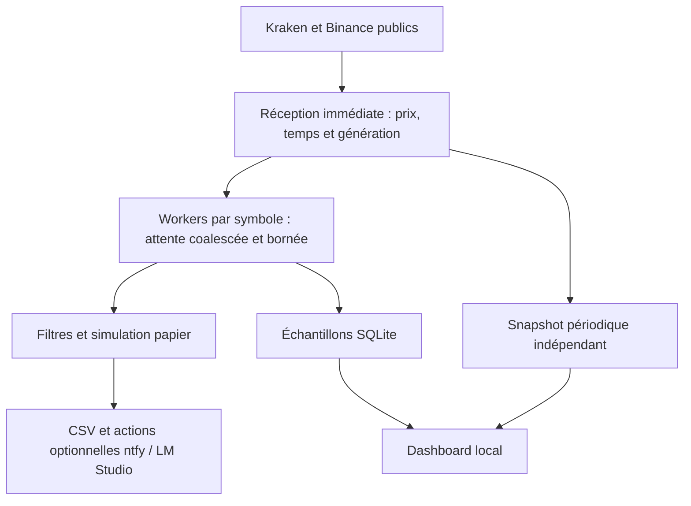

<div align="center">

# 📊 Pravda-Bot

### Un observatoire local pour comprendre les marchés et la qualité des données

*Surveillance publique · Simulation papier · Historique traçable*

[](https://github.com/suvorovpravda/Pravda-Bot/actions)
[](https://www.python.org/)
[](#français)
[](SECURITY.md)

[Français](#français) · [Русский](#русский) · [English](#english)

</div>

---

## Français

> **Surveillance et simulation uniquement.** Aucun ordre réel n'est envoyé. Aucun solde, inventaire, emprunt ou transfert de compte n'est vérifié. Une estimation de spread ou d'exécution ne constitue pas une promesse de rendement.

### Pourquoi utiliser Pravda-Bot ?

Pravda-Bot rassemble des observations publiques et leurs limites dans un outil Python exécuté localement. Il permet d'étudier les écarts de prix entre Kraken et Binance, de conserver des échantillons dans SQLite, de tester des hypothèses en simulation et de repérer les données obsolètes avant de leur attribuer une signification.

Le même travail sur les horloges, les files d'attente, la provenance et les erreurs peut servir à d'autres projets : observatoires locaux, tableaux de bord de qualité des données et expériences de traitement d'événements. Les contributions utiles améliorent ces propriétés mesurables.

### Fonctions et périmètre

| Domaine | Ce que fournit le code maintenu | Limite à garder visible |
|---|---|---|
| 📈 Crypto | Tickers publics Kraken/Binance pour BTC/USDT, ETH/USDT et SOL/USDT | Un dernier prix n'est pas une offre d'exécution garantie |
| 🧮 Détection | Spread, estimation de frais, confirmation, hystérésis et rejet des anomalies | L'opportunité reste théorique ; aucun compte privé connecté |
| 🧪 Simulation | Portefeuille papier et estimations sur carnets publics : VWAP, profondeur, frais et contraintes | Pas de remplissage réel, inventaire, marge, emprunt ou latence de placement |
| 🗃️ Historique | SQLite, vues jour/semaine/mois, résumés et exports CSV | Échantillons sélectionnés par les workers ; des ticks intermédiaires peuvent être coalescés |
| 🔔 Alertes | Seuils locaux EUR/CHF ; ntfy optionnel | FX quotidien ; ntfy utilise un service externe s'il est activé |
| ⚡ Énergie | Observations ENTSOG à des points transfrontaliers | Ni tracés de conduites ni état opérationnel vérifié |
| 💱 Devises | Taux de référence BCE via Frankfurter, source et âge affichés | Pas de Forex tick par tick ; l'assimilation USDT/USD reste une hypothèse de conversion |
| 📰 Actualités | GDELT, avec repli RSS BBC | Informations rapportées, pas incidents vérifiés ou prévisions |
| 🖥️ Interface | Serveur HTTP local, historique, rapports et état des sources | Sans authentification ; doit rester sur 127.0.0.1 |
| 🤖 Analyse | LM Studio facultatif, limité à une destination loopback | Modèle à charger séparément ; aucun fallback GPT/Gemini automatique |

Le portefeuille papier en mémoire est réinitialisé au redémarrage. L'historique SQLite conserve les observations enregistrées ; il ne devient pas automatiquement un état de portefeuille restauré.

### Architecture et fraîcheur



Les lecteurs ne doivent pas attendre SQLite, REST, ntfy ou le LLM avant de recevoir la frame suivante. Avant les effets différés, les générations et la santé des cotations sont revérifiées. Le snapshot destiné au dashboard possède son propre producteur, indépendant des trois workers.

La lecture des observations CSV conserve les dernières lignes logiques, y compris les champs entre guillemets avec retours à la ligne. Elle utilise une fenêtre de lecture bornée : la croissance normale du journal au-delà de 50 000 lignes ou 8 Mio ne désactive plus `/data`. Une ligne individuelle qui ne tient pas dans le budget, un schéma incompatible ou un CSV invalide dans la fenêtre lue produit une erreur contrôlée. Le préfixe hors fenêtre n'est pas validé. La taille des fichiers sur disque doit toujours être surveillée.

Les régressions de concurrence utilisent des événements de synchronisation. Une comparaison fragile entre horloges murale et monotone à quelques millisecondes près n'est pas utilisée pour valider le fonctionnement du producteur de snapshots.

### Calculs : des unités explicites

Les frais simplifiés sont **0,36 %**, soit `0.0036` en fraction ou `0.36` point de pourcentage :

```text
Spread brut       1,20 %
Frais estimés   − 0,36 point
Spread net        0,84 %
```

Le helper robuste retourne une fraction ; le bot convertit explicitement en pourcentage pour ses seuils et journaux. Le détecteur d'écart absolu et le spread directionnel achat/vente ont des usages distincts : un résultat directionnel négatif conserve son signe. Le plafond brut par défaut de **5 %** écarte des anomalies sans démontrer la faisabilité économique. Les frais fixes réseau/retrait et un véritable modèle de remplissage ne sont pas inclus.

### Installation — Windows

Pour une **nouvelle copie**, avec Python 3.12 installé :

```powershell
git clone https://github.com/suvorovpravda/Pravda-Bot.git
Set-Location Pravda-Bot
py -3.12 -m venv .venv
.\.venv\Scripts\python.exe -m pip install --require-hashes -r requirements-bootstrap.txt
.\.venv\Scripts\python.exe -m pip install --require-hashes -r requirements.txt
.\.venv\Scripts\python.exe -m pip check
if (-not (Test-Path '.env')) { Copy-Item '.env.example' '.env' }
```

Dans une copie existante, relever d'abord `git status --short --branch` et conserver les modifications locales avant de changer de branche. L'activation du venv n'est pas obligatoire : les commandes ci-dessus appellent son interpréteur explicitement.

### Installation — Linux

```bash
git clone https://github.com/suvorovpravda/Pravda-Bot.git
cd Pravda-Bot
python3.12 -m venv .venv
.venv/bin/python -m pip install --require-hashes -r requirements-bootstrap.txt
.venv/bin/python -m pip install --require-hashes -r requirements.txt
.venv/bin/python -m pip check
[ -f .env ] || cp .env.example .env
```

Le projet cible la série **3.12**. La CI enregistre le correctif réellement installé sur chaque OS ; elle ne demande pas une version exacte absente du runner Windows. Runtime, outils d'audit et outils de construction utilisent des verrous distincts. Leur régénération utilise `uv pip compile --universal --python-version 3.12 --generate-hashes --no-build` et doit être revue.

### Lancer et vérifier

Dans un premier terminal Windows :

```powershell
$env:NTFY_TOPIC_URL=''
$env:LM_STUDIO_ENABLED='false'
.\.venv\Scripts\python.exe main.py
```

Dans un second terminal du même dossier :

```powershell
.\.venv\Scripts\python.exe dashboard.py --port 8080
```

Ouvrir [http://127.0.0.1:8080](http://127.0.0.1:8080). Si le port est occupé, utiliser par exemple `--port 8081`. Sous Linux, remplacer l'interpréteur par `.venv/bin/python`.

Le lanceur Windows se construit avec `.build-venv\Scripts\python.exe build_onefile.py` après installation des dépendances de construction. Il doit rester à côté des sources et de `.venv` ; ce n’est pas un bot autonome. Le test `--help` ne valide pas une session de flux réels.

| Variable | Valeur / rôle |
|---|---|
| `TRADING_MODE` | `paper` uniquement |
| `NTFY_TOPIC_URL` | Vide par défaut ; destination HTTPS publique explicite si activée |
| `LM_STUDIO_ENABLED` | `false` dans l'exemple ; `true` active l'analyse locale |
| `LM_STUDIO_API_BASE` | Exemple : `http://127.0.0.1:1234/v1` |
| `LM_MODEL_NAME` | Identifiant effectivement exposé par LM Studio |
| `DASHBOARD_RATE_LIMIT_PER_MINUTE` | 240 par IP par défaut ; le polling normal dépasse 60/minute |
| `MARKET_HISTORY_DB` | Chemin SQLite local, par défaut `market_history.sqlite3` |
| `MARKET_DATA_STALE_SECONDS` | Seuil de fraîcheur des cotations, 4 s par défaut |

Les données de marché et d'actualité nécessitent le réseau, même si les traitements et l'inférence sont locaux. « Local » ne signifie pas « entièrement hors ligne ».

### Vérification et sécurité

```powershell
.\.venv\Scripts\python.exe -m unittest discover -s tests -t . -v
.\.venv\Scripts\python.exe -m unittest discover -s launcher_tests -v
.\.venv\Scripts\python.exe -m pip check
node --test tests_js/dashboard-security.test.cjs
```

La [CI](https://github.com/suvorovpravda/Pravda-Bot/actions/workflows/ci.yml) effectue une installation hashée, compile les modules Python publiés, contrôle le JavaScript, exécute les deux suites et lance les audits CVE et Bandit. Les journaux associent leurs résultats à un SHA, un OS et une version Python. Les tests ignorés restent distingués des tests réussis. Un résultat CI positif ne constitue pas un audit exhaustif ni une validation des fournisseurs réels.

Lire [SECURITY.md](SECURITY.md) pour les contrôles, le périmètre et le signalement. Les erreurs des chemins HTTP maintenus sont génériques ; les exports de texte externe sont protégés contre les formules. Le dashboard est sans authentification et reste **strictement local**. Une écoute loopback, un masque de logs ou une analyse statique ne garantissent pas l'absence de vulnérabilité.

### Modules expérimentaux et travaux en cours

| Chantier | État |
|---|---|
| Historique, alertes, exports, réception bornée | Implémentés ; vérifier les journaux du commit examiné |
| STALE de 25–29 s | Causes logicielles couvertes par régressions ; mesure des flux réels encore nécessaire |
| Géographie ENTSOG et proxy maritime | Modules conservés ; leurs points/segments ne prouvent pas des tracés réels |
| AIS | Connecteur expérimental ; le proxy vide n'est pas un fournisseur opérationnel et les endpoints signalent l'indisponibilité |
| Données GEM | À réintégrer avec source, licence, attribution et précision documentées |
| OSINT à plusieurs niveaux | Utilitaire expérimental ; aucun incident n'est déclaré vérifié sur la seule présence d'une URL officielle |
| TTF licencié / Forex continu / comptes privés | Non intégrés |
| Archivage et rétention SQLite/CSV | À définir ; lecture bornée et stockage borné sont deux propriétés différentes |
| Kafka Docker Playground | Piste d'expérimentation ; aucune dépendance Kafka déployée |

[Kafka Docker Playground](https://github.com/vdesabou/kafka-docker-playground), proposé par le cousin du porteur du projet, peut aider à expérimenter producteurs/consommateurs, diagnostic et rejeu. Il ne fournit pas de données ni de licences et ne corrige pas automatiquement la latence. [Alfred Spotify Mini Player](https://github.com/vdesabou/alfred-spotify-mini-player) est un projet lié ; son workflow macOS n'est pas incorporé dans cette copie. Les conditions d'un fournisseur AIS ou musical doivent être vérifiées avant utilisation et redistribution.

### Une organisation de développement vérifiable

Vincent fixe les orientations et accepte les travaux. Les rôles ci-dessous organisent la revue ; ils ne sont pas des agents autonomes exécutés par le bot.

| Étape | Responsable | Preuve attendue |
|---|---|---|
| 1. Maîtrise d'ouvrage technique | GPT | Périmètre, priorités, critères d'acceptation |
| 2. Pilotage | Gemini | Plan et première validation de projet |
| 3. Vérification | Vérificateur | Défaut reproductible sur un SHA identifié |
| 4. Comparaison | Comparateur | Différences entre versions et cohérence des preuves |
| 5. Correction | Implémenteur | Patch et tests de régression |
| 6. Contre-vérification | Vérificateur → comparateur | Résultats du candidat corrigé |
| 7. Visa et livraison | Gemini → GPT → Vincent | Avis réel, CI du commit, contrôle humain avant fusion/release |

Une approbation non obtenue n'est jamais attribuée à un modèle. Une modification retourne en correction si un cas reproductible l'invalide. Les récapitulatifs promotionnels ne remplacent pas le code ni les journaux.

> **Vie du projet :** la moitié de l'équipe est en vacances ; reprise progressive annoncée vers le **2 novembre 2026**.

### Contribuer et réutiliser

Les contributions recherchées : bugs reproductibles, tests asynchrones, accessibilité, traductions, provenance des données et connecteurs autorisés. Ouvrir une issue avec un exemple minimal, puis une PR limitée indiquant changements, tests et limites. Les secrets, bases, journaux privés et environnements Python restent hors de Git.

Les modules principaux sont `main.py` (flux et orchestration), `market_history.py` (SQLite), `dashboard.py` / `dashboard.html` (interface), `energy_data.py` / `live_market_data.py` (sources), `security_config.py` / `secure_http.py` (politiques réseau) et `tests/` / `launcher_tests/` (régressions). Les utilitaires `src/` ont leur propre périmètre ; leur présence ne démontre pas leur intégration.

**Licence :** aucune licence MIT n'est annoncée tant qu'un fichier `LICENSE` validé n'est pas publié. Les bibliothèques et données tierces conservent leurs licences et conditions respectives.

---

## Русский

### Назначение

**Pravda-Bot** — локальный Python-инструмент для наблюдения за публичными котировками Kraken/Binance, качества данных и бумажной симуляции. Он хранит выбранные наблюдения в SQLite и показывает историю, отчёты и состояние источников. Реальные ордера и проверка балансов не реализованы.

| Возможность | Ограничение |
|---|---|
| BTC/USDT, ETH/USDT, SOL/USDT | Последняя цена не гарантирует исполнение |
| Комиссия 0,36 %, подтверждение и гистерезис | Модель упрощена; `1,20 % − 0,36 п.п. = 0,84 %` |
| Бумажный портфель и публичные стаканы | Нет реального исполнения, заёмных средств или проверки инвентаря |
| SQLite, день/неделя/месяц, CSV и уведомления | История содержит выбранные образцы; промежуточные ticks могут объединяться |
| ENTSOG, BCE/Frankfurter, GDELT/BBC | Точки наблюдения, ежедневные курсы и сообщённые новости, а не проверенные инциденты |
| LM Studio | Необязателен, только loopback; облачного fallback нет |

При перезапуске бумажный портфель сбрасывается; сохранённые наблюдения SQLite остаются. Порог аномалий 5 % не доказывает экономическую выполнимость. Лицензированные цены TTF, непрерывный Forex и приватные счета не подключены. Экспериментальные AIS/географические/OSINT-модули не являются доказательством оперативной готовности или лицензии на данные.

### Запуск и проверка

Используйте Python 3.12 и отдельный `.venv`. Команды Windows/Linux приведены выше; до слияния нужен код ветки `fix/restore-history-and-hardening`. Bootstrap и runtime устанавливаются с `--require-hashes`, затем выполняется `pip check`. Аудит и сборка используют отдельные окружения.

Запустите `main.py` и `dashboard.py --port 8080` в двух терминалах с Python вашего venv. Dashboard: [http://127.0.0.1:8080](http://127.0.0.1:8080), без аутентификации, только локально. В примере `.env` модель и ntfy выключены. `Pravda_Lanceur.exe` — лаунчер соседних исходников и venv, а не самостоятельный торговый бинарный файл. Публичным источникам всё равно нужен интернет.

Проверка: `python -m unittest discover -s tests -t . -v`, отдельно `python -m unittest discover -s launcher_tests -v`, затем `python -m pip check`. CI выполняет Windows/Linux, синтаксис, JavaScript, тесты и аудиты; число тестов, пропуски и версия Python относятся к конкретному SHA. Тесты не отключаются только потому, что сравнение часов нестабильно.

### Надёжность и ограничения

Чтение последних логических CSV-записей ограничено объёмом, поддерживает кавычки и переносы строк; обычный рост файла не отключает dashboard. При этом хранение CSV/SQLite не ограничено политикой автоматического удаления. Требуются мониторинг размера и план архивирования.

HTTP/RSS и происхождение запросов проверяются в поддерживаемых путях; DNS-проверка не закрепляет IP соединения. Подробности и безопасное сообщение об уязвимости — в [SECURITY.md](SECURITY.md). Не публикуйте `.env`, базы и частные журналы. Полная безопасность и наличие MIT-лицензии не заявляются без соответствующих доказательств и файла `LICENSE`.

### Участие и управление

Vincent определяет цели и принимает результат. GPT отвечает за техническую координацию, Gemini — за управление проектом, проверяющий и сравнивающий агенты изучают доказательства, исполнитель исправляет код. Цикл: исправление → проверка → сравнение → Gemini → GPT → контроль Vincent. Это организация разработки, а не встроенная сеть автономных агентов.

Половина команды в отпуске; работа постепенно возобновляется около **2 ноября 2026 года**. Полезны воспроизводимые ошибки, тесты, доступность, переводы и разрешённые источники. Kafka Docker Playground рассматривается для экспериментов, но не установлен. Проект может стать основой других локальных инструментов наблюдения и качества данных.

---

## English

### Purpose

**Pravda-Bot** is a local Python observatory for public Kraken/Binance tickers, data quality and paper simulation. It retains selected observations in SQLite and exposes history, reports and source status. It sends no real orders and does not validate exchange balances.

| Capability | Evidence boundary |
|---|---|
| BTC/USDT, ETH/USDT, SOL/USDT | Last trade prices do not guarantee executable quotes |
| 0.36% fee estimate, confirmation and hysteresis | Simplified model: `1.20% − 0.36 percentage points = 0.84%` |
| Paper portfolio and public order books | No real fills, borrowing, inventory validation or placement latency |
| SQLite, day/week/month views, CSV and local alerts | Selected samples; intermediate ticks may be coalesced |
| ENTSOG, ECB/Frankfurter, GDELT/BBC | Point observations, daily reference rates and reported news, not verified incidents |
| Optional LM Studio | Loopback-only; no automatic cloud fallback |

The paper portfolio resets on restart; SQLite observations remain. The 5% gross anomaly cap is not proof of feasibility. Licensed TTF, tick-by-tick Forex and private account integration are absent. Experimental AIS/geography/OSINT modules do not establish operational readiness, global coverage or data rights.

### Setup and verification

Use Python 3.12 and a dedicated `.venv`. The Windows and Linux commands above install the hashed bootstrap/runtime and run `pip check`. Audit and build tools have separate environments and locks. CI records each platform's actual Python patch version.

Run `main.py` and `dashboard.py --port 8080` in separate terminals using that venv. Open [http://127.0.0.1:8080](http://127.0.0.1:8080). The unauthenticated server must remain local. The example disables ntfy and model calls. `Pravda_Lanceur.exe` launches adjacent sources with their own venv; it is not a self-contained trading executable. Public feeds still require network access.

Run `python -m unittest discover -s tests -t . -v`, separately `python -m unittest discover -s launcher_tests -v`, then `python -m pip check`. CI covers Windows/Linux, Python/JavaScript syntax, tests, dependency auditing and Bandit. Counts and skipped checks belong to a specific SHA. Clock-resolution differences are addressed with deterministic assertions rather than skipping the test.

### Reliability and limitations

CSV observation reading uses a bounded tail of complete logical records, preserving quoting and embedded newlines. Normal log growth no longer disables the endpoint. This does not bound on-disk CSV/SQLite storage: monitor size and define retention separately.

Maintained HTTP/RSS paths enforce target/origin policies and bounds. DNS prechecks do not pin the connection IP. Read [SECURITY.md](SECURITY.md) for scope, residual risks and reporting. Keep `.env`, databases and private logs out of Git. Neither complete security nor an MIT licence is asserted without evidence and a validated `LICENSE` file.

### Contributing and governance

Vincent sets direction and accepts the work. GPT coordinates technical ownership, Gemini manages the project, verifiers/comparators examine evidence and implementers supply fixes. The loop is correction → verification → comparison → Gemini → GPT → Vincent's delivery review. These are development roles, not autonomous agents embedded in the bot.

Half the team is on holiday, with work expected to resume around **2 November 2026**. Contributions should include minimal reproductions, tests, provenance and limitations. Kafka Docker Playground is under consideration for event-processing experiments; it is not deployed. This work can support other useful local observatories and data-quality projects.

### Packaging et publication

La version candidate 0.2.0 construit un paquet source et un wheel avec `python -m build --no-isolation` dans un environnement équipé de `requirements-build.txt`. `python -m twine check --strict dist/*` contrôle les métadonnées ; `python tools/check_distribution.py` vérifie le wheel installé hors du dépôt. Cette vérification ne remplace pas les tests Windows ni un audit complet.

La publication PyPI exige une CI réussie, un tag correspondant exactement à la version, la configuration du Trusted Publisher et l’activation explicite de `PYPI_PUBLISH_ENABLED`. La propriété du nom PyPI doit être vérifiée avant toute publication. Aucune publication n’est garantie par la seule création d’un tag.

SQLite utilise WAL et retente les transactions sur contention temporaire avec un nombre limité d’essais. Un verrou persistant reste une erreur ; surveiller la taille et sauvegarder la base.

## Migration Rust / Миграция Rust / Rust migration

**FR :** Migration en cours. Le module `rust/market-core` contient un premier calcul de spread et un garde-fou, encore indépendant du bot Python. Les flux, SQLite, le dashboard et le lanceur restent à migrer. Aucune parité complète n'est revendiquée. Vérification : `cargo fmt --all -- --check`, `cargo clippy --workspace --all-targets -- -D warnings`, puis `cargo test --workspace`.

**RU :** Миграция продолжается. `rust/market-core` содержит первый расчёт спреда и защитную проверку; он ещё не подключён к боту. Потоки, SQLite, dashboard и запуск остаются на Python. Полная эквивалентность пока не подтверждена.

**EN:** Migration is in progress. `rust/market-core` provides an initial spread calculation and guardrail and is not yet connected to the bot. Feeds, SQLite, dashboard and launcher remain in Python. Full behavioural parity has not been established.
