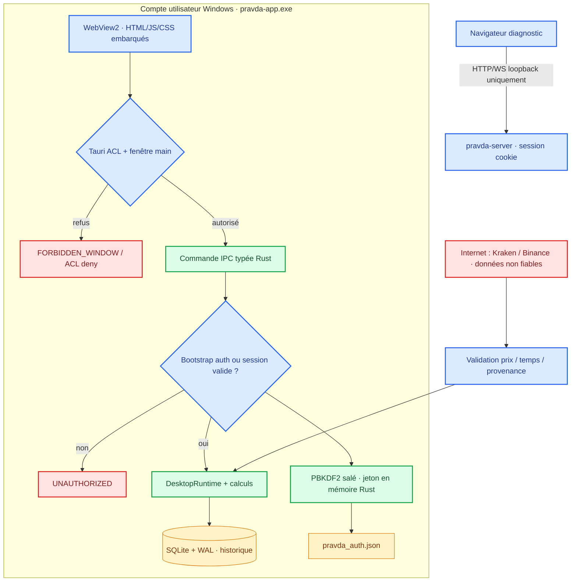
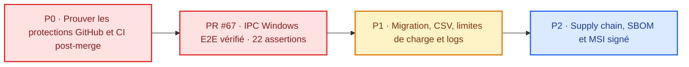

<div align="center">

# 🛡️ SECURITY · PRAVDA-BOT
### Politique de sécurité · Modèle de menace · Plan de durcissement


**[Signalement](#-signaler-une-vulnérabilité)** · **[Frontières](#-frontières-de-confiance)** · **[Contrôles](#-contrôles-effectivement-présents)** · **[Risques](#-risques-résiduels-et-limites)** · **[Plan P0–P2](#-plan-de-sécurisation-priorisé)**

[README](README.md) · [Guide technique unique](docs/PRAVDA-GUIDE.md) · [Avancement P0–P2](docs/PRAVDA-GUIDE.md#-tableau-de-bord-priorisé)

</div>

---

## Refus du modèle actuel et exigences de sécurité utilisateur — 4 novembre 2026

**Décision propriétaire : modèle de sécurité actuel refusé** pour manque de retour d'information sur l'état des protections. Le produit ne peut être qualifié de prêt pour production sans **centre de sécurité authentifié**, états réels `PROTÉGÉ / ATTENTION / BLOQUÉ / NON VÉRIFIÉ`, remédiations transparentes et audit des tests au SHA exact. Un contrôle non effectué doit rester **NON VÉRIFIÉ**, jamais vert par défaut. Les données d'authentification et les secrets ne sont jamais exposés à WebView2 ou aux rapports. Les erreurs doivent être visibles sans divulguer de détails sensibles.

**Proton VPN en option (aucun compte exigé dans Pravda-Bot) :** si l'utilisateur dispose d'un accès Proton VPN, il doit pouvoir choisir cette option indépendamment du cœur d'authentification. Préférer l'application officielle Proton VPN Windows et son propre processus de connexion. Un bouton « ouvrir Proton VPN » ou des instructions ne constituent **pas** une activation automatique. La CLI Proton documentée concerne Linux ; aucun protocole de commande Windows non officiel ne sera improvisé. Ne déclarer `VPN actif` qu'avec une **preuve fiable de connexion/tunnel et de protection effective**, pas seulement la présence de l'application ou une déclaration d'abonnement. Sinon `INCONNU`. L'activation du kill switch standard/avancé reste dans l'application officielle et exige le choix explicite de l'utilisateur ; le mode avancé peut bloquer l'accès Internet, y compris lors de la connexion Windows. Un VPN n'est pas une preuve suffisante de sécurité du trading ni une alternative à TLS, au coffre ou à l'IPC sécurisé. Références : [Application Windows Proton VPN](https://protonvpn.com/support/protonvpn-windows-vpn-application), [Kill switch avancé](https://protonvpn.com/support/advanced-kill-switch).

**Statut :** cette section fixe des **exigences de développement, non une fonctionnalité actuellement livrée**. Les nouvelles protections et leur recette sont suivies dans [#106](https://github.com/suvorovpravda/Pravda-Bot/issues/106).

## Situation des contrôles et de la distribution — 4 novembre 2026

Cette rubrique complète le modèle de menace historique ci-dessous. **Les badges, les tests unitaires et une CI verte ne sont ni un audit indépendant ni une certification de sécurité.** [Plan de production #106](https://github.com/suvorovpravda/Pravda-Bot/issues/106).

| Frontière / preuve | Présent dans le code et la CI | Ce qui n'est pas démontré |
| --- | --- | --- |
| WebView2 / IPC natif | Tests de refus fenêtre hostile/non authentifiée, persistance du mot de passe et perte de session après redémarrage ([#111](https://github.com/suvorovpravda/Pravda-Bot/pull/111)) | Pentest indépendant, tous scénarios E2E sur un PC externe |
| Windows MSI / NSIS | Distribution de trois artefacts indépendants ; ZIP compagnon contrôlés contre le SHA-256 du manifeste principal ([#115](https://github.com/suvorovpravda/Pravda-Bot/pull/115)) ; smoke du binaire installé ([#112](https://github.com/suvorovpravda/Pravda-Bot/pull/112)) | Réputation SmartScreen, signature de l'éditeur, chaîne PKI/horodatage sur les paquets **non signés de test** |
| Réinstallation et conservation | Essai automatisé sur runner Windows propre : enregistrement MSI, démarrage, désinstallation/réinstallation et préservation de **deux fichiers témoins** ([#116](https://github.com/suvorovpravda/Pravda-Bot/pull/116)) | Conservation de toutes les bases SQLite réelles, migration de profils préexistants et rollback sur PC utilisateur |
| Stockage SQLite | WAL et tests existants de réouverture ; [#118](https://github.com/suvorovpravda/Pravda-Bot/pull/118) vérifie en cours de CI la copie transactionnelle et la restauration de lignes de test | Qualification complète de backup/restore, redémarrage brutal, verrouillage et reprise après corruption |
| Diagnostic local | `pravda-doctor.exe` : contrôles passifs et rapport `PASS/WARN/FAIL/SKIP` expurgé, hors réseau ; une lecture de l'état de santé **ne vaut pas** une réparation | Résolution automatique de panne, récupération de secret, authenticité d'un compte distant |
| Simulation préproduction | `pravda-harness.exe` : smoke succès/refus/crash/timeout et validation de métriques | Isolement **OS/VM** et interdiction d'egress prouvés, replay de données de marché réelles ou acceptation économique des seuils |
| Revolut X / fonds réels | Modes d'observation, échanges read-only limités et garde-fous hors ligne | **Aucun ordre réel homologué**, aucun retrait et aucune permission de négociation approuvée ([#89](https://github.com/suvorovpravda/Pravda-Bot/issues/89)) |

**Installation zéro manipulation technique et choix de modules — exigence P0 :** le MSI/NSIS doit proposer Standard ou Personnalisé. Les modules facultatifs sont désactivés/supprimés **avec leurs permissions natives, accès réseau et surfaces IPC**, et non seulement masqués dans l'UI. Une sélection ne peut jamais désactiver le noyau d'auth, la validation SQLite, les permissions IPC minimales, l'intégrité ou les mécanismes de vérification du runtime WebView2. Toutes les options et dépendances sont répertoriées dans un contrat versionné à liste autorisée ; configuration inconnue, composant non vérifiable, téléchargement indisponible ou retour Windows ambigu => refus sécurisé avec diagnostic expurgé. Les choix persistent aux mises à niveau ; aucune suppression de données ou secrets sans consentement séparé. Doctor/Harness sont proposés comme outils indépendants, Harness exclu du profil normal par défaut. Aucune case n'active un ordre réel ou un label Enterprise signé. Les parcours personnalisés doivent être testés sur **MSI et NSIS**, avec options permises/interdites, absence WebView2, offline, upgrades, corruptions et attaques par substitution. **L'installateur modulaire est une cible non encore validée, pas une fonctionnalité annoncée comme présente.** [Exigences #106](https://github.com/suvorovpravda/Pravda-Bot/issues/106).

**Politique de release :** la CI ne peut publier l'étiquette « Enterprise signée » que si la signature Authenticode de **tous** les binaires/installateurs est valide, horodatée et liée au certificat autorisé ; en l'absence de ce certificat, proposer uniquement une **version d'essai non signée** explicitement identifiée ([#90](https://github.com/suvorovpravda/Pravda-Bot/issues/90)). Ne pas recommander de désactiver SmartScreen. Les ZIP GitHub Actions sont temporaires : ne pas les présenter comme une Release stable.

**Données/diagnostics :** ne publier ni mots de passe, clés API, tokens, exports d'authentification, bases `.db`, journaux `-wal`/`-shm` ou historiques de transactions. Un rapport Doctor ne doit contenir que les diagnostics autorisés ; **SKIP ≠ PASS**. En présence d'une base potentiellement corrompue : arrêter l'application, préserver les fichiers, diagnostiquer une copie cohérente et ne lancer aucune réparation automatique. Le test SQLite de [#118](https://github.com/suvorovpravda/Pravda-Bot/pull/118) utilise des données artificielles et n'est pas un bouton de sauvegarde utilisateur.

**Périmètre des actions financières :** `PRAVDA_LIVE_TRADING_ENABLED` ne doit jamais être utilisé comme raccourci pour contourner la validation d'ordres ; un futur trading live exige approbation explicite distincte, gestion native des secrets, limites durables, audit, contrôle du broker et rapprochement des états inconnus. **Aucun ordre réel ne doit être émis par le Doctor, le Harness, les scripts d'installation ni les essais CI.**

**Environnement GitHub `unsigned-test` :** le libellé `Deployed` affiché dans `Settings → Environments` correspond aux jobs CI associés à l'environnement ; **il ne prouve pas** une installation machine, un vrai déploiement opérationnel, une signature de code ou une homologation financière. La séparation entre artefacts temporaires, Release publique et déploiement réel doit rester explicite. Un ancien échec d'exécution est traçable mais n'invalide pas automatiquement un dernier SHA revalidé.

**Preuves :** [Actions Windows](https://github.com/suvorovpravda/Pravda-Bot/actions/workflows/windows-package.yml), [CodeQL](https://github.com/suvorovpravda/Pravda-Bot/actions/workflows/codeql.yml), [PR de persistance MSI #116](https://github.com/suvorovpravda/Pravda-Bot/pull/116), [contrôle syntaxique PowerShell #117](https://github.com/suvorovpravda/Pravda-Bot/pull/117). Toujours citer le SHA exact d'une campagne réussie.

---

## Exigence nouvelle — architecture fintech renforcée (mise à jour 03/11/2026)

**Statut : conception et durcissement en cours.** « Niveau Revolut » est une exigence qualitative de robustesse, **pas** un standard public mesurable, une attestation de conformité Revolut, une certification ISO 27001, SOC 2 ou PCI DSS, ni une homologation réglementaire. L'objectif est une architecture de type opérateur financier : contrôles indépendants, moindre privilège, isolation de données, contrôles pré- et post-trade, et preuves vérifiables. Aucun composant actuel ne doit être présenté comme « sécurisé niveau banque » avant audit externe documenté.

### Frontières de confiance obligatoires

| Frontière | Politique cible | Mise en œuvre actuelle / écart |
| --- | --- | --- |
| **Replay/test offline** | VM/OS avec egress **physiquement ou par règle système bloqué**; aucun réseau, clé, ordre ou runtime externe | Harnais Tokio/Serde en PR [#99](https://github.com/suvorovpravda/Pravda-Bot/pull/99), à valider sur le dernier commit; les flags `PRAVDA_OFFLINE_TEST` seuls ne forment pas un air-gap |
| **Desktop WebView2** | Assets embarqués, CSP ferme, IPC typé autorisé uniquement à `main`, aucune action financière à partir d'un état JS non authentifié | Tauri 2 IPC en place, tests fenêtres concurrentes et origine hostile; revoir chaque nouvelle capability |
| **Public market data** | Client réseau sortant isolé; inventaire explicite des destinations; validation TLS, quotas, freshness | Collecte publique possible en mode normal; **interdite** dans le replay; déconnexion distincte de cotation périmée |
| **Read-only account** | Vault natif Windows, secrets inaccessibles au navigateur, authentification signée sans journaliser les signatures | Client privé GET balances existant; validation end-to-end avec l'API actuelle à documenter |
| **Trading live** | Service Rust distinct, **désactivé à la compilation/configuration par défaut** et à l'exécution; permission d'ordre distincte; confirmation opérateur, contrôle de risque indépendant | **Non livré**. Pas d'endpoint POST/DELETE d'ordre à ce stade; issue [#89](https://github.com/suvorovpravda/Pravda-Bot/issues/89) ouverte |
| **Persistance ordre** | SQLite journal transactionnel avec idempotency key, transition monotone, fsync/durabilité, lease de writer, état UNKNOWN après ambiguïté, réconciliation authentifiée | Modélisation hors ligne et journal de garde-fou proposés; état de production encore non prouvé |
| **Distribution** | Builds reproductibles, SBOM/provenance, contrôles SAST/SCA, MSI/NSIS/PE Authenticode, horodatage et rotation du certificat | Hashes et workflow de contrôle présents; certificat et signature réels **non attestés**, issue [#90](https://github.com/suvorovpravda/Pravda-Bot/issues/90) |
| **Observabilité** | Diagnostic à liste blanche, incident IDs non sensibles, journaux bornés et expurgés, rétention documentée | `pravda-doctor.exe` hors réseau et rapport local; ne valide ni connexion live ni authentification interactive |

### Threat model — risques et exigences bloquantes

**Actifs :** clés Ed25519 d'exchange, mots de passe/verifiers, sessions locales, soldes, intentions d'ordres, journal des exécutions, données de marché, installateurs, certificats et pipeline GitHub. **Adversaires :** malware local sous même compte Windows, extension/processus navigateur, composant de dépendance compromis, fournisseur de marché hostile, proxy MITM, compromission CI ou mainteneur, opérateur inattentif, restauration SQLite partielle.

1. **Vol de clés et confusion de privilège.** Un accès à une page ou un IPC WebView ne doit jamais autoriser un ordre. Les clés sont confinées au vault Windows, idéalement TPM/HSM avec clés non exportables et identités séparées. Ne jamais les inclure dans les exports, rapports, erreurs, arguments de processus ou `stdout`. Prévoir rotation, révocation et rupture d'accès. Credential Manager protège le stockage mais n'isole pas contre tout malware du même utilisateur.
2. **Ordres dupliqués / expositions inattendues.** Réservation persistée **avant** envoi, identifiant unique par ordre, pas de nouvel envoi sur timeout ambigu, statut UNKNOWN, réconciliation lecture seule auprès du broker. L'arrêt d'urgence est durable, testable après crash/reboot et bloque les **nouveaux ordres**; les fills déjà en route restent possibles et doivent être comptabilisés. Contrôles d'exposition, notional, prix, précision, solde, marché périmé et limite journalière dans le service Rust, **jamais seulement dans l'UI**.
3. **Race conditions/TOCTOU.** Un prix validé au moment de la préparation ne garantit pas un prix identique au placement. Revalider fraîcheur, limites, disponibilité et autorisation au dernier point de décision, sous transaction/verrou. Horodatages monotones pour durée locale, UTC authentifiable pour audit; refus en cas de dérive horloge excessive.
4. **Contamination des données de simulation.** Aucune connexion ou identifiant live en mode replay. Fixtures locales, provenance/empreintes SHA-256, métriques au schéma Serde strict, bornes et refus des NaN/overflow. Une métrique produite par un exécutable malveillant n'est **pas** prouvée par `deny_unknown_fields` : revue du binaire, signature et isolation OS requises.
5. **Compromission de distribution.** Sur Windows, appliquer Authenticode **à l'EXE, au MSI et au NSIS** et vérifier signature, thumbprint, chaîne de confiance, timestamp et SHA-256. Un commit GitHub vérifié est distinct d'une signature Authenticode du produit. SmartScreen peut avertir même sur un binaire correctement signé tant que sa réputation n'est pas acquise. Ne jamais désactiver SmartScreen pour réussir une recette.
6. **Restauration incorrecte et perte de preuve.** Protéger le journal d'ordres et le magasin d'authentification par ACL OS. Sauvegarde SQLite cohérente incluant le WAL via API de backup ou checkpoint contrôlé **après arrêt**. Tester régulièrement un restore sur VM isolée; ne jamais copier uniquement `.db` depuis une base active. Toute restauration des intentions d'ordre exige un état UNKNOWN/STOPPED et une réconciliation préalable.
7. **Surveillance/abuse.** Durées et volumes bornés pour chaque test; aucune entrée libre n'est utilisée comme commande shell. Les sorties des enfants sont limitées, non exposées par défaut; les erreurs publiques sont des codes invariants. La détection RSS échantillonnée ne remplace pas les limites mémoire kernel / Windows Job Objects pour toute arborescence.

### Plan institutionnel par niveaux de preuve

- **P0 avant installation de préproduction :** CI verte au SHA exact; signature des commits; protection de branche; secrets hors Git; vérification de l'EXE/driver/artefacts; séparation réseau replay et application; tests d'authentification IPC négatifs; aucun ordre réel. Bloquer la livraison sur échec, pas de dérogation silencieuse.
- **P1 avant l'activation d'un compte réel :** revue indépendante threat model et code; audit ciblé Windows/Tauri/Win32; analyse SCA/SBOM; contrôle de compétence des rôles, approbation distincte, limites de risque approuvées, kill switch et sauvegarde testés; mock broker exhaustif; plan de réponse incident; signature validée sur PC propre. **Nécessite les autorités/permissions et certificats du propriétaire; non réalisable automatiquement depuis un agent GitHub seul.**
- **P2 pour une exploitation financière réglementée :** gouvernance sécurité (ISO 27001/SOC 2 comme référentiels potentiels, **sans prétendre être certifié**), cartographie données et obligations légales applicables (ex. DORA uniquement si l'entité relève de son champ), gestion fournisseurs, test d'intrusion indépendant, séparation des tâches, revue périodique des accès, résilience et RTO/RPO démontrés, suivi des vulnérabilités et exercices de crise.

### Autorisation de trading et sécurité par défaut

Aucune fonctionnalité privée n'est éligible au trading réel sans un **opt-in opérateur distinct**, consigné sur un backend de confiance, et une confirmation du mode live au moment de l'action. Les rôles *observateur*, *opérateur*, *risk approver* et *release signer* doivent être séparés si déployés en équipe. Le logiciel actuel n'implémente pas cette chaîne de privilèges complète. En cas de configuration absente, panne de vault, horloge incohérente, feed périmé, quota dépassé, ambiguïté d'ordres, token expiré ou divergence de soldes : **FAIL CLOSED**.

Aucun mode dégradé ne doit réactiver un ordre réel, remettre le kill switch à zéro, baisser automatiquement les seuils de risque ou forcer une requête de placement après un timeout. Les opérateurs devront disposer d'une procédure manuelle de consultation des statuts broker avant toute relance.

### Incidents et confidentialité

1. **Contenir :** interrompre immédiatement les nouveaux envois via le kill switch local et désactiver les autorisations exchange par son interface officielle; les ordres déjà ouverts doivent être vérifiés via le broker.
2. **Préserver :** identifier le SHA-256 du binaire et du manifeste de release, la version du schéma du journal, l'heure UTC, le nombre d'ordres en attente, les codes d'erreur expurgés; pas de clé, mot de passe, token, cookie, adresse personnelle ni export de base brute dans un ticket public.
3. **Restaurer :** démarrer hors réseau, vérifier SQLite et Authenticode, restaurer une sauvegarde cohérente si nécessaire, ne réactiver aucune fonctionnalité live avant rapprochement intégral des ordres et approbation responsable.
4. **Reporter :** utiliser de préférence [GitHub Security](https://github.com/suvorovpravda/Pravda-Bot/security) pour un signalement privé; joindre uniquement le `PRAVDA-DOCTOR REPORT` expurgé et la synthèse du harnais Rust (jamais de secrets ni de dump de journal).

**Critère de fermeture des tickets :** [#89](https://github.com/suvorovpravda/Pravda-Bot/issues/89) exige un véritable contrôle d'ordres sécurisé avec preuve d'opt-in; [#90](https://github.com/suvorovpravda/Pravda-Bot/issues/90) exige un workflow signé, vérifié et conservé en preuve. Aucun CI vert, aucune PR fusionnée et aucune ligne README ne remplacent ces preuves.

---

> [!WARNING]
> **Ne pas interpréter « CI verte » ou « desktop sans port HTTP » comme une certification.** Les pourcentages ci-dessous représentent des jalons vérifiables et non un niveau général de sécurité garanti. Les [PR #64](https://github.com/suvorovpravda/Pravda-Bot/pull/64) et [#67](https://github.com/suvorovpravda/Pravda-Bot/pull/67) ont été fusionnées le **2 novembre 2026**. La PR #67 a passé **8/8 checks**, dont une batterie IPC WebView2 sur Windows réel (**22 assertions** avec rapport JSON). Le test utilise **deux sessions natives successives** : il ne prouve ni deux fenêtres simultanées dans le même processus, ni une origine distante hostile. Le propriétaire maintient le projet seul et a **retiré l'exigence d'une review par un second développeur** ; la PR, les checks et la protection sans bypass restent la politique souhaitée. Une capture du paramétrage a été fournie, mais l'API d'administration reste inaccessible à l'intégration (**403**) ; ne pas présenter une vérification API comme acquise. **Aucun MSI Enterprise signé n'est attesté.**

### 🔄 Situation vérifiée : code livré et PR #88

La sécurité déjà intégrée dans `main` comprend les capabilities Tauri limitées, le jeton de session conservé dans Rust, les **22 assertions WebView2** de la PR #67, la séparation de l'ancien Python (#72) et le **coffre Rust/Win32 isolé** (#75). Le coffre ne donne **aucun accès aux clés privées depuis la WebView** et ne permet aucun ordre réel.

La **[PR #88](https://github.com/suvorovpravda/Pravda-Bot/pull/88) a été fusionnée** dans `main` au commit [`b2a6fc3`](https://github.com/suvorovpravda/Pravda-Bot/commit/b2a6fc399213e07504f8949ec4664bf0d3c5840d). Elle regroupe notamment les tests Windows de fenêtres simultanées et d'origine hostile, les contrôles CSP/IPC, les tests du coffre, l'audit de secrets et la compilation de l'EXE release. La [CI Rust de `main`](https://github.com/suvorovpravda/Pravda-Bot/actions/runs/41557110751) a réussi sur ce commit ; chaque changement ultérieur nécessite ses propres vérifications.

Le ruleset `main` actif, consulté le 2 novembre 2026, impose une branche à jour, des discussions résolues et **CodeQL**, **Rust check (windows-latest)** ainsi que **Windows desktop build and startup** ; **aucune approbation d'un second développeur** n'est imposée. Ces garanties de gouvernance ne sont pas un audit indépendant. Aucun MSI signé, attestation de provenance ou protection contre un malware sous le même compte Windows n'est revendiqué.

### 📊 État des chantiers et sécurité — priorités

La même échelle que celle du [README](README.md#-avancement-par-priorité) est utilisée ici : **pourcentage = jalons documentés accomplis ÷ jalons prévus**. Les éléments marqués *branche* ne sont **pas fusionnés** ; la séparation Python/Rust de la PR #72 est désormais intégrée à `main` et validée par le contrôle CI de frontière. Un test CI ne remplace pas un audit indépendant.

| Priorité | Chantier | Jalons / total | Progression | Preuve ou réserve |
|:--|:--|--:|--:|:--|
| **P0** | Séparation Python / Rust | 6/6 (main) | **100 %** | PR #72 fusionnée ; contrôle Rust-only production boundary vert sur `main` `6b1b916` ; parité métier distincte |
| **P0** | Sécurité IPC Windows | 2/4 | **50 %** | 22 tests déjà fusionnés ; issue #70 clôturée, tests avancés regroupés dans la PR #88 |
| **P0** | Parité Rust métier | 3/8 | **38 %** | Sources et fonctions historiques non entièrement portées |
| **P0** | CI / règles GitHub | 3/5 | **60 %** | Ruleset de `main` et checks obligatoires consultés ; contrôle release Windows proposé dans #88 |
| **P1** | Migration SQLite | 3/4 | **75 %** | Tests transactionnels ; reprise/backup Windows à prouver |
| **P1** | Desktop / robustesse | 2/4 | **50 %** | IPC + authentification ; scénarios dégradés à compléter |
| **P1** | Distribution signée | 0/4 | **0 %** | MSI Authenticode non livré |
| **P2** | Observabilité / quotas | 1/4 | **25 %** | Uptime disponible, CPU/RSS/charge à compléter |
| **P2** | Feeds optionnels / LLM | 0/4 | **0 %** | Non démontrés ; pas de succès fictif |


**[Tableau de bord complet, critères de sortie et preuves](docs/PRAVDA-GUIDE.md#-tableau-de-bord-priorisé)**.

## 🇫🇷 Politique — français

### 🎯 Périmètre et garantie réelle

Le présent document couvre **le code Rust actuellement maintenu** :
- `crates/pravda-app/` : frontend Tauri 2/WebView2 embarqué et commandes IPC.
- `rust/pravda-server/` : services Rust partagés, authentification et serveur Axum de **diagnostic séparé**.
- `crates/pravda-core/`, `crates/pravda-store/`, `crates/pravda-engine/` et `crates/pravda-fetchers/` : calculs, SQLite, simulation et réception de marchés.
- Les pipelines sous `.github/workflows/`, le modèle de migration legacy et les scripts de développement Windows.

**Hors garanties :** composants Python archivés (`archive/python-legacy/`), poste déjà compromis par un logiciel malveillant, compte Windows administrateur hostile, réseau d'exchange non fiable, publication de données via un logiciel tiers, paquet binaire distribué en dehors de la chaîne contrôlée.

**Ce que le logiciel ne fait pas :** trading réel ou transmission d'ordres aux exchanges ; le nouveau client Revolut X ne contient qu'un **GET fixe de soldes signé Ed25519**, sans permission IPC ni route HTTP privée. Le workflow d'installateurs peut exiger Authenticode si un certificat du mainteneur est configuré, mais **aucune distribution signée n'est revendiquée**. Aucun scénario de sécurité ne doit supposer qu'une simulation papier équivaut à un ordre réel.

**Intégration Revolut X :** le carnet public est accessible depuis le desktop. Le client de soldes utilise une signature Ed25519 et une commande de console locale distincte ; il ne propose pas d'ordre. Le coffre Windows reste **isolé des commandes Tauri/HTTP**. La connexion à un compte réel reste à vérifier.

La configuration en console exige le mot de passe local et une saisie masquée de la clé API. Les commandes lisent le profil Windows local par défaut et ignorent les chemins d'authentification fournis par l'environnement. La commande de solde affiche des données financières à l'écran. Le fichier PEM source doit être protégé par l'utilisateur. Les protections mémoire réduisent l'exposition sans garantir l'effacement de toutes les copies. Le délai anti-tentatives de l'authentification est en mémoire et ne s'applique pas entre deux processus CLI distincts ; Credential Manager ne protège pas contre un programme malveillant exécuté sous le même compte Windows.

### 🔭 Frontières de confiance



| Frontière | Confiance accordée | Rejet exigé |
|:--|:--|:--|
| Internet → fetchers | **Aucune** sur les cotations reçues | Valeurs NaN/∞, négatives, périmées et écarts incohérents |
| WebView2 → commandes Rust | Fenêtre `main` + capacité nommée + session | Fenêtre non autorisée, non connecté, entrées malformées |
| Auth Rust → stockage | Chemins explicites, identité Windows, vérificateur PBKDF2 | Enregistrement auth corrompu, chemin invalide |
| Desktop → SQLite | Requêtes paramétrées et bornées | SQL arbitraire depuis JS et export vers chemin fourni par UI |
| Navigateur → Axum | Loopback, `Host` et `Origin` cohérents, cookie valide | Origine étrangère, rebinding, accès non authentifié |
| CI → publication | Commit, checks et artefacts vérifiés | MSI non signé, secrets dans artefact, checks incomplets |

### ✅ Contrôles effectivement présents

<details open>
<summary><strong>1. Authentification et sessions locales</strong></summary>

- Mot de passe local **≥ 15 caractères** et **≤ 1 024 octets**.
- Vérificateur **PBKDF2-HMAC-SHA256** avec sel aléatoire et **600 000 itérations**, stocké dans `pravda_auth.json` ; le fichier ne contient pas le mot de passe en clair.
- Création initiale refusée si un vérificateur existe déjà. Un fichier de vérification invalide empêche le démarrage au lieu de réinitialiser silencieusement l'authentification.
- **Verrouillage dès le 5e échec**, avec délai progressif (base 30 s, plafond 15 min, selon l'implémentation). Validité nominale de session : **12 heures** ; révocation lors du logout.
- Dans Tauri, **le jeton de session reste dans Rust**, via `IpcAuth` : il n'est pas renvoyé au JavaScript. Les opérations PBKDF2 s'exécutent hors thread WebView.
- Dans Axum, les sessions navigateur utilisent un **cookie HttpOnly / SameSite=Strict**, sans transmettre le secret par les snapshots métier.

**Limite :** ce mécanisme ne résiste pas à un malware ayant accès au compte utilisateur, à la mémoire de processus ou aux fichiers autorisés. La migration de dépendances PBKDF2 0.13/SHA2 0.11 préparée en #88 est accompagnée d'un vecteur de compatibilité mais ne remplace pas l'analyse de résistance aux attaques locales.

</details>

<details open>
<summary><strong>2. IPC Tauri minimal et ressources locales</strong></summary>

- UI depuis `WebviewUrl::App("index.html")` et `build.frontendDist="frontend"` ; pas de chargement initial d'un site distant.
- `crates/pravda-app/capabilities/main.json` donne des permissions **individuelles** aux commandes de la seule fenêtre `main` ; aucune permission `shell`, `fs` globale, aucune origine distante déclarée.
- **14 commandes nommées dans la PR #88**, enregistrées dans le manifeste Tauri : 5 d'auth/session, 7 lectures historiques, 1 lecture de sources publiques et 1 ouverture contrôlée du navigateur :
  - Bootstrap/session : `ipc_auth_status`, `ipc_auth_setup`, `ipc_auth_login`, `ipc_auth_logout`, `ipc_session_check`.
  - Métier : `ipc_market_snapshot`, `ipc_history_recent`, `ipc_history_query`, `ipc_history_export_csv`, `ipc_paper_alerts_snapshot`, `ipc_runtime_metrics`, `ipc_fx_status`.
  - **Dans #88 :** `ipc_public_feed` accepte uniquement des catégories fixées côté Rust ; `ipc_open_source` n'ouvre que des URL HTTPS officielles prédéfinies ou des articles HTTPS filtrés depuis une action utilisateur. Aucune capacité distante et aucune permission globale `shell`/`fs` n'est ajoutée.
- Les commandes de bootstrap valident la **fenêtre `main`** ; les opérations protégées appellent **`require_authenticated()` côté Rust**, en plus de l'ACL Tauri.
- Content Security Policy (CSP) desktop : `script-src 'self'` et `style-src 'self'`, `object-src 'none'`, `frame-src 'none'`, `form-action 'none'`, `base-uri 'none'`. `connect-src` autorise uniquement les schémas internes du pont IPC (`ipc:` et `http://ipc.localhost`). **Cette autorisation ne signifie pas qu'Axum écoute sur ce port.**
- Commandes d'historique avec filtres typés et réponses bornées. Le CSV provient de lignes validées et non d'un chemin de fichier arbitraire.
- Le desktop **ne démarre pas de serveur HTTP ni de WebSocket local pour l'UI**. Démarrage Windows et absence de socket `Listen` sur son PID testés manuellement ; le smoke CI le contrôle aussi.

**Preuve historique :** #67 a validé les refus IPC dans des sessions successives. Les scénarios complémentaires de fenêtres simultanées et d'origine hostile de #88 ont été validés sur `main` à `b2a6fc3`. Les commits ultérieurs requièrent leurs propres tests ; une protection écrite dans le code ne prouve pas l'absence de vulnérabilités.

</details>

<details>
<summary><strong>3. Serveur Axum de diagnostic (transport différent)</strong></summary>

- Écoute **127.0.0.1** uniquement ; `DASHBOARD_PORT` validé et réservé ; le port n'est pas utilisé comme transport UI du desktop.
- Vérification stricte de `Host`, `Origin`, du port et des métadonnées navigateur `Sec-Fetch-*` ; rejets d'origines étrangères, de doublons d'en-têtes et d'hôtes arbitraires.
- Exception **bornée** de navigation WebView2 historique pour certains documents publics ; **pas** de permission générale sur les API ou WebSocket.
- En-têtes défensifs `Cache-Control: no-store`, `X-Content-Type-Options: nosniff`, `X-Frame-Options: DENY`, `Referrer-Policy: no-referrer` et `Cross-Origin-Resource-Policy: same-origin`.
- Accès au dashboard métier, API et WebSocket conditionné par la session serveur. Les clients CLI locaux sans `Origin` restent possibles et ne constituent pas une barrière contre un processus local malveillant.

**Ne jamais exposer ce serveur par un proxy public, un tunnel, un transfert NAT ou une redirection de port.** « Loopback » ne signifie pas « isolé de tous les processus du poste ».

</details>

<details>
<summary><strong>4. Intégrité des données et migration SQLite</strong></summary>

- Historique SQLite avec journal **WAL**, accès SQL paramétré et filtres symbol/exchange/période sous formes d'énumérations.
- Réponses d'historique **limitées à 10 000 événements**, indicateur de troncature ; pas d'injection de SQL utilisateur depuis le frontend.
- Import legacy Python : source ouverte **en lecture seule**, transaction d'import cible, table de provenance des lignes importées, rollback intégral si une ligne invalide bloque le lot.
- Un chemin legacy explicite absent/invalide produit une erreur, **pas** une création silencieuse d'une base de remplacement.
- **Attention :** le chemin canonique de la base source fait partie de l'identité de réimport ; la déplacer peut faire considérer ses lignes comme une nouvelle source.
- Répertoires Windows utilisateur : `%LOCALAPPDATA%\Pravda-Bot` pour SQLite et auth, sauf chemins d'environnement explicites.

**Sauvegarde :** arrêter les processus, puis effectuer une sauvegarde cohérente SQLite (API de backup ou copie valide de la base et de son WAL) **et** du fichier auth. Une copie à chaud du seul `.db` ne garantit pas l'intégrité.

</details>

<details>
<summary><strong>5. CI, dépendances et comportement de marché</strong></summary>

- CI Rust Linux/Windows, MSRV **1.95.0**, `fmt`, `clippy`, tests, compilation Release, contrats JS/IPC statiques, build/smoke Tauri Windows, scénario serveur navigateur et CodeQL.
- Dependabot surveille des dépendances Cargo, GitHub Actions, archive Python et une configuration npm ; les PR de dépendances doivent rester soumises aux validations normales.
- Flux publics : validation des cours **finis et strictement positifs**, contraintes de fraîcheur/désynchronisation et écarts avant la simulation papier.
- Valeurs indisponibles : renvoi de `null` ou état `unavailable` lorsqu'une source/métrique (FX, CPU/RSS, etc.) n'est pas effectivement implémentée.
- **Aucun ordre en argent réel** ; le moteur ne modélise pas des fills garantis ni tous les coûts d'exécution.

**Limite :** un scan CodeQL vert ou une compilation reproductible ne constitue pas, à eux seuls, un audit de sécurité indépendant.

</details>

### 🔎 Matrice de menaces et état des protections

| Menace | Actif | Défense intégrée | Vérification / risque restant |
|:--|:--|:--|:--|
| XSS / script externe | WebView2 | JS/CSS locaux, CSP `'self'` | Tests d'injection et revue du frontend à compléter |
| Appel IPC non autorisé | Données métier | ACL `main` + autorisation Rust | Tests #67 et #88 fusionnés et validés sur `main` `b2a6fc3` ; vérifier les prochains commits |
| Vol local de session | Session | Jeton côté Rust ; révocation logout | Malware même utilisateur hors garantie |
| Brute force mot de passe | Auth | PBKDF2 + verrouillage progressif | Tester sur redémarrage/attaques répétées |
| SQL injection / export arbitraire | SQLite | Requêtes paramétrées, enums, CSV borné | Revue du format et test CSV malveillant |
| Corruption de migration | Historique | Lecture seule source, transaction et provenance | Restaurations et crash tests à compléter |
| DNS rebinding / CSRF HTTP | Serveur diagnostic | Host/Origin/Fetch Metadata et cookies | Processus local hostile non exclu |
| Déni de service local | Disque / CPU / flux | Requêtes historiques bornées | Limites globales connexions, débit et disque **à faire** |
| Dépendance compromise | Build | CI, CodeQL, Dependabot | Audit/attestation SBOM et provenance à faire |
| Exécutable remplacé | Poste Windows | Aucune signature Enterprise attestée | **P0 release :** signature éditeur, horodatage et contrôle chaîne |
| Contournement de gouvernance | `main` | Ruleset actif, aucun acteur de bypass, branche à jour et discussions résolues | Ruleset GitHub consulté : 3 contrôles requis (CodeQL, Rust Windows, desktop Windows), zéro approbation extérieure ; vérifier la CI du SHA à fusionner |

### 🔗 Revolut X privé et signature Windows : garde-fous obligatoires

**Lecture privée seulement :** la [spécification officielle Revolut X](https://developer.revolut.com/docs/api/revolut-x-crypto-exchange) exige `X-Revx-API-Key`, `X-Revx-Timestamp` (millisecondes) et `X-Revx-Signature` (Ed25519). Le client Rust effectue exclusivement `GET https://revx.revolut.com/api/1.0/balances`, avec URL figée, sans redirection, réponses bornées et erreurs expurgées. Les secrets sont conservés dans un enregistrement `SecretStore` avec compatibilité des anciennes entrées, **sans commande WebView de provisionnement**. Les tests utilisent des données fictives ; aucun compte réel n'a été connecté ici.

**Ordres réels : NON activés.** Le futur passage à l'exécution nécessite une demande explicite de l'utilisateur, une validation des permissions de la clé par le fournisseur, des limites de pertes/montants, une prévisualisation des frais/slippage, des identifiants d'ordres idempotents, une vérification de fraîcheur et un mécanisme d'arrêt d'urgence. La simulation papier ne doit jamais déclencher un ordre automatiquement.

**Signature Enterprise :** `.github/workflows/windows-package.yml` est **manuel**. Sans `signed=true`, ses MSI/NSIS sont des candidats non signés ; si `signed=true`, il utilise les secrets d'environnement `windows-signing` pour importer un certificat de **signature de code**, activer la signature Tauri de l'EXE et des installateurs, puis échoue si l'empreinte, la validité Authenticode ou l'horodatage ne conviennent pas. Les secrets ne doivent jamais être commités, les clés restent isolées du frontend. Un installateur signé n'atteste pas sa recette d'installation ni la sécurité du logiciel.

### 🔐 Coffre Windows — inventaire, menaces et réversibilité (#74)

**État prouvé :** la [PR #75](https://github.com/suvorovpravda/Pravda-Bot/pull/75) a fusionné une abstraction Rust `SecretStore` et `WindowsCredentialStore` utilisant les API Win32 `CredWriteW/CredReadW/CredDeleteW`. Le composant est **non branché aux commandes Tauri/HTTP** et ne permet aucun ordre réel. Les tests supplémentaires issus de #77 ont été fusionnés par la [PR #88](https://github.com/suvorovpravda/Pravda-Bot/pull/88).

| Actif / surface | Menace | Contrôle et limite |
|:--|:--|:--|
| Mot de passe local | Fuite du mot de passe | Vérificateur PBKDF2 salé en fichier, pas une clé d'exchange |
| Clé d'exchange future | Fuite via JSON/YAML/`.env`/Git | À conserver exclusivement dans Credential Manager sous l'identité Windows ; aucune clé privée actuellement nécessaire |
| Processus Rust | Dump mémoire, spyware, débogueur même utilisateur | `SecretValue` nettoie ses propres octets au `Drop`, mais les copies temporaires, OS et crash dumps **ne sont pas garantis purgés** |
| Frontend WebView / Tauri / Axum | Exfiltration IPC ou export | Aucune commande de lecture de coffre ; **ne pas en créer** sans nouveau modèle de menace |
| SQLite/WAL, exports CSV et journaux | Secrets accidentels sur disque | Pas de stockage intentionnel de clés ; contrôles négatifs dans #88, par signatures **non exhaustives** |
| Sauvegardes et appareil perdu | Restauration impossible ou accès via session compromise | Chiffrement du volume/disque et hygiène OS à organiser hors app ; ne **jamais** exporter une clé dans une sauvegarde en clair |
| Git historique | Clé autrefois committée toujours récupérable | Contrôle de signatures haute confiance et des *merge diffs* transféré dans #88 ; fuite constatée ⇒ révoquer la clé, ne pas se contenter de supprimer la ligne |

**Procédure sans clés réelles :** pour une rotation, révoquer la clé auprès de l'exchange, générer une nouvelle clé avec permissions minimales, remplacer l'entrée par `SecretStore::put`, vérifier le retour via `get` seulement dans Rust puis supprimer l'ancienne identité via `remove` si elle diffère. Pour une suppression, `remove` doit rendre le prochain `get` indisponible. Pour une restauration après perte du profil Windows, **recréer et réapprovisionner** une nouvelle clé chez le fournisseur ; il n'existe pas de sauvegarde plaintext ou d'export de coffre supporté. Les tests utilisent uniquement des identifiants fictifs. La révocation côté fournisseur est **obligatoire** si une clé pouvait être compromise, la suppression locale ne suffit pas.

**Périmètre non couvert :** malware actif sur le même compte, capture par crash dump, matériel HSM/Windows Hello/YubiKey, test d'intrusion tiers, sauvegarde automatique de secrets, clé de production réellement provisionnée ou trading réel.

### ⚠️ Risques résiduels et limites

> [!CAUTION]
> **Ce qui n'est PAS garanti :** protection complète contre un malware local, absence de vulnérabilité, confidentialité face à l'administrateur du poste, résultats financiers réels, qualité intrinsèque des sources de marché ou intégrité d'un exécutable non signé téléchargé ailleurs.

1. **IPC :** [preuves natives WebView2 de la PR #67](https://github.com/suvorovpravda/Pravda-Bot/actions/runs/41469749796/job/125359902577) et scénarios de fenêtres simultanées et d'origine hostile de #88 validés sur `main` `b2a6fc3`. Couverture exhaustive des XSS et audit indépendant restent absents.
2. **Distribution :** dans #88, `bundle.active=true` et les cibles NSIS/MSI sont activées avec un workflow manuel d'artefacts non signés. **Aucun MSI signé Authenticode/RFC 3161 ni parcours d'installation certifié n'est encore attesté** ; un binaire non signé n'est pas une release Enterprise.
3. **Charge / déni de service :** pas de garantie de quota global sur toutes les connexions, sessions, flux, requêtes et la taille de la base. Les limites d'une **réponse** ne sont pas une limite de volume du disque.
4. **Disponibilité :** #88 propose BCE/Frankfurter, GDELT et ENTSOG via HTTPS public borné, plus CPU/RAM locaux. Les réponses invalides ou indisponibles doivent rester marquées `unavailable`. AIS live et TTF prix live nécessitent une source autorisée. Aucun flux ou prix n'est fabriqué.
5. **Legacy :** une ancienne base Python, ses scripts et ses dépendances restent des matériaux de référence, **pas** des composants héritant automatiquement de la sécurité Rust.
6. **Gouvernance d'un dépôt solo :** le propriétaire a décidé de **ne plus exiger de reviewer externe**. Cette décision n'est pas une revue indépendante rétroactive de #64/#67. Le ruleset actif de `main` a été consulté via l'API : branche à jour, trois checks requis et aucun acteur de contournement. **Attention :** l'UI GitHub de la PR #88 signale désormais une approbation requise, alors que le ruleset REST indique zéro approbation standard ; il faut vérifier une éventuelle règle supplémentaire ou obtenir une véritable approbation autorisée, sans forcer le merge. La protection historique de branche consultée via une autre API peut rester inaccessible ; ne jamais lever les checks requis pour forcer une fusion. Ne jamais lever les checks requis pour forcer une fusion.

### 🗺️ Plan de sécurisation priorisé



| Étape | Action attendue | Preuve de clôture |
|:--|:--|:--|
| **P0 — immédiat** | Vérifier les résultats des jobs **sur le SHA `main` fusionné**, pas seulement sur la tête de PR | Liens CI, SHA et conclusion de chaque job |
| **P0 — gouvernance** | Solo : PR et checks requis, branche à jour, commentaires résolus et « Do not allow bypassing » ; **aucun reviewer indépendant obligatoire** | Capture enregistrée / validation des paramètres effectifs par l'administrateur |
| **P0 — IPC** | **Acquis dans #67 :** refus sans session, après logout et fenêtre `security-probe` isolée. **Complément en #88 :** tests natifs d'origine hostile et de fenêtres simultanées ; vérifier la CI sur la branche fusionnée | Logs de la [CI #67](https://github.com/suvorovpravda/Pravda-Bot/actions/runs/41469749796/job/125359902577) ; futur scénario natif complémentaire |
| **P1 — stockage** | Import SQLite legacy avec doublons, fichier corrompu, interruption, rollback/reprise ; vérifier export CSV et refus de formules | Jeux de données fictives + tests reproductibles |
| **P1 — robustesse** | Tester erreurs/charge, reconnections exchange, quotas disque, masquage des logs | Tests automatisés + résultat de saturation |
| **P2 — dépendances** | Cartographier dépendances et produire SBOM, audit et provenance artefacts | SBOM + rapport d'audit associé à un SHA |
| **P2 — livraison** | Signer **EXE et MSI** Authenticode, horodater RFC 3161, vérifier sur Windows propre, sécuriser rollback | Signatures `signtool` et tests install/upgrade/uninstall |

**Règle de publication :** la chaîne de signature est préparée avec mode d'activation explicite, **mais la release Enterprise reste interdite** sans certificat de signature approuvé, horodatage valide, recette sur Windows propre, intégrité de build et revue de sécurité. La cible client « délai –50 % » n'autorise aucun contournement des validations. Les jalons P0/P1/P2 ne sont pas des échéances calendaires.

### 🧪 Procédures de contrôle reproductibles

**Vérifier le contrat source et les tests automatiques :**

```powershell
cargo fmt --all -- --check
cargo clippy --locked --workspace --all-targets -- -D warnings
cargo test --locked --workspace
cargo test --locked --manifest-path .\crates\pravda-app\Cargo.toml
node tools/test-desktop-ipc.mjs
node tools/test-dashboard.mjs
```

**Vérifier le réseau du desktop** (application ouverte, depuis PowerShell) :

```powershell
$app = @(Get-CimInstance Win32_Process |
    Where-Object { $_.Name -eq "pravda-app.exe" })
if ($app.Count -eq 0) {
    throw "Le desktop Tauri n'est pas lancé."
}
$listeners = @(Get-NetTCPConnection -State Listen -ErrorAction SilentlyContinue |
    Where-Object { $app.ProcessId -contains $_.OwningProcess })
if ($listeners.Count -ne 0) {
    $listeners | Select-Object LocalAddress, LocalPort, OwningProcess
    throw "Écoute TCP détectée sur le processus desktop."
}
Write-Host "OK : aucun listener TCP pour pravda-app.exe."
```

**Ce test vérifie uniquement les sockets en écoute de ce processus**, pas les connexions sortantes ou les autres programmes Windows.

**Scénarios de sécurité à ne pas sauter :** tentative d'invocation avant setup/auth, identifiants faux, logout suivi d'accès IPC, fenêtre secondaire sans capability, tentative de chargement externe, expiration, chemin SQLite invalide, migration interrompue, import répété, CSV avec données hostiles. Utiliser **uniquement des données de test**.

### 🔒 Gestion des données et des secrets

- **Ne jamais publier** mots de passe, `pravda_auth.json`, bases SQLite utilisateur, fichiers WAL, clés/tokens, environnements, topics de notification privés, chemins absolus personnels ou journaux bruts.
- Ne pas stocker un mot de passe dans une capture ou un script partagé ; les variables d'environnement restent observables par des logiciels disposant des droits nécessaires.
- Ne pas versionner les bases réelles dans Git. `.gitignore` n'efface **pas** des secrets déjà commités : en cas d'exposition, **révoquer/renouveler** les identifiants concernés et examiner l'historique.
- Ne pas publier de fichiers `.pfx` de signature ni leur mot de passe dans le dépôt ou les artefacts CI.
- Faire des sauvegardes **cohérentes** et tester une restauration avec des données fictives avant toute migration réelle.
- Vérifier l'URL/éditeur et le SHA d'un artefact ; un SHA-256 hébergé au même endroit qu'un exécutable compromis n'est pas une preuve suffisante d'authenticité.

### 📩 Signaler une vulnérabilité

> [!IMPORTANT]
> **Ne publiez jamais un exploit, un mot de passe, une base personnelle ou une trace contenant des données sensibles dans une issue publique.**

1. Ouvrir la [page Security du dépôt](https://github.com/suvorovpravda/Pravda-Bot/security) et chercher **« Report a vulnerability »** si la fonctionnalité **Private vulnerability reporting** est activée.
2. Si elle n'apparaît pas, **demander au mainteneur un canal privé** sans communiquer la preuve d'exploitation dans une issue publique. Aucun email de sécurité non vérifié n'est annoncé ici.
3. Inclure, **dans le canal privé**, la version/commit, le système, la catégorie d'impact, les prérequis, des étapes minimales et des données de test non sensibles.
4. Préférer la divulgation coordonnée : laisser le temps de confirmer, corriger, tester puis publier une note de sécurité. **Aucun délai de réponse ou SLA non vérifié n'est promis.**

**Attentes du mainteneur :** accuser réception si possible, reproduire sur un environnement isolé, évaluer la gravité, corriger dans une branche revue, ajouter un test de non-régression et communiquer sur les versions réellement touchées. Le projet n'affirme ni programme de bug bounty ni garantie d'indemnisation.

---

## 🇬🇧 Security policy — English

**Scope.** Maintained Rust/Tauri 2 Windows desktop, separate Axum loopback diagnostic server, shared authentication, market validation, SQLite storage and CI. Archived Python is **not** part of the active desktop runtime.

**Desktop boundary.** Bundled WebView2 local assets call named Tauri IPC commands; permissions are scoped to the `main` window and the Rust command handlers enforce session checks. The session token stays in Rust, never in JS. CSP restricts scripts/styles to local resources; no generic filesystem or shell permissions are granted. The desktop does **not** open an HTTP listener for its UI.

**Authentication.** Minimum 15 characters, salted PBKDF2-HMAC-SHA256 with 600,000 iterations. Failed attempts trigger progressive lockout; logout revokes the active session. The separate Axum browser mode binds to loopback, validates Host/Origin/Fetch Metadata, and uses authenticated HttpOnly/SameSite=Strict session cookies.

**Persistence.** SQLite WAL, parameterized and bounded history reads, read-only source for transactional Python legacy migration, and per-user Windows AppData defaults. Back up the database **including its WAL consistency** and the password verifier before migrating.

**Verified and outstanding.** [PR #88](https://github.com/suvorovpravda/Pravda-Bot/pull/88), including native same-process and hostile-origin checks, is merged and CI passed on `main` commit `b2a6fc3`. New commits need fresh checks. A signed MSI, SBOM and independent review are pending. CI is **not** a security certification.

**Responsible disclosure.** Use [GitHub Security](https://github.com/suvorovpravda/Pravda-Bot/security) → **Report a vulnerability** if private reporting is enabled. Otherwise ask the maintainer for a **private contact route without posting exploit details publicly**. Share reproducible non-sensitive evidence privately. No guaranteed response SLA is published.

---

## 🇷🇺 Политика безопасности — русский

**Область действия:** текущий код Rust/Tauri 2, отдельный диагностический сервер Axum, SQLite, аутентификация и CI. Архив Python не является рабочим процессом desktop.

**Desktop:** локальные HTML/CSS/JS и IPC Tauri; разрешения только для окна `main`, проверка сессии в Rust. Токен сессии не передаётся JavaScript. UI **не открывает локальный HTTP-порт**; сервер диагностики Axum работает отдельно и использует loopback, проверку Host/Origin и cookie-сессию.

**Пароль:** минимум 15 символов, случайная соль, PBKDF2-HMAC-SHA256 (600 000 итераций), задержки после ошибок, отзыв сессии при выходе. Данные сохраняются в SQLite/WAL и файле проверки пароля в пользовательском каталоге Windows. При миграции нужны согласованные резервные копии.

**Проверено и ограничения:** [PR #88](https://github.com/suvorovpravda/Pravda-Bot/pull/88), включая дополнительные проверки WebView2 и Windows Vault, объединён с `main`; CI коммита `b2a6fc3` прошла. Новые коммиты требуют повторных проверок. Подписанный MSI, SBOM и независимый аудит остаются задачами.

**Уязвимости:** используйте [закрытую отправку через GitHub Security](https://github.com/suvorovpravda/Pravda-Bot/security), если она включена, либо запросите у сопровождающего приватный способ связи. Не публикуйте пароли, данные пользователей или подробности эксплуатации в открытых issues.
