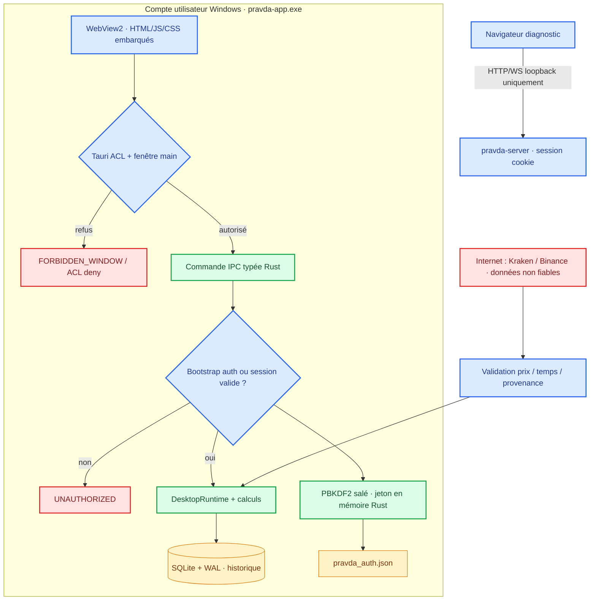
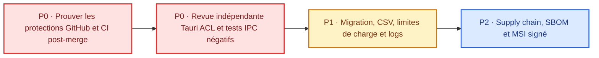

<div align="center">

# 🛡️ SECURITY · PRAVDA-BOT
### Politique de sécurité · Modèle de menace · Plan de durcissement


**[Signalement](#-signaler-une-vulnérabilité)** · **[Frontières](#-frontières-de-confiance)** · **[Contrôles](#-contrôles-effectivement-présents)** · **[Risques](#-risques-résiduels-et-limites)** · **[Plan P0–P2](#-plan-de-sécurisation-priorisé)**

[README](README.md) · [Threat model](docs/architecture/threat-model.md) · [Acceptance](docs/architecture/acceptance.md)

</div>

---

> [!WARNING]
> **Ne pas interpréter « CI verte » ou « desktop sans port HTTP » comme une certification.** La [PR #64](https://github.com/suvorovpravda/Pravda-Bot/pull/64) a été fusionnée le **2 novembre 2026** et son parcours Windows natif a été testé par le responsable. La **review GitHub indépendante n'a pas été enregistrée** et le réglage **« Do not allow bypassing »** de `main` n'a pas pu être confirmé par l'intégration, malgré `protected=true`. Un examen de sécurité indépendant et des tests négatifs dynamiques restent requis. Aucun paquet MSI Enterprise signé n'est attesté.

## 🇫🇷 Politique — français

### 🎯 Périmètre et garantie réelle

Le présent document couvre **le code Rust actuellement maintenu** :
- `crates/pravda-app/` : frontend Tauri 2/WebView2 embarqué et commandes IPC.
- `rust/pravda-server/` : services Rust partagés, authentification et serveur Axum de **diagnostic séparé**.
- `crates/pravda-core/`, `crates/pravda-store/`, `crates/pravda-engine/` et `crates/pravda-fetchers/` : calculs, SQLite, simulation et réception de marchés.
- Les pipelines sous `.github/workflows/`, le modèle de migration legacy et les scripts de développement Windows.

**Hors garanties :** composants Python archivés (`archive/python-legacy/`), poste déjà compromis par un logiciel malveillant, compte Windows administrateur hostile, réseau d'exchange non fiable, publication de données via un logiciel tiers, paquet binaire distribué en dehors de la chaîne contrôlée.

**Ce que le logiciel ne fait pas :** trading réel, ordres aux exchanges, stockage de clés d'API de trading pour ordonner des transactions, signature Authenticode du paquet actuel. Aucun scénario de sécurité ne doit supposer qu'une simulation papier équivaut à un ordre réel.

### 🔭 Frontières de confiance



| Frontière | Confiance accordée | Rejet exigé |
|:--|:--|:--|
| Internet → fetchers | **Aucune** sur les cotations reçues | Valeurs NaN/∞, négatives, périmées et écarts incohérents |
| WebView2 → commandes Rust | Fenêtre `main` + capacité nommée + session | Fenêtre non autorisée, non connecté, entrées malformées |
| Auth Rust → stockage | Chemins explicites, identité Windows, vérificateur PBKDF2 | Enregistrement auth corrompu, chemin invalide |
| Desktop → SQLite | Requêtes paramétrées et bornées | SQL arbitraire depuis JS et export vers chemin fourni par UI |
| Navigateur → Axum | Loopback, `Host` et `Origin` cohérents, cookie valide | Origine étrangère, rebinding, accès non authentifié |
| CI → publication | Commit, checks et artefacts vérifiés | MSI non signé, secrets dans artefact, checks incomplets |

### ✅ Contrôles effectivement présents

<details open>
<summary><strong>1. Authentification et sessions locales</strong></summary>

- Mot de passe local **≥ 15 caractères** et **≤ 1 024 octets**.
- Verificateur **PBKDF2-HMAC-SHA256** avec sel aléatoire et **600 000 itérations**, stocké dans `pravda_auth.json` ; le fichier ne contient pas le mot de passe en clair.
- Création initiale refusée si un vérificateur existe déjà. Un fichier de vérification invalide empêche le démarrage au lieu de réinitialiser silencieusement l'authentification.
- **5 tentatives libres**, puis délai progressif de verrouillage (base 30 s, plafond 15 min, selon l'implémentation). Validité nominale de session : **12 heures** ; révocation lors du logout.
- Dans Tauri, **le jeton de session reste dans Rust**, via `IpcAuth` : il n'est pas renvoyé au JavaScript. Les opérations PBKDF2 s'exécutent hors thread WebView.
- Dans Axum, les sessions navigateur utilisent un **cookie HttpOnly / SameSite=Strict**, sans transmettre le secret par les snapshots métier.

**Limite :** ce mécanisme ne résiste pas à un malware ayant accès au compte utilisateur, à la mémoire de processus ou aux fichiers autorisés.

</details>

<details open>
<summary><strong>2. IPC Tauri minimal et ressources locales</strong></summary>

- UI depuis `WebviewUrl::App("index.html")` et `build.frontendDist="frontend"` ; pas de chargement initial d'un site distant.
- `crates/pravda-app/capabilities/main.json` donne des permissions **individuelles** aux commandes de la seule fenêtre `main` ; aucune permission `shell`, `fs` globale, aucune origine distante déclarée.
- **12 commandes nommées**, enregistrées dans le manifeste Tauri ; 5 liées à auth/session et 7 lectures :
  - Bootstrap/session : `ipc_auth_status`, `ipc_auth_setup`, `ipc_auth_login`, `ipc_auth_logout`, `ipc_session_check`.
  - Métier : `ipc_market_snapshot`, `ipc_history_recent`, `ipc_history_query`, `ipc_history_export_csv`, `ipc_paper_alerts_snapshot`, `ipc_runtime_metrics`, `ipc_fx_status`.
- Les commandes de bootstrap valident la **fenêtre `main`** ; les opérations protégées appellent **`require_authenticated()` côté Rust**, en plus de l'ACL Tauri.
- Content Security Policy (CSP) desktop : `script-src 'self'` et `style-src 'self'`, `object-src 'none'`, `frame-src 'none'`, `form-action 'none'`, `base-uri 'none'`. `connect-src` autorise uniquement les schémas internes du pont IPC (`ipc:` et `http://ipc.localhost`). **Cette autorisation ne signifie pas qu'Axum écoute sur ce port.**
- Commandes d'historique avec filtres typés et réponses bornées. Le CSV provient de lignes validées et non d'un chemin de fichier arbitraire.
- Le desktop **ne démarre pas de serveur HTTP ni de WebSocket local pour l'UI**. Démarrage Windows et absence de socket `Listen` sur son PID testés manuellement ; le smoke CI le contrôle aussi.

**Limite :** la preuve d'un **refus IPC dynamique depuis une seconde fenêtre ou origine hostile** n'a pas encore été consignée. Une protection écrite dans le code n'est pas un test d'intrusion.

</details>

<details>
<summary><strong>3. Serveur Axum de diagnostic (transport différent)</strong></summary>

- Écoute **127.0.0.1** uniquement ; `DASHBOARD_PORT` validé et réservé ; le port n'est pas utilisé comme transport UI du desktop.
- Vérification stricte de `Host`, `Origin`, du port et des métadonnées navigateur `Sec-Fetch-*` ; rejets d'origines étrangères, de doublons d'en-têtes et d'hôtes arbitraires.
- Exception **bornée** de navigation WebView2 historique pour certains documents publics ; **pas** de permission générale sur les API ou WebSocket.
- En-têtes défensifs `Cache-Control: no-store`, `X-Content-Type-Options: nosniff`, `X-Frame-Options: DENY`, `Referrer-Policy: no-referrer` et `Cross-Origin-Resource-Policy: same-origin`.
- Accès au dashboard métier, API et WebSocket conditionné par la session serveur. Les clients CLI locaux sans `Origin` restent possibles et ne constituent pas une barrière contre un processus local malveillant.

**Ne jamais exposer ce serveur par un proxy public, un tunnel, un transfert NAT ou une redirection de port.** « Loopback » ne signifie pas « isolé de tous les processus du poste ».

</details>

<details>
<summary><strong>4. Intégrité des données et migration SQLite</strong></summary>

- Historique SQLite avec journal **WAL**, accès SQL paramétré et filtres symbol/exchange/période sous formes d'énumérations.
- Réponses d'historique **limitées à 10 000 événements**, indicateur de troncature ; pas d'injection de SQL utilisateur depuis le frontend.
- Import legacy Python : source ouverte **en lecture seule**, transaction d'import cible, table de provenance des lignes importées, rollback intégral si une ligne invalide bloque le lot.
- Un chemin legacy explicite absent/invalide produit une erreur, **pas** une création silencieuse d'une base de remplacement.
- **Attention :** le chemin canonique de la base source fait partie de l'identité de réimport ; la déplacer peut faire considérer ses lignes comme une nouvelle source.
- Répertoires Windows utilisateur : `%LOCALAPPDATA%\Pravda-Bot` pour SQLite et auth, sauf chemins d'environnement explicites.

**Sauvegarde :** arrêter les processus, puis effectuer une sauvegarde cohérente SQLite (API de backup ou copie valide de la base et de son WAL) **et** du fichier auth. Une copie à chaud du seul `.db` ne garantit pas l'intégrité.

</details>

<details>
<summary><strong>5. CI, dépendances et comportement de marché</strong></summary>

- CI Rust Linux/Windows, MSRV **1.95.0**, `fmt`, `clippy`, tests, compilation Release, contrats JS/IPC statiques, build/smoke Tauri Windows, scénario serveur navigateur et CodeQL.
- Dependabot surveille des dépendances Cargo, GitHub Actions, archive Python et une configuration npm ; les PR de dépendances doivent rester soumises aux validations normales.
- Flux publics : validation des cours **finis et strictement positifs**, contraintes de fraîcheur/désynchronisation et écarts avant la simulation papier.
- Valeurs indisponibles : renvoi de `null` ou état `unavailable` lorsqu'une source/métrique (FX, CPU/RSS, etc.) n'est pas effectivement implémentée.
- **Aucun ordre en argent réel** ; le moteur ne modélise pas des fills garantis ni tous les coûts d'exécution.

**Limite :** un scan CodeQL vert ou une compilation reproductible ne constitue pas, à eux seuls, un audit de sécurité indépendant.

</details>

### 🔎 Matrice de menaces et état des protections

| Menace | Actif | Défense intégrée | Vérification / risque restant |
|:--|:--|:--|:--|
| XSS / script externe | WebView2 | JS/CSS locaux, CSP `'self'` | Tests d'injection et revue du frontend à compléter |
| Appel IPC non autorisé | Données métier | ACL `main` + autorisation Rust | **P0 :** tests négatifs sur fenêtres/origines |
| Vol local de session | Session | Jeton côté Rust ; révocation logout | Malware même utilisateur hors garantie |
| Brute force mot de passe | Auth | PBKDF2 + verrouillage progressif | Tester sur redémarrage/attaques répétées |
| SQL injection / export arbitraire | SQLite | Requêtes paramétrées, enums, CSV borné | Revue du format et test CSV malveillant |
| Corruption de migration | Historique | Lecture seule source, transaction et provenance | Restaurations et crash tests à compléter |
| DNS rebinding / CSRF HTTP | Serveur diagnostic | Host/Origin/Fetch Metadata et cookies | Processus local hostile non exclu |
| Déni de service local | Disque / CPU / flux | Requêtes historiques bornées | Limites globales connexions, débit et disque **à faire** |
| Dépendance compromise | Build | CI, CodeQL, Dependabot | Audit/attestation SBOM et provenance à faire |
| Exécutable remplacé | Poste Windows | Aucune signature Enterprise attestée | **P0 release :** signature éditeur, horodatage et contrôle chaîne |
| Contournement de gouvernance | `main` | Branche indiquée protégée | **P0 :** no-bypass non vérifié ; approbation #64 non attestée |

### ⚠️ Risques résiduels et limites

> [!CAUTION]
> **Ce qui n'est PAS garanti :** protection complète contre un malware local, absence de vulnérabilité, confidentialité face à l'administrateur du poste, résultats financiers réels, qualité intrinsèque des sources de marché ou intégrité d'un exécutable non signé téléchargé ailleurs.

1. **IPC :** le contrôle dynamique des permissions pour les fenêtres non autorisées et les origines externes n'a pas encore de rapport manuel indépendant ; il faut le tester sur Windows réel avec une instrumentation contrôlée.
2. **Distribution :** `bundle.active=false` et **aucun MSI signé avec Authenticode/RFC 3161** n'est attesté ; les scripts de lancement de développement ne constituent pas une chaîne de release.
3. **Charge / déni de service :** pas de garantie de quota global sur toutes les connexions, sessions, flux, requêtes et la taille de la base. Les limites d'une **réponse** ne sont pas une limite de volume du disque.
4. **Disponibilité :** FX, énergie, actualités, AIS, notifications et mesures CPU/RSS n'ont pas tous un backend réel complet ; afficher l'absence de données plutôt que créer des valeurs.
5. **Legacy :** une ancienne base Python, ses scripts et ses dépendances restent des matériaux de référence, **pas** des composants héritant automatiquement de la sécurité Rust.
6. **Post-fusion #64 :** le propriétaire a lancé lui-même la fusion. Le journal GitHub consulté ne contient que deux reviews `COMMENTED` du connecteur, **pas** d'`APPROVED` humain indépendant. `main` était `protected=true`, mais la lecture détaillée des protections a renvoyé **403**. Consigner et corriger toute divergence de procédure ; ne pas prétendre à une approbation qui n'existe pas.

### 🗺️ Plan de sécurisation priorisé



| Étape | Action attendue | Preuve de clôture |
|:--|:--|:--|
| **P0 — immédiat** | Vérifier les résultats des jobs **sur le SHA `main` fusionné**, pas seulement sur la tête de PR | Liens CI, SHA et conclusion de chaque job |
| **P0 — gouvernance** | Administrateur : confirmer « Require a pull request », review humaine, refus bypass, résolution des commentaires et politiques de signature | Capture des paramètres de protection / ruleset et revue indépendante |
| **P0 — IPC** | Tester sans session, sur fenêtre non `main`, origine distante, après logout et session expirée | Matrice `command → expected denial` et logs sans secret |
| **P1 — stockage** | Import SQLite legacy avec doublons, fichier corrompu, interruption, rollback/reprise ; vérifier export CSV et refus de formules | Jeux de données fictives + tests reproductibles |
| **P1 — robustesse** | Tester erreurs/charge, reconnections exchange, quotas disque, masquage des logs | Tests automatisés + résultat de saturation |
| **P2 — dépendances** | Cartographier dépendances et produire SBOM, audit et provenance artefacts | SBOM + rapport d'audit associé à un SHA |
| **P2 — livraison** | Signer **EXE et MSI** Authenticode, horodater RFC 3161, vérifier sur Windows propre, sécuriser rollback | Signatures `signtool` et tests install/upgrade/uninstall |

**Règle de publication :** tant qu'un certificat de signature approuvé, les tests de Windows réel, l'intégrité de la chaîne de build et une revue de sécurité ne sont pas démontrés, **aucune promesse de release Enterprise prête à déployer**. Les jalons P0/P1/P2 ne sont pas des échéances calendaires.

### 🧪 Procédures de contrôle reproductibles

**Vérifier le contrat source et les tests automatiques :**

```powershell
cargo fmt --all -- --check
cargo clippy --locked --workspace --all-targets -- -D warnings
cargo test --locked --workspace
cargo test --locked --manifest-path .\crates\pravda-app\Cargo.toml
node tools/test-desktop-ipc.mjs
node tools/test-dashboard.mjs
```

**Vérifier le réseau du desktop** (application ouverte, depuis PowerShell) :

```powershell
$app = @(Get-CimInstance Win32_Process |
    Where-Object { $_.Name -eq "pravda-app.exe" })
if ($app.Count -eq 0) {
    throw "Le desktop Tauri n'est pas lancé."
}
$listeners = @(Get-NetTCPConnection -State Listen -ErrorAction SilentlyContinue |
    Where-Object { $app.ProcessId -contains $_.OwningProcess })
if ($listeners.Count -ne 0) {
    $listeners | Select-Object LocalAddress, LocalPort, OwningProcess
    throw "Écoute TCP détectée sur le processus desktop."
}
Write-Host "OK : aucun listener TCP pour pravda-app.exe."
```

**Ce test vérifie uniquement les sockets en écoute de ce processus**, pas les connexions sortantes ou les autres programmes Windows.

**Scénarios de sécurité à ne pas sauter :** tentative d'invocation avant setup/auth, identifiants faux, logout suivi d'accès IPC, fenêtre secondaire sans capability, tentative de chargement externe, expiration, chemin SQLite invalide, migration interrompue, import répété, CSV avec données hostiles. Utiliser **uniquement des données de test**.

### 🔒 Gestion des données et des secrets

- **Ne jamais publier** mots de passe, `pravda_auth.json`, bases SQLite utilisateur, fichiers WAL, clés/tokens, environnements, topics de notification privés, chemins absolus personnels ou journaux bruts.
- Ne pas stocker un mot de passe dans une capture ou un script partagé ; les variables d'environnement restent observables par des logiciels disposant des droits nécessaires.
- Ne pas versionner les bases réelles dans Git. `.gitignore` n'efface **pas** des secrets déjà commités : en cas d'exposition, **révoquer/renouveler** les identifiants concernés et examiner l'historique.
- Ne pas publier de fichiers `.pfx` de signature ni leur mot de passe dans le dépôt ou les artefacts CI.
- Faire des sauvegardes **cohérentes** et tester une restauration avec des données fictives avant toute migration réelle.
- Vérifier l'URL/éditeur et le SHA d'un artefact ; un SHA-256 hébergé au même endroit qu'un exécutable compromis n'est pas une preuve suffisante d'authenticité.

### 📩 Signaler une vulnérabilité

> [!IMPORTANT]
> **Ne publiez jamais un exploit, un mot de passe, une base personnelle ou une trace contenant des données sensibles dans une issue publique.**

1. Ouvrir la [page Security du dépôt](https://github.com/suvorovpravda/Pravda-Bot/security) et chercher **« Report a vulnerability »** si la fonctionnalité **Private vulnerability reporting** est activée.
2. Si elle n'apparaît pas, **demander au mainteneur un canal privé** sans communiquer la preuve d'exploitation dans une issue publique. Aucun email de sécurité non vérifié n'est annoncé ici.
3. Inclure, **dans le canal privé**, la version/commit, le système, la catégorie d'impact, les prérequis, des étapes minimales et des données de test non sensibles.
4. Préférer la divulgation coordonnée : laisser le temps de confirmer, corriger, tester puis publier une note de sécurité. **Aucun délai de réponse ou SLA non vérifié n'est promis.**

**Attentes du mainteneur :** accuser réception si possible, reproduire sur un environnement isolé, évaluer la gravité, corriger dans une branche revue, ajouter un test de non-régression et communiquer sur les versions réellement touchées. Le projet n'affirme ni programme de bug bounty ni garantie d'indemnisation.

---

## 🇬🇧 Security policy — English

**Scope.** Maintained Rust/Tauri 2 Windows desktop, separate Axum loopback diagnostic server, shared authentication, market validation, SQLite storage and CI. Archived Python is **not** part of the active desktop runtime.

**Desktop boundary.** Bundled WebView2 local assets call named Tauri IPC commands; permissions are scoped to the `main` window and the Rust command handlers enforce session checks. The session token stays in Rust, never in JS. CSP restricts scripts/styles to local resources; no generic filesystem or shell permissions are granted. The desktop does **not** open an HTTP listener for its UI.

**Authentication.** Minimum 15 characters, salted PBKDF2-HMAC-SHA256 with 600,000 iterations. Failed attempts trigger progressive lockout; logout revokes the active session. The separate Axum browser mode binds to loopback, validates Host/Origin/Fetch Metadata, and uses authenticated HttpOnly/SameSite=Strict session cookies.

**Persistence.** SQLite WAL, parameterized and bounded history reads, read-only source for transactional Python legacy migration, and per-user Windows AppData defaults. Back up the database **including its WAL consistency** and the password verifier before migrating.

**Known gaps.** No independent GitHub `APPROVED` review was recorded for merged PR #64, and the no-bypass setting was not confirmed. Negative IPC boundary testing, load limits, signed MSI/Authenticode, SBOM, and some data-source adapters still need work. Local malware can access files under the compromised account. CI is **not** a security certification.

**Responsible disclosure.** Use [GitHub Security](https://github.com/suvorovpravda/Pravda-Bot/security) → **Report a vulnerability** if private reporting is enabled. Otherwise ask the maintainer for a **private contact route without posting exploit details publicly**. Share reproducible non-sensitive evidence privately. No guaranteed response SLA is published.

---

## 🇷🇺 Политика безопасности — русский

**Область действия:** текущий код Rust/Tauri 2, отдельный диагностический сервер Axum, SQLite, аутентификация и CI. Архив Python не является рабочим процессом desktop.

**Desktop:** локальные HTML/CSS/JS и IPC Tauri; разрешения только для окна `main`, проверка сессии в Rust. Токен сессии не передаётся JavaScript. UI **не открывает локальный HTTP-порт**; сервер диагностики Axum работает отдельно и использует loopback, проверку Host/Origin и cookie-сессию.

**Пароль:** минимум 15 символов, случайная соль, PBKDF2-HMAC-SHA256 (600 000 итераций), задержки после ошибок, отзыв сессии при выходе. Данные сохраняются в SQLite/WAL и файле проверки пароля в пользовательском каталоге Windows. При миграции нужны согласованные резервные копии.

**Ограничения:** защита от вредоносной программы в той же учётной записи не гарантируется; независимая проверка PR #64 и настройка запрета bypass не подтверждены. Подписанный Enterprise MSI, негативные IPC-тесты и ограничения нагрузки ещё требуют выполнения.

**Уязвимости:** используйте [закрытую отправку через GitHub Security](https://github.com/suvorovpravda/Pravda-Bot/security), если она включена, либо запросите у сопровождающего приватный способ связи. Не публикуйте пароли, данные пользователей или подробности эксплуатации в открытых issues.
