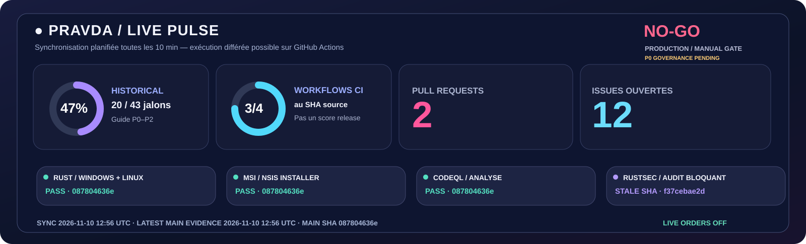
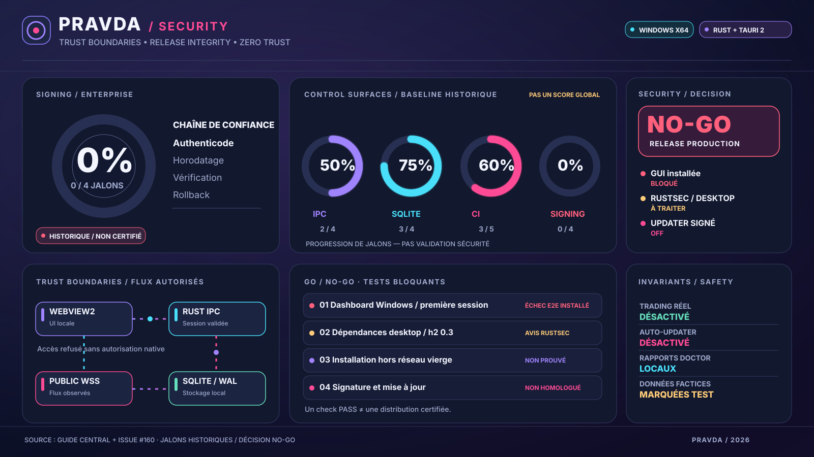

# 🛡️ PRAVDA / SECURITY
### TRUST CONTROL · RELEASE INTEGRITY · RISK MONITORING

**Des permissions minimales, des preuves vérifiables et aucun faux indicateur de conformité.**

[**Security cockpit**](#-security-cockpit) · [**Contrôles**](#-jalons-de-sécurité-et-risques) · [**Threat model**](#-frontières-de-confiance) · [**Release gate**](#-release-security-gate) · [**Signalement**](#-signaler-une-vulnérabilité) · [**README**](README.md) · [**Reviewing**](docs/REVIEWING.md)

---

## ⚡ Security Live Pulse — métriques GitHub actualisées

**[Statut brut JSON](docs/assets/pravda-live-status.json)** · **[Actualisations GitHub Actions](https://github.com/suvorovpravda/Pravda-Bot/actions/workflows/live-docs.yml)**

Les résultats sont récupérés depuis les API GitHub **environ toutes les 10 minutes** et à la clôture des workflows concernés ; le rafraîchissement dépend des délais GitHub Actions et des caches d'images GitHub. L'horodatage indique la **dernière preuve observée**, pas une certification récente. Le tableau vérifie le SHA des runs et marque les tests hors SHA comme périmés. **L'audit RustSec observe-only n'est jamais converti en PASS** ; le statut de diffusion demeure **NO-GO** jusqu'à décision formelle de la chaîne de publication.

## 🌌 Security cockpit

> **Précision essentielle :** ces anneaux illustrent les **jalons techniques historiques** du [guide central](docs/PRAVDA-GUIDE.md), pas une note de sûreté. Il est impossible de déduire un niveau de protection global d'un assemblage de pourcentages. Le statut de publication est **NO-GO** jusqu'à la levée documentée des conditions bloquantes.

Les badges dynamiques indiquent uniquement le résultat de leurs workflows. Le workflow **RustSec dependency audit (observe only)** peut être marqué réussi alors qu'une commande d'audit des dépendances a échoué : ce badge ne constitue **jamais** une preuve d'absence de vulnérabilités.

## 📊 Jalons de sécurité et risques

Les quatre chiffres ci-dessous sont des **fractions historiques de tâches** ; ils n'ont pas de signification statistique de cybersécurité.

| Domaine | Avancement historique | Lecture correcte |
| :--- | ---: | :--- |
| 🟣 Sécurité IPC Windows | **50 %** | 2 jalons sur 4 documentés dans le guide, vérification native à maintenir |
| 🟦 Historique / SQLite | **75 %** | 3 jalons sur 4, restaurations et migrations à qualifier |
| 🌸 Vérifications CI et gouvernance | **60 %** | 3 jalons sur 5, recettage sur l'artefact exact obligatoire |
| 🔴 Packaging Enterprise | **0 %** | 0 jalon sur 4, pas de chaîne de signature homologuée |

<strong>📈 Afficher le graphique Mermaid des jalons historiques</strong>

~~~mermaid
xychart-beta
    title "Contrôles techniques historiques — PAS un security score"
    x-axis ["IPC", "SQLite", "CI", "Enterprise"]
    y-axis "Jalons (%)" 0 --> 100
    bar [50,75,60,0]
~~~

### État des risques résiduels

| Gravité | Surface | Situation | Action requise |
| :--- | :--- | :--- | :--- |
| 🔴 P0 | Interface Windows réellement installée | **Non homologuée** | Première configuration, JS initialisé, redémarrage et reconnexion |
| 🔴 P0 | Desktop RustSec | **Avis non levés** | Auditer Cargo.lock desktop, traiter h2 et les dépendances héritées |
| 🟠 P0 | Flux publics | **Sur poste non prouvés** | Observation horodatée, provenance, reconnexion et contrôle des données périmées |
| 🔴 P0 | Authenticode | **Non qualifié** | Signature, identité et timestamp sur tous les artefacts déclarés signés |
| 🔴 P0 | Mise à jour signée | **OFF** | Vérification cryptographique, anti-downgrade, rollback |
| 🟠 P0 | MSI / NSIS | **Recette finale manquante** | Onboarding graphique réel, désinstallation et conservation SQLite |
| 🔴 P0 | VM sans WebView2 et sans réseau | **Non testée entièrement** | Isolation niveau hyperviseur et snapshots jetables |
| 🟢 Contrôle | Trading live | **OFF** | Maintenir l'absence de capacités d'ordre jusqu'à homologation indépendante |

**Preuve d'incident connu :** un test MSI installé a constaté une initialisation partielle du tableau de bord après la création du mot de passe ([run 42290188079](https://github.com/suvorovpravda/Pravda-Bot/actions/runs/42290188079)). La [PR d'intégration #159](https://github.com/suvorovpravda/Pravda-Bot/pull/159) a été fusionnée ; cela ne suffit pas à certifier un déploiement sur poste cible.

**Registre principal : [Issue #160 — Security / Déploiement, GO / NO-GO](https://github.com/suvorovpravda/Pravda-Bot/issues/160).** Les difficultés reportées dans cette issue restent **ouvertes sur le fond** jusqu'à une preuve contraire.

## 🔐 Frontières de confiance

~~~mermaid
flowchart TD
    USER["👤 Session Windows"]
    WEB["🖥️ Tauri / WebView2"]
    IPC["🔐 Rust IPC Auth + Permissions"]
    CORE["⚙️ Runtime Rust"]
    STORE[("🗄️ SQLite / WAL")]
    FEED["📡 API publiques autorisées"]
    DIAG["🛡️ Doctor / Harness hors réseau"]
    SIGN["🔏 Mise à jour signée : OFF"]
    USER --> WEB --> IPC --> CORE
    FEED --> CORE
    CORE --> STORE
    CORE --> DIAG
    SIGN -. "Aucune installation implicite" .-> CORE
~~~

| Frontière | Politique de sécurité | Interdiction explicite |
| :--- | :--- | :--- |
| **Frontend → IPC** | Commandes autorisées par la fenêtre, session et validation Rust | Escalade via JS/DOM ou popup non autorisée |
| **Session → callback** | Réponse liée à la session d'origine, révocation après déconnexion | Résultat ancien réutilisé sous une nouvelle session |
| **Coffre → runtime** | Secrets conservés exclusivement côté natif | Mots de passe et clés dans WebView, rapports ou logs |
| **Sources → moteur** | TLS, allowlist, consentement réseau et fraîcheur | Valeur fictive déclarée observation live |
| **SQLite → diagnostic** | Inspection passive, transaction et WAL cohérents | Réparation destructrice ou réinitialisation silencieuse |
| **CI → publication** | Commit, SHA-256, provenance et signature si annoncée | Badges verts considérés comme certification |
| **Paper → live** | Séparation de capacité et autorisation indépendante | Ordre réel déclenché depuis un test synthétique |

### Contrôles non négociables

- Le **Doctor** ne récupère aucun mot de passe, compte financier ou clé d'exchange ; les rapports sont expurgés et leur partage reste manuel.
- Le **Harness** utilise des fixtures **synthétiques** : un test PASS ne prouve pas que Kraken ou Binance répondent.
- Un état **SKIP** signale un contrôle non exécuté et ne peut jamais être converti en PASS.
- Aucun test de diagnostic ne peut lancer de transaction réelle, corriger une base personnelle sans autorisation ou contourner Windows Defender.

## 🧱 Dépendances / RustSec

Le lock desktop a révélé historiquement la chaîne **reqwest 0.11.27 → hyper 0.14.32 → h2 0.3.27**, associée à l'avis **RUSTSEC-2026-0258**, ainsi que des avertissements relatifs à des bibliothèques non maintenues.

L'audit doit inspecter **le Cargo.lock du bureau**, et pas seulement le lock de l'espace de travail racine. Toute suppression ou mise à jour de dépendance exige une régénération du lockfile **avec Cargo**, suivie des tests Rust et Windows au SHA exact. Les advisories doivent être triés avant d'autoriser une publication signée, sans simple masquage des erreurs.

## 🚦 Release security gate

Aucune release de production ne reçoit le statut GO sans des **preuves cohérentes sur le même commit et le même artefact** :

- [ ] Rust fmt, clippy, tests Linux/Windows, tests IPC et CodeQL validés.
- [ ] RustSec desktop examiné, vulnérabilités bloquantes traitées.
- [ ] Bureau Windows en sous-système graphique, sans console dépendante de l'application.
- [ ] MSI et NSIS réellement installés, mot de passe, initialisation complète, reconnexion et désinstallation testés.
- [ ] SQLite et ses données préservés à l'installation, au redémarrage et à la mise à niveau.
- [ ] Rapport de diagnostic local et expurgé ; une seule instance et arrêt propre.
- [ ] SHA-256 et provenance des binaires vérifiés ; Authenticode et timestamp vérifiés pour toute édition prétendue signée.
- [ ] Installation VM sans WebView2 ni réseau confirmée si revendiquée.
- [ ] Mise à jour signée vérifiée, anti-downgrade et rollback testés avant toute activation.
- [ ] Aucune capacité de trading réel activée.

Le packaging Tauri prévoit le prérequis WebView2 via **offlineInstaller** : **cela ne prouve pas** que l'installation sur une VM vierge hors réseau est homologuée.

**Édition unsigned-test ≠ édition Enterprise.** Ne jamais désactiver antivirus, SmartScreen, UAC ou pare-feu pour diffuser un paquet.

## 📩 Signaler une vulnérabilité

Privilégier le [centre GitHub Security](https://github.com/suvorovpravda/Pravda-Bot/security) et les signalements privés lorsqu'ils sont activés. Ne jamais publier un exploit contenant un secret dans une Issue publique.

Préciser la version ou le commit affecté, l'impact, le scénario minimal reproductible et les résultats de test **expurgés**. Ne transmettre **aucun** mot de passe, clé, token, PFX, base SQLite, fichier WAL/SHM, donnée de compte ou journal privé.

## 📚 Navigation

---

**EN** — Production release NO-GO. The percentage gauges are **historical workstream milestones, not a cybersecurity score**. Desktop RustSec, Windows onboarding, signing and updater gates require exact-build evidence. Live orders OFF.

**RU** — Релиз в продакшен пока не разрешён. Проценты — **исторические инженерные этапы, а не рейтинг безопасности**. Торговля реальными средствами отключена.
