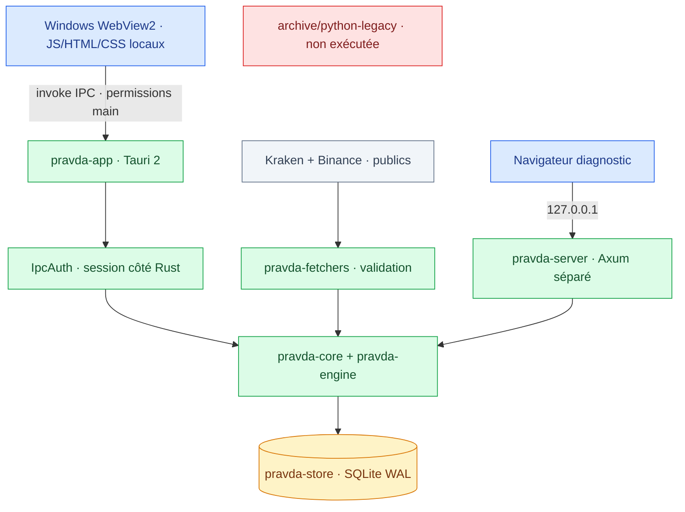
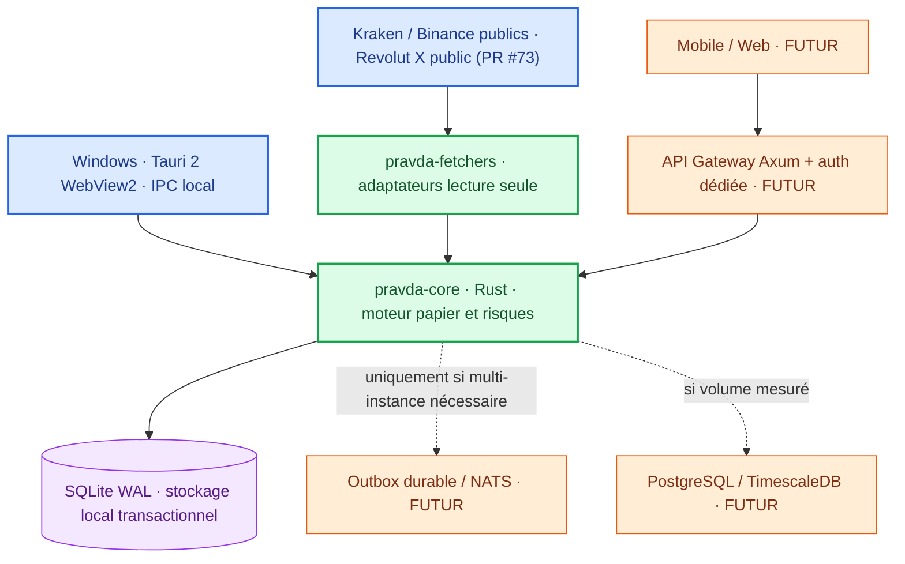

<div align="center">

# 🧭 PRAVDA-BOT · GUIDE CENTRAL
### Architecture · Migration Rust · Sécurité · Versions · Feuille de route


**[Accueil](../README.md)** · **[Politique de sécurité](../SECURITY.md)** · **[Progression](#-tableau-de-bord-priorisé)** · **[Architecture](#-architecture-et-composants-rust)** · **[Historique](#-historique-technique-et-versions)** · **[Livraison](#-preuves-ci-et-critères-de-publication)**

</div>

---

## État actuel de livraison et recette — 4 novembre 2026

**Référentiel de production :** [issue #106](https://github.com/suvorovpravda/Pravda-Bot/issues/106), [workflow Windows](https://github.com/suvorovpravda/Pravda-Bot/actions/workflows/windows-package.yml), dernier commit de [`main`](https://github.com/suvorovpravda/Pravda-Bot/commits/main). Ce chapitre est prioritaire sur les anciennes estimations de progression et versions reproduites plus bas. **Objectif : 30/11/2026, conditionné aux contrôles.**

### Trois livrables distincts — comment les obtenir

Sur la page [GitHub Actions du packaging Windows](https://github.com/suvorovpravda/Pravda-Bot/actions/workflows/windows-package.yml), choisir un run **réussi de `main`**, vérifier son **SHA de commit**, puis télécharger depuis **le même run** :

| Nom d'artefact GitHub | Contenu | Lancement |
| --- | --- | --- |
| `pravda-windows-unsigned-candidate-installers` | `bundle/msi/*.msi`, `bundle/nsis/*-setup.exe`, `pravda-app.exe`, `pravda-doctor.exe`, `pravda-harness.exe`, `bundle/SHA256SUMS.txt`, `bundle/release-evidence.json` | Installer le MSI/NSIS sur Windows propre ; n'ouvrir que l'application `pravda-app.exe` installée |
| `pravda-windows-production-test` | `pravda-harness.exe`, `PRODUCTION-TEST.txt` | Extraire le ZIP puis `pravda-harness.exe --smoke` dans PowerShell ; exécuter les campagnes dans une VM **sans accès réseau** |
| `pravda-windows-troubleshooting` | `pravda-doctor.exe`, `TROUBLESHOOTING.txt` | Extraire puis double-cliquer pour le rapport Bloc-notes ; `--no-open` pour le contrôle CI |

Les ZIP compagnons sont des **applications distinctes**, mais **ne sont pas chacun un MSI**. Les deux compagnons sont comparés par la CI au manifeste SHA-256 de l'archive principale, correspondant au même commit. Leurs guides sont des fichiers `.txt`. Aucun certificat de signature Enterprise n'a été annoncé comme validé : **les artefacts `unsigned` restent des builds de test**, même lorsque les checks sont verts. Les artefacts Actions ont une durée de conservation limitée ; ce ne sont pas des Releases stables pérennes.

### Installation autonome et personnalisée — contrat à réaliser (P0)

L'utilisateur final n'est **pas** un développeur : télécharger le MSI/NSIS, lancer, choisir **Standard recommandé** ou **Personnalisé**, puis configurer son mot de passe applicatif dans la fenêtre native. Aucune commande PowerShell, installation manuelle Rust, Visual Studio, Python, Node ou WebView2. Windows peut légitimement demander l'autorisation UAC ; ne jamais la contourner.

**Sélection cible (non encore disponible/validée dans les installateurs actuels) :**

| Composant | Standard | Personnalisé | Restriction de sécurité |
| --- | --- | --- | --- |
| Noyau desktop Tauri/WebView2, auth, SQLite indispensable, intégrité et IPC sécurisé | Obligatoire | Non décochable | Aucun contournement de l'auth ni ajout de permission arbitraire |
| Cours publics et feeds Kraken/Binance | Selon profil d'observation | Activable/désactivable | Aucun accès broker privé implicite |
| Simulation papier | Activée si profil test | Activable/désactivable | Aucun ordre réel |
| Doctor passif | Recommandé | Facultatif, archive séparée préservée | Aucune collecte/transmission de secrets |
| Harness préproduction | Non installé par défaut | Facultatif, archive séparée préservée | Campagnes en VM/OS sans réseau, hors compte réel |
| Revolut X en lecture seule | Désactivé | Opt-in **seulement si homologué** | Consentement explicite et coffre natif, zéro ordre |
| Trading live / retraits | **Absent** | **Non proposé** | Bloqué par [#89](https://github.com/suvorovpravda/Pravda-Bot/issues/89) |

**À implémenter et démontrer :** option list et dépendances versionnées ; étude WiX MSI vs NSIS pour une sélection vraiment installable ; prérequis WebView2 silencieux vérifié, modules authentifiés et signatures de provenance ; cohérence des capacités Tauri et accès réseau entre modules installés/désactivés ; persistance des options en upgrade ; absence de perte de profils/données ; scénarios d'échec et rollback sans désactiver SmartScreen/UAC. Si le découpage natif MSI/NSIS n'est pas réalisable avec les protections requises, utiliser des **installateurs distincts** ou une **activation post-installation sûre** documentée plutôt qu'une case qui ne fait rien. Aucun module tiers non signé. **La présence de `downloadBootstrapper` ne constitue pas une preuve d'installation offline.**

**Recette obligatoire :** Windows 10/11 propre, MSI et NSIS, runtime WebView2 absent/présent, connecté/déconnecté, Standard/Personnalisé, options individuellement et combinaisons, upgrade et désinstallation/réinstallation, refus des manifestes altérés, vérification effective des privilèges et ports. [Plan #106](https://github.com/suvorovpravda/Pravda-Bot/issues/106). Ne pas déclarer « installation personnalisable » tant que ces cas ne sont pas démontrés sur un SHA exact.

### Matrice de recette fondée sur les PR

| Critère | Source des tests | Interprétation |
| --- | --- | --- |
| Desktop natif, IPC et auth après redémarrage | [#111](https://github.com/suvorovpravda/Pravda-Bot/pull/111) | Seuls les cas testés en CI sont validés ; ne prouve pas un parcours complet d'utilisateur final |
| Démarrage de l'EXE extrait du véritable MSI sur runner Windows propre | [#112](https://github.com/suvorovpravda/Pravda-Bot/pull/112) | Vérifie démarrage et SQLite isolé, **pas** un scénario de trading |
| Trois téléchargements distincts, SHA des compagnons et tests Doctor/Harness | [#115](https://github.com/suvorovpravda/Pravda-Bot/pull/115) | Vérification de chaque binaire contre `bundle/SHA256SUMS.txt` du même run |
| Désinstallation puis réinstallation sans écraser deux fichiers témoins `APPDATA`/`LOCALAPPDATA` | [#116](https://github.com/suvorovpravda/Pravda-Bot/pull/116) | Preuve des canaris, pas une vraie migration/restauration d'une base utilisateur |
| Vérification précoce des scripts PowerShell | [#117](https://github.com/suvorovpravda/Pravda-Bot/pull/117) | Test syntaxique ; ne remplace pas l'installation réelle |
| Snapshot d'une base SQLite WAL active + restauration de lignes artificielles | [#118](https://github.com/suvorovpravda/Pravda-Bot/pull/118) | PR **en validation** au 4 novembre ; ne pas la compter comme recette fusionnée |

### Opérations et interdictions

- **Pour vérifier l'intégrité :** dans l'archive principale extraite, consulter `bundle/release-evidence.json`, relever le SHA de commit, vérifier les empreintes `SHA256SUMS.txt` ; pour chaque compagnon, calculer `Get-FileHash -Algorithm SHA256 .\pravda-doctor.exe` ou `Get-FileHash -Algorithm SHA256 .\pravda-harness.exe` dans son propre répertoire et comparer au manifeste principal. **Ne pas récupérer les compagnons de runs différents.**
- **Pour installer :** exécuter le MSI/NSIS correspondant au SHA validé, laisser SmartScreen actif, vérifier la présence de WebView2 ; la compilation MSVC n'est nécessaire qu'aux développeurs et à la CI, pas à l'utilisateur final d'un installateur.
- **Pour diagnostiquer :** Doctor est passif, hors réseau, sans réparation automatique. Partager seulement les lignes d'état et `SUMMARY`; ne pas joindre `.db`, fichiers d'authentification ou secrets.
- **Pour sauvegarder :** ne jamais copier à chaud les seuls fichiers `.db` d'une base WAL. Utiliser une copie transactionnelle (SQLite Online Backup / `VACUUM INTO` sur un nouveau fichier, sous procédure qualifiée) ou fermer proprement avant copie cohérente. Le test G3 en cours n'ajoute pas de commande de restauration pour utilisateurs.
- **Pour la simulation :** `--smoke` est synthétique et retourne volontairement `build_accepted=false` lorsque les cas refus/crash/timeout sont correctement détectés ; ce n'est pas une qualification d'une stratégie rentable.
- **Pour la sécurité financière :** aucun ordre de trading réel ni retrait n'est autorisé par la livraison Windows. [#89](https://github.com/suvorovpravda/Pravda-Bot/issues/89) (trading live) et [#90](https://github.com/suvorovpravda/Pravda-Bot/issues/90) (Authenticode Enterprise) exigent une acceptation indépendante.

---

## Manuel d'exploitation — Windows, sécurité financière et dépannage (03/11/2026)

> **Périmètre réel :** outil local d'observation/simulation; **pas** de service de trading live approuvé. Ce guide est la référence unique d'installation, d'utilisation, de diagnostic, de reprise et de validation. Le niveau de défense « fintech réglementée » est une cible à auditer, **pas** une certification obtenue. Le mode quantitatif air-gapped ne doit jamais contenir de clés d'exchange. Lire également [SECURITY.md](../SECURITY.md).

### 1. Choisir le bon exécutable

| Programme / méthode | Usage | Réseau | Ne pas confondre |
| --- | --- | --- | --- |
| `pravda-app.exe` sous `crates/pravda-app/target/release/` | Desktop Tauri 2 avec interface native WebView2, IPC typé, données locales | Flux publics possibles en mode normal si explicitement activés | **Ne doit pas** afficher `Pravda Server listening on http://127.0.0.1:8080` |
| `pravda-doctor.exe` | Double clic, autodiagnostic passif, rapport Bloc-notes | **Aucun DNS/TCP/HTTP** pendant le diagnostic | Ne remplace pas les tests interactifs de l'application |
| `pravda-harness.exe` | Campagnes Rust/Tokio N runs et métriques JSON locales | Hors réseau au niveau du code; isolation **OS/VM obligatoire** | Une campagne synthétique `--fixture-ok` ne teste pas une stratégie réelle |
| `pravda-server` | Adaptateur Axum de compatibilité / diagnostic ancien | Écoute `127.0.0.1` dans son mode explicite | **Ce n'est pas l'UI Tauri**. Ne pas l'utiliser comme solution de contournement d'IPC |
| `v0.3.4` depuis Releases | Archive historique pré-PR récentes | Variable selon compilation | Le numéro du ZIP ne prouve ni la date du code ni sa signature |

**Origine des binaires :** [Actions](https://github.com/suvorovpravda/Pravda-Bot/actions) → workflow Windows installer packaging réussi, vérifier le SHA exact et la rubrique **Artifacts**; [Releases](https://github.com/suvorovpravda/Pravda-Bot/releases) est un espace différent. L'absence d'artefact à télécharger pour un workflow n'implique pas une compilation cassée : le job peut construire sans publier le fichier. **Ne jamais renommer une build de test non signée en « Enterprise ».**

### 2. Installation, compilation et première ouverture

**Prérequis Windows 10/11 x64** : Rust stable compatible avec les `Cargo.lock`, WebView2 Runtime, Microsoft Visual C++ Build Tools/Windows SDK pour la cible `x86_64-pc-windows-msvc`. Les outils de compilation MSVC **ne sont pas un runtime Python/Node**; la CI du projet peut encore utiliser Node pour ses tests d'interface historiques, ce qui ne modifie pas l'exécution Rust du harnais.

Sous **Developer PowerShell for VS 2022** (ou VS Build Tools récent), s'assurer que `where.exe link.exe` trouve l'éditeur de liens MSVC; autrement installer la charge « Desktop development with C++ » et relancer le terminal. VS Code seul ne fournit pas `link.exe`.

```powershell
cd "C:\Users\Utilisateur\Pravda-Bot"
git status --short
git pull --ff-only origin main
where.exe link.exe
cargo build --locked --release --manifest-path "crates\pravda-app\Cargo.toml"
Get-Item ".\crates\pravda-app\target\release\pravda-app.exe" | Select-Object FullName,Length,LastWriteTime
Get-FileHash ".\crates\pravda-app\target\release\pravda-app.exe" -Algorithm SHA256
```

**Attendre `Finished release profile` :** `cargo build` qui échoue avec `link.exe not found` laisse intact un **ancien** `target/release/pravda-app.exe`. Une taille/décalage de date ne prouve pas qu'il s'agit du bon binaire. Comparer le hash et le commit testé, démarrer ensuite uniquement l'EXE compilé depuis `main` approuvé.

```powershell
.\crates\pravda-app\target\release\pravda-app.exe
```

Au premier lancement, définir un mot de passe fort d'au moins 15 caractères via la fenêtre native. Ne pas passer un mot de passe dans les arguments du terminal, ni dans un rapport envoyé au support. Le coffre de secrets Windows/les fichiers d'authentification restent hors de l'interface WebView; le mécanisme de session est géré par Rust.

**Données :** `%LOCALAPPDATA%\Pravda-Bot\pravda.db` et `%LOCALAPPDATA%\Pravda-Bot\pravda_auth.json` sont les valeurs par défaut de l'application Windows. Le chemin du dépôt `C:\Users\Utilisateur\Pravda-Bot` est le **code source**, pas nécessairement l'emplacement des bases actives. Les variables `PRAVDA_DB_PATH` et `PRAVDA_AUTH_PATH` peuvent explicitement remplacer ces chemins; ne pas modifier les chemins à l'aveugle.

### 3. Utilisation du desktop et règles de mode

- **Connexion :** effectuer le premier setup puis la connexion dans la fenêtre native. Si le formulaire échoue, exécuter Doctor avant toute réinitialisation. Ne pas effacer `pravda_auth.json` pour essayer un mot de passe.
- **Marchés :** afficher les prix Kraken/Binance et les sources publiques uniquement si l'option de flux réseau est activée en mode normal. Les prix périmés ou absents doivent afficher *indisponible*, jamais être considérés comme exécutables.
- **Historique :** consulter les ticks SQLite et exports autorisés après authentification. Une base intacte ne signifie pas que le flux marché est actuel.
- **Simulation papier :** journal de simulation/risk gating distinct, sans compte de courtage, clé ni ordre réel. Les résultats de replay ne donnent aucune promesse de PnL.
- **Revolut X :** données publiques et lectures privées encadrées seulement. Les opérations de trading réelles sont **désactivées** tant que [#89](https://github.com/suvorovpravda/Pravda-Bot/issues/89) n'a pas été validée indépendamment.
- **Arrêt :** fermer l'application avant sauvegarde et vérifier qu'aucune activité persistante n'est encore en cours. Un kill switch futur bloque les nouveaux envois, **pas** les fills déjà acceptés par le broker.

### 4. Diagnostic d'un problème : procédure « un clic »

1. Décompresser l'artefact Windows `pravda-windows-troubleshooting` du **même run validé** que l'application et son manifeste SHA-256, **sans exécuter directement le ZIP**.
2. Double-cliquer sur `pravda-doctor.exe`; un rapport local `PRAVDA-DOCTOR REPORT v2` s'ouvre dans le Bloc-notes.
3. Copier **seulement** le rapport `PASS/WARN/FAIL/SKIP` et sa ligne `SUMMARY` dans le support. Ne jamais joindre la base `.db`, le mot de passe, des secrets, des captures de clé ou les répertoires personnels.
4. Corréler `application_sha256` avec l'artefact/Release testé. Doctor qui ne retrouve pas `pravda-app.exe` émet `adjacent_app_binary | WARN`, **pas** un jugement sur la validité de l'application.
5. Si Doctor indique `FAIL | sqlite_health` : arrêter le logiciel, sauvegarder la base et tous ses sidecars de manière cohérente, demander une restauration ou une analyse sur copie, **ne pas faire de réparation automatique**.

**Interprétation stricte :** `PASS` = contrôle précisément exécuté réussi; `WARN` = intervention/diagnostic complémentaire; `FAIL` = défaut constaté; `SKIP` = non testé. `auth_record_validity PASS` ne prouve pas que le mot de passe est connu ni que la connexion fonctionne. `sqlite_health PASS` ne prouve ni l'actualité des prix ni l'intégrité d'un registre financier externe. Doctor est hors réseau et n'envoie rien par lui-même.

### 5. Catalogue de dépannage Windows

| Symptôme | Cause à confirmer | Action autorisée, sans perte |
| --- | --- | --- |
| `linker link.exe not found` | Toolchain Rust MSVC sans linker Visual C++ ou terminal non configuré | Installer/réparer **Visual Studio Build Tools Desktop C++** et Windows SDK; relancer Developer PowerShell; reconstruire et attendre succès |
| Ancien EXE affiche `Pravda Server listening on http://127.0.0.1:8080` | Binaire historique backend/HTTP encore dans `target/release` | Fermer le processus, reconstruire Tauri depuis `main`, contrôler SHA-256; ne pas affaiblir les règles Host/Origin |
| `{"error":"request origin not allowed"}` | Origine HTTP non autorisée par l'adaptateur Axum | Vérifier quel EXE/port/protocole est réellement utilisé; **ne pas ajouter `*` aux origines autorisées**; desktop normal = WebView2/IPC |
| Écran vide / WebView2 indisponible | Runtime WebView2, bundle frontend ou ancienne Release | Doctor `webview2_runtime`; contrôler version du ZIP/EXE, assets embarqués et log de démarrage expurgé |
| Windows SmartScreen « éditeur inconnu » | Signature absente/non reconnue, réputation insuffisante | Vérifier Authenticode et SHA-256; utiliser uniquement une source fiable; **ne pas désactiver SmartScreen** |
| Mot de passe pas sauvegardé | Chemin auth incohérent, permissions, verrou, ancienne version | Doctor `local_auth_file`, `auth_record_validity`, vérifier `PRAVDA_AUTH_PATH`; ne pas supprimer le verifier |
| `127.0.0.1` refuse la connexion | Normal si desktop IPC Tauri sans listener HTTP | Ouvrir la fenêtre `pravda-app.exe`; utiliser HTTP uniquement pour l'ancien serveur diagnostic délibérément démarré |
| `.db-wal` / `.db-shm` présents | Journaux/locks SQLite, **normaux** lorsque base active | Ne pas supprimer à chaud; backup via SQLite backup API ou arrêt propre + vérification |
| Marchés `Indisponible` | Mode air-gapped, flux désactivé, absence de réseau, feed périmé | Vérifier la configuration, les timestamps et les flux uniquement dans le mode public autorisé; **aucun test réseau en replay** |
| `PRAVDA-DOCTOR` indique deux WARN et huit SKIP | Processus arrêté et EXE non trouvé à côté du Doctor, fonctionnalités non testées | Conserver le rapport, vérifier le répertoire du bon EXE, démarrer séparément l'app; SKIP ne se transforme pas en PASS |
| Un workflow PR est `Cancelled` | Nouveau push sous `concurrency.cancel-in-progress` | Vérifier le **dernier SHA** et ses jobs; éviter d'empiler les commits pendant un build long |
| Fusion GitHub bloquée après CI verte | Branch protection, signatures Git et approbations configurées | Lire le message précis; vérifier les commits `Verified`, les checks réellement émis et les rulesets actifs; ne pas désactiver les protections de sécurité |
| `429`, timeout broker, statut `Unknown` | Résultat de requête potentiellement ambigu | **Ne jamais renvoyer l'ordre** en aveugle; exiger rapprochement lecture seule authentifié et confirmation opérateur |

### 6. Sauvegarde et récupération — sans suppression de données

Les fichiers `pravda.db`, `pravda.db-wal`, `pravda.db-shm` et `pravda_auth.json` ne sont **pas** des fichiers temporaires interchangeables. Fermer tout client avant de copier des fichiers ou, mieux, utiliser l'API **SQLite Online Backup** pour une sauvegarde transactionnelle. Vérifier qu'une copie restaurée sur une VM **hors réseau** démarre, qu'un lecteur de schéma la reconnaît et qu'aucune identité broker live n'y est présente. Ne jamais coller un dump dans un ticket public.

Pour un journal d'ordres futur, l'ouverture après reboot doit laisser le mode trading sur STOPPED, toutes intentions incertaines sur UNKNOWN et les ordres toujours ouverts sur « à rapprocher ». Reprendre uniquement avec preuves de l'API broker et autorisation humaine. Le diagnostic ne modifie rien par défaut.

### 7. Simulation massive : harnais Rust / Tokio

Le harnais de la PR [#99](https://github.com/suvorovpravda/Pravda-Bot/pull/99) possède des `struct Metrics` à schéma versionné `serde(deny_unknown_fields)`, des gates de risque et un superviseur Tokio qui lance des binaires Rust de replay via `std::process::Command`, borne stdout/stderr, les timeouts, la concurrence et agrège localement un JSON avec codes d'échec. **Lancer sur VM/OS sans aucun accès réseau :** une variable d'environnement ne suffit pas à garantir le confinement des processus enfants.

Après téléchargement de l'artefact compilé du **dernier SHA validé** et extraction dans une VM isolée :

```text
pravda-harness.exe --smoke
pravda-harness.exe prepare . pravda-harness.exe 1000 campaign.json --fixture-ok
pravda-harness.exe run campaign.json .
```

`--smoke` vérifie le succès, le rejet financier, le crash et le timeout; son résultat `build_accepted=false` est **normal**. La campagne `--fixture-ok` est **synthétique**; pour évaluer la stratégie, elle doit être remplacée par un véritable exécutable Rust de replay qui lit des fixtures locales signées/hashées et imprime une unique structure JSON `Metrics` par run. Le dossier de binaires n'est pas une commande libre; chaque fichier est contrôlé par SHA-256 dans le manifeste.

**KPIs :** PnL brut/net/fees (USD cents), drawdown et VaR 99 (bps), Sharpe, Sortino, Calmar, gains/pertes, nombre de trades, slippage (bps), latence p50/p99 (microsecondes). Gates *provisoires* : maxDD <= 15 %, VaR <= 4 %, slippage <= 15 bps, p99 <= 25 ms, au moins 200 trades/run, PnL net non négatif, ratios risque ajusté >= 0. Ces limites doivent être **signées par le responsable des risques** avant production et recalibrées pour la fréquence/stratégie. Un Sharpe moyen sur N runs n'est pas le Sharpe du portefeuille agrégé.

La sortie finale `Summary` contient `schema_version`, `build_accepted`, `aggregate` et `rejected_reasons`. Copier **la ligne JSON condensée seulement**; ne pas transmettre journaux volumineux, métriques individuelles, secrets ou données réelles. Un `FAIL` sur p99, drawdown, VaR ou un dépassement de mémoire doit bloquer la promotion du build.

**Limites connues avant label production** : supervision des descendants (Windows Job Objects), quotas mémoire kernel, sécurité contre un replay binaire compromis, provenance des historiques, métriques robustes pour évènements rares et corrélation temporelle des rendements. Des tests synthétiques verts n'impliquent pas une conformité HFT institutionnelle.

### 8. Mise en place du mode trading réel — réservé, non activé

Aucun secret ni demande de permission broker ne doit passer par GitHub, l'interface Tauri, les logs ou cette conversation. L'authentification de compte Revolut X en lecture seule est différente d'un autorisation de placement d'ordres. Le code contient des validations hors ligne, une réconciliation et des protections de persistance **en cours de durcissement**; pas de canal de placement réel accepté.

**Conditions conjointes de levée du blocage #89 :** contrat API officiel vérifié (signature, expiration, precision, endpoints statut/annulation); permission trading minimale sans retrait; approbation explicite en deux temps; limites de notionnel et exposition; réservations idempotentes persistées avant toute tentative; interdiction du resend en cas de statut inconnu; contrôles d'horloge et cotations; kill switch durable; tests négatifs timeout/429/fills/reboot; journaux et UI expurgés; revue indépendante; recette d'activation et de révocation du compte. Le retour de l'API broker doit servir d'autorité; l'UI n'est jamais la source de vérité.

**Séparation mode offline/live :** le harnais ne doit jamais exécuter de binaire ayant un client réseau d'ordres; une éventuelle passerelle connectée doit vivre dans un processus Rust isolé avec destinations TLS autorisées et permissions propres. Aucun `--live` improvisé ne doit pouvoir supprimer les barrières.

### 9. Distribution Windows signée — check-list #90

La procédure existe dans [`.github/workflows/windows-package.yml`](../.github/workflows/windows-package.yml), workflow **Windows installer packaging (manual; optional Authenticode)**. Depuis GitHub Actions → choisir `Run workflow` → branche autorisée → `signed = true` **uniquement** si l'environnement protégé `windows-signing` contient un certificat Authenticode valide, sa clé sécurisée et un dispositif de rotation/revocation. Ne jamais coller PFX ou mot de passe dans une issue.

Pour chaque artefact **EXE, MSI et NSIS**, enregistrer : commit SHA, nom fichier, taille, SHA-256, signature Authenticode `Valid`, thumbprint, chaîne de confiance et horodatage reconnu. Contrôler le manifeste `SHA256SUMS.txt` après extraction de l'artefact, puis démarrer l'application sur Windows propre avec WebView2 disponible. Un MSI/NSIS non signé est **test-only**. SmartScreen peut encore afficher un avertissement sur une nouvelle signature en raison de sa réputation.

**Dépendances humaines non automatisables :** acquisition et autorisation du certificat, disponibilité de l'HSM/service de signature, création des secrets/environnements GitHub, signature légale, tests utilisateur sur poste propre. Le ticket [#90](https://github.com/suvorovpravda/Pravda-Bot/issues/90) ne se ferme pas sur un simple workflow de compilation vert.

### 10. Qualification du programme et go/no-go 30 novembre 2026

**Responsabilités minimales** : développeur (Rust/CI/code), mainteneur release (versions/artefacts/signature), responsable risque (limites/activité réelle), sécurité/auditeur indépendant (modèle de menace/pen-test), opérateur (recette/incident). Une seule personne cumulant tous ces rôles est un risque opérationnel documenté; la séparation doit être rendue effective avant production live.

**Critères Go** : dernière version fusionnée et CI verte au SHA final; strictement aucun secret en logs; backup/restore validés; Windows propre démarrant en IPC sans socket HTTP; Test Harness sur VM air-gapped avec échantillons représentatifs et gates approuvés; incident response répétée; déploiement signé ou restriction explicite aux candidats unsigned de test. **Trading live : NO-GO** sans le ticket #89 complet, revue externe et opt-in. **Distribution Enterprise signée : NO-GO** sans le ticket #90 complet.

Pour reproduire et déboguer, demander une seule collecte : rapport Doctor expurgé + SHA/commit du binaire + `Summary` JSON du harnais + étapes d'action, sans contenu de compte. Toute nouvelle anomalie est une PR ciblée, tests de régression et recueil de preuve avant fusion.

---

> [!IMPORTANT]
> **Référence vérifiée :** la PR #88 a été fusionnée sur `main` au commit [`b2a6fc3`](https://github.com/suvorovpravda/Pravda-Bot/commit/b2a6fc399213e07504f8949ec4664bf0d3c5840d), dont la [CI Rust](https://github.com/suvorovpravda/Pravda-Bot/actions/runs/41557110751) a réussi. Cette page n'est pas une attestation de release ; tout commit suivant exige sa propre validation. Les anciens guides restent dans l'[historique Git](https://github.com/suvorovpravda/Pravda-Bot/tree/93f2775311ecf26bda0857ffc3523fb7f6318154).

## 🔄 État consolidé : une seule PR de livraison

Le [regroupement #88](https://github.com/suvorovpravda/Pravda-Bot/pull/88) réunit les anciens travaux #71, #77, #82, #84, #85 et #86, tous fermés **sans fusion directe**. Il regroupe les tests réels de deux WebViews concurrentes et d'une origine HTTPS hostile, l'audit Win32 du coffre, le scan de l'historique Git complet, les migrations PBKDF2 0.13/SHA2 0.11/getrandom 0.4/rusqlite 0.41/thiserror 2, les deux `Cargo.lock`, la CI `concurrency` et le build Windows release PE/SHA-256 avec démarrage isolé.

**Preuve traçable :** la PR #88 est fusionnée et les contrôles post-fusion de `main` sur `b2a6fc3` sont verts. Le coffre reste privé à Rust, l'UI n'exécute **aucun ordre réel**, et **aucun MSI Enterprise signé** n'est attesté. Une CI verte ne valide pas les commits suivants ni les usages avec de vrais comptes.

Le [ruleset `main`](https://github.com/suvorovpravda/Pravda-Bot/rules/26400957), consulté le 2 novembre 2026, impose une branche à jour, la résolution des fils de revue, **CodeQL**, **Rust check (windows-latest)** et **Windows desktop build and startup**, avec zéro approbation extérieure obligatoire. Ce contrôle de gouvernance ne constitue pas une certification de sécurité.

## 🎯 Doctrine : une production Rust, une archive Python

Pravda-Bot est une **application locale Windows** de surveillance de cotations publiques et de **simulation papier**. Le desktop est en **Tauri 2 avec backend Rust, front-end HTML/CSS/JS embarqué et commandes IPC typées**. Le serveur Axum est un **diagnostic navigateur distinct**, accessible en loopback ; il n'est **pas** le transport de l'interface desktop.

**Aucun ordre de marché réel**, échange de clés de trading, retrait de fonds ou rendement garanti n'est fourni.

### Convention de dépôt

| Répertoire / composant | Statut | Contrat |
|---|---|---|
| `crates/pravda-core/` | Production Rust | Types, logique métier, runtime |
| `crates/pravda-engine/` | Production Rust | Simulation et calculs papier |
| `crates/pravda-fetchers/` | Production Rust | Flux marché publics et sources optionnelles explicitement indisponibles |
| `crates/pravda-store/` | Production Rust | SQLite, historique, migration transactionnelle |
| `rust/market-core/` | Production Rust | Validations numériques et garde-fous de prix |
| `rust/pravda-server/` | Diagnostic Rust séparé | Auth et serveur Axum loopback + backend partagé |
| `crates/pravda-app/` | Desktop Windows | Tauri 2, WebView2, IPC et ressources locales |
| `crates/pravda-app/frontend/` | Frontend local | HTML/CSS/JS : **normal**, ce n'est pas du backend Python |
| `tools/` et `.github/workflows/` | Développement / CI | Node.js/PowerShell/Batch de test et maintenance ; pas de runtime Python |
| `archive/python-legacy/` | **Archives historiques** | Références et fixtures historiques **non exécutées** en production |
| `docs/PRAVDA-GUIDE.md` | **Guide unique** | Architecture, contrats, migration, versions et avancement |
| `README.md` / `SECURITY.md` | Pages essentielles | Accueil utilisateur et politique de sécurité |

Les anciens `pyproject.toml`, `requirements*.txt/.in`, `MANIFEST.in`, métadonnées `egg-info` et le `rust/market-core/pyproject.toml` ont été **déplacés dans l'archive**, par la PR #72 fusionnée, pour éviter de présenter un package Python à la racine comme méthode de lancement actuelle. **Ils ne sont pas supprimés de l'historique Git.** L'exclusion `linguist-vendored` permet à GitHub d'ignorer cette archive dans ses statistiques **après fusion et recalcul GitHub**. Cela ne convertit pas magiquement les fonctionnalités Python historiques en Rust.

## 📊 Tableau de bord priorisé

Les pourcentages sont des **indicateurs de jalons techniques**, **pas** des mesures automatiques de lignes de code ni des promesses d'avancement fonctionnel. **Calcul :** jalons prouvés ou implémentés sur la branche explicitement indiquée ÷ total des jalons de la ligne, arrondi à l'unité. Une modification dans une PR non fusionnée peut compter comme *préparée* mais ne compte **pas** comme intégrée à `main`. Chaque révision doit indiquer sa base Git et ajuster numérateur, dénominateur et preuve.

| Priorité | Chantier | Progression des jalons | Livré / vérifié | Prochaine condition pour 100 % |
|:--|:--|--:|:--|:--|
| **P0** | **Séparation Python → Rust** | **6/6 · 100 % (`main`)** | PR #72 fusionnée : archive Python, packaging racine retiré, Linguist, CI de frontière et contrôle réussi sur `main` `6b1b916` | Ne pas confondre séparation du code de production et parité fonctionnelle Rust (chantier distinct) |
| **P0** | **Sécurité IPC Windows** | **2/4 · 50 %** | Tests WebView2 et scénarios de fenêtres simultanées et d'origine hostile fusionnés dans #88 | Compléter la revue indépendante et les scénarios non couverts |
| **P0** | **Parité des fonctions Rust** | **3/8 · 38 %** | Cours publics, auth/IPC, historique SQLite | FX, énergie, news/AIS, alertes configurables, intégrations optionnelles avec provenance prouvée |
| **P0** | **Vérifications CI et gouvernance** | **3/5 · 60 %** | Rust multi-OS, CodeQL, E2E WebView2 permanent ; contrôle Python hors production vert | Vérifier le ruleset et la CI de chaque nouveau HEAD |
| **P1** | **Historique / migration SQLite** | **3/4 · 75 %** | Source legacy lecture seule, import transactionnel, tests de non-régression | Restauration réelle / interruption avec WAL sur Windows, preuve d'export CSV |
| **P1** | **Interface et robustesse desktop** | **2/4 · 50 %** | Fenêtre Tauri IPC et authentification persistante | Gestion complète des sources indisponibles et recette ergonomique multi-scénarios |
| **P1** | **Packaging Windows Enterprise** | **0/4 · 0 %** | Le binaire est compilable, **pas de paquet signé** | MSI/EXE signé, horodatage, SBOM/provenance, installation/rollback sur Windows propre |
| **P2** | **Observabilité et charge** | **1/4 · 25 %** | Uptime et statut runtime | CPU/RSS fiables, limitations disque/flux, diagnostics expurgés et tests saturation |
| **P2** | **Notifications / LLM / sources facultatives** | **0/4 · 0 %** | Archives de référence uniquement, pas de parité attestée | Contrats, adaptateurs réels, permissions/secrets, tests d'intégration reproductibles |

> [!WARNING]
> **Un 50 % n'est pas « moitié du produit fini ».** La progression reflète le nombre de jalons listés ; la complexité et l'effort restant peuvent être très différents. La séparation Python/Rust atteint **6/6 jalons techniques sur `main`** ; la parité métier Rust reste distincte et incomplète. En cas de changement des critères, actualiser aussi le dénominateur.

### Vue d'ensemble des étapes


**Règle d'ordonnancement :** traiter les **P0 en premier** ; les P1 ne servent pas de prétexte pour assouplir les ACL ou publier une release non signée. L'issue [#70](https://github.com/suvorovpravda/Pravda-Bot/issues/70) est clôturée ; ses preuves complémentaires et celles du coffre ont été fusionnées par la PR #88.

## 🏗️ Architecture et composants Rust



### Frontières et invariants

1. **Desktop** : ne démarre **pas** de serveur HTTP/WS pour son interface. Les assets sont embarqués et les IPC sont autorisées pour `windows: ["main"]` uniquement.
2. **Auth** : setup local, mot de passe de **15 caractères minimum**, vérificateur PBKDF2 salé, session en mémoire Rust, refus après logout ou expiration.
3. **Données** : SQLite dans `%LOCALAPPDATA%\Pravda-Bot` par défaut, WAL, opérations paramétrées, imports transactionnels depuis legacy **lecture seule**.
4. **Simulation** : ordres et soldes **fictifs** ; rejets de cotations invalides, fraîches/anciennes selon les seuils, frais estimatifs de **0,36 %**.
5. **Diagnostic serveur** : boucle locale 127.0.0.1, transport HTTP volontairement séparé, protections Host/Origin/Fetch Metadata et cookie d'authentification.
6. **Tests sécurité** : ne jamais ajouter une permission `fs`/`shell`, une origine externe ou un fallback HTTP au desktop pour faire réussir une CI.

### Correspondance HTTP diagnostic → IPC desktop

| Fonction | Desktop IPC | Diagnostic HTTP (séparé) | Limite |
|---|---|---|---|
| État authentification | `ipc_auth_status` / `ipc_session_check` | Setup/login/session | Contrats de cookies et jetons distincts |
| Initialisation / login / logout | `ipc_auth_setup` / `ipc_auth_login` / `ipc_auth_logout` | Routes auth serveur | Protection appliquée côté Rust |
| Marché | `ipc_market_snapshot` | Snapshot de marché | Les cours dépendent d'une source publique disponible |
| Historique | `ipc_history_recent`, `ipc_history_query` | Lecture filtrée JSON | Réponses bornées (10 000 lignes max) |
| Export | `ipc_history_export_csv` | Endpoint CSV | Contrôle téléchargement WebView à compléter |
| Alertes papier | `ipc_paper_alerts_snapshot` | Endpoints simulation | Pas de création d'alertes personnalisées prouvée |
| Métriques | `ipc_runtime_metrics` | Mesures du processus Rust | Dans #88 : CPU échantillonné et RAM résidente Windows/Linux ; première mesure ou OS non pris en charge : résultat partiel |
| FX | `ipc_fx_status` | Référence/route partielle | Retour « indisponible » si absence de fournisseur |

**Fonctionnalités ajoutées dans #88 et fusionnées :** pages interactives, alertes locales côté frontend, BCE/Frankfurter (références Forex), GDELT (articles), ENTSOG (flux publics), carnet Revolut X lecture seule et télémétrie CPU/RAM. Une réponse externe invalide doit apparaître indisponible, jamais comme succès vide. **Restent hors preuve de parité complète :** AIS live et prix TTF sous licence, accès privé Revolut X sur compte réel, ordres, modules OSINT, LLM et notifications distantes.

## 🪟 Windows — installation, essais et sauvegardes

### Desktop natif Tauri 2

Prérequis : Windows x64, Rust MSVC/Cargo, outillage C++ et WebView2 Runtime.

```powershell
git clone https://github.com/suvorovpravda/Pravda-Bot.git
cd Pravda-Bot
cargo test --locked --workspace
cargo test --locked --manifest-path .\crates\pravda-app\Cargo.toml
cargo run --release --locked --manifest-path .\crates\pravda-app\Cargo.toml
```

Le premier lancement crée un mot de passe local de 15 caractères minimum ; les lancements suivants utilisent le même fichier vérificateur. **Ne jamais supprimer `pravda.db` ou `pravda_auth.json` pour corriger une erreur de connexion.** Le démarrage du desktop utilise IPC et **ne demande aucun navigateur ouvert**.

<details>
<summary><strong>Test Windows sans réseau dans un profil de données isolé</strong></summary>

```powershell
$dir = Join-Path $env:TEMP ("pravda-rust-test-" + (Get-Date -Format "yyyyMMdd-HHmmss"))
New-Item -ItemType Directory -Force -Path $dir | Out-Null
$env:PRAVDA_DB_PATH = Join-Path $dir "pravda.db"
$env:PRAVDA_AUTH_PATH = Join-Path $dir "pravda_auth.json"
$env:PRAVDA_MARKET_FEEDS_ENABLED = "false"
Remove-Item Env:PRAVDA_ADMIN_PASSWORD -ErrorAction SilentlyContinue
cargo run --release --locked --manifest-path .\crates\pravda-app\Cargo.toml
```

Reprendre **la même fenêtre PowerShell et les mêmes chemins** au redémarrage pour vérifier la persistance. Ne jamais employer la base ou un vrai mot de passe dans un rapport public.

</details>

### Diagnostic navigateur distinct

```powershell
$env:PRAVDA_DB_PATH = Join-Path $env:TEMP "pravda-diagnostic.db"
$env:PRAVDA_AUTH_PATH = Join-Path $env:TEMP "pravda-diagnostic-auth.json"
cargo run --locked -p pravda-server
```

Puis ouvrir `http://127.0.0.1:8080`. Ne pas publier le serveur par NAT, proxy ou tunnel. Le script `tools/Start-Pravda-Bot.ps1` est un **outil de lancement du serveur Rust diagnostic**, pas le runtime normal du desktop.

### Migration et sauvegarde SQLite

| Phase | Principe | Vérification |
|---|---|---|
| Préparer | Arrêter l'application et sauvegarder une base cohérente (base et WAL) + fichier auth | Sauvegarde restaurable sur copie |
| Détecter | Paramètres `PRAVDA_LEGACY_DB_PATH` ou `MARKET_HISTORY_DB` | Source existante, ouverte en lecture seule |
| Importer | Correspondance champs `market_ticks` → historique Rust | Transaction atomique, provenance traçable |
| Rejouer | Identité d'une source basée sur son chemin canonique | Même import : aucune nouvelle ligne |
| Échouer | Ligne malformée ou interruption | Rollback, pas de base « vide » créée silencieusement |

La copie d'un seul fichier `.db` pendant que WAL est actif **n'est pas une sauvegarde fiable**. Ne pas déclencher la migration en pointant une ancienne base réelle avant recette de restauration sur des données fictives.

## 🛡️ Sécurité et preuves

La référence normative en matière de vulnérabilités et de divulgation responsable reste **[SECURITY.md](../SECURITY.md)**. Ce guide central liste les preuves techniques et leurs limites.

| Preuve / contrôle | Situation au 02/11/2026 |
|---|---|
| [PR #64](https://github.com/suvorovpravda/Pravda-Bot/pull/64) — IPC desktop | Fusionnée, contrat IPC intégré |
| [PR #67](https://github.com/suvorovpravda/Pravda-Bot/pull/67) — WebView2 natif | 8 checks CI verts, 22 assertions de sécurité PASS |
| [PR #69](https://github.com/suvorovpravda/Pravda-Bot/pull/69) — E2E permanent | Fusionnée ; test sur PR et commits `main` pertinents |
| [Issue #70](https://github.com/suvorovpravda/Pravda-Bot/issues/70) | Clôturée ; tests complémentaires fusionnés par #88 et validés sur `main` `b2a6fc3` |
| Protection de `main` | Ruleset 26400957 actif, aucun acteur de bypass, branche à jour, trois checks obligatoires ; paramètres du ruleset consultés via l'API |
| Revue externe obligatoire | **Supprimée par le propriétaire** (dépôt maintenu seul) ; cela n'est pas une revue externe effectuée |
| MSI signé / SBOM | **Non livrés / non attestés** |

### Test IPC Windows natif (concret)

Lancer la variante Debug opt-in `security-e2e` seulement pour les tests de sécurité. Le pilote `tools/test-ipc-security-windows.mjs` utilise réellement WebDriver/EdgeDriver sous Windows, jamais un mock de `invoke`. Il vérifie :

- `UNAUTHORIZED` avant setup/login pour les commandes protégées, puis après logout.
- Succès de `ipc_market_snapshot` **après** authentification depuis `main`.
- Refus par les capabilities de `security-probe` **sans capability**.
- Refus des commandes de plugins `fs` et `shell`, sans écriture d'un fichier témoin.
- Rapport JSON avec `passed=true`, 22 assertions, SHA exact du checkout, absence de secret.

**Limite de la preuve historique #67 :** ses deux WebViews étaient testées dans des sessions natives successives. La PR #88 ajoute le scénario natif de deux fenêtres **simultanées** dans un processus authentifié et le contrôle d'une origine hostile ; ces scénarios ont été validés sur `main` `b2a6fc3`. La sonde demeure **Debug-only**, sans permission Tauri de release supplémentaire.

## 🧪 Preuves CI et critères de publication

```powershell
cargo fmt --all -- --check
cargo clippy --locked --workspace --all-targets -- -D warnings
cargo test --locked --workspace
cargo test --locked --manifest-path .\crates\pravda-app\Cargo.toml
node tools/test-desktop-ipc.mjs
node tools/test-dashboard.mjs
# Garde de frontière Rust / Python (intégrée à main via #72) :
node tools/test-rust-production-boundary.mjs
```

Les workflows testent Rust Ubuntu/Windows, MSRV, desktop Windows, mode navigateur, CodeQL et **E2E WebView2 permanent**. Dans #88 s'ajoutent le **scan de l'historique Git complet**, les scénarios natifs multi-fenêtres, la vérification de l'exécutable Windows release et l'annulation des anciens runs d'une même PR. Un statut « vert » n'est significatif que si le job a **vraiment été exécuté** (et non `skipped`), sur le SHA approprié, avec un rapport de preuve exploitable.

### Livraison accélérée — objectif commercial de −50 % de délai

L'objectif annoncé est de **réduire de moitié le délai initial**, sous réserve de disposer d'une durée de référence vérifiable et d'une validation client. Les travaux suivants avancent **en parallèle**, sans diminuer les contrôles :

| Voie | Livrable et limites | Validation de sortie |
|:--|:--|:--|
| **Application fonctionnelle** | UI moderne multi-pages, alertes locales, liens officiels dans le navigateur Windows, sources publiques BCE/Frankfurter, GDELT, ENTSOG et Revolut X carnet public | CI de #88 sur dernier SHA, tests Windows interactifs réels, erreurs et indisponibilités gérées |
| **Packaging Windows** | Tauri 2 NSIS et MSI ; workflow manuel pour candidats non signés, SHA-256 et vérification de signature | Certificat d'éditeur et horodatage, tests installation/mise à jour/désinstallation, puis release signée |
| **Comptes et ordres privés Revolut X** | API officielle Ed25519 ; coffre Windows, soldes et contrôles d'exécution | Clé API de l'utilisateur, approbations fournisseur et tests négatifs ; **aucun ordre réel activé à ce stade** |
| **Données sous licence** | AIS live et prix TTF | Clé fournisseur et droits d'utilisation compatibles, sans proxy public non autorisé |

L'interface et l'installateur **de démonstration** ne doivent pas être bloqués par les flux privés sous licence. Une publication **Enterprise** reste bloquée sans signature et recette Windows. **Aucune date finale ou réduction de délai n'est garantie sans mesurer le planning initial.**

### Signature Authenticode préparée (PR #88)

Le workflow manuel `.github/workflows/windows-package.yml` peut compiler les installateurs **NSIS + MSI**. Par défaut, il produit des candidats **non signés**. Pour réclamer la signature du binaire de release et des deux formats, activer explicitement `signed=true` et configurer, dans l'environnement GitHub `windows-signing`, les secrets `WINDOWS_CERTIFICATE_BASE64` et `WINDOWS_CERTIFICATE_PASSWORD` d'un certificat de **signature de code**. Le certificat est importé sur le runner éphémère et la configuration Tauri est générée uniquement durant le workflow. La vérification est bloquante sur le statut Authenticode, l'empreinte et l'horodatage ; les empreintes SHA-256 sont journalisées sans divulguer les secrets.

**Ce workflow n'a pas encore été testé avec un véritable certificat dans ce dépôt.** La publication Enterprise, la réputation SmartScreen, l'installation propre, la mise à jour, la désinstallation et la reprise après échec nécessitent des essais complémentaires. Ne pas confondre candidat MSI, binaire signé et produit prêt à distribuer.

### Barrières avant une distribution Windows Enterprise

1. **Rust/Tauri local** : création, login, logout, redémarrage, SQLite/WAL et mode hors ligne validés, sans port HTTP pour l'UI.
2. **Sécurité** : chemins/permissions Tauri minimaux, refus IPC, données de test, origine hostile explicitement vérifiée, logs expurgés.
3. **Supply chain** : builds reproductibles, artefacts SHA, SBOM, vérification des dépendances, absence de secrets dans l'archive.
4. **Distribution** : MSI/EXE signé Authenticode, horodatage conforme, test d'installation/mise à jour/désinstallation/rollback sur Windows propre.

**Ne pas appeler « Enterprise prêt » un binaire non signé, ni annoncer une date non étayée.**

## 🏛️ Architecture cible évolutive — lecture seule d'abord


> [!IMPORTANT]
> **Architecture envisagée, non livrée.** Ne pas confondre l'objectif « robuste/enterprise » et un système HFT. Pravda-Bot reste aujourd'hui un **desktop Windows local, mono-utilisateur, simulations papier**. Une API réseau et des identifiants d'exchange ne sont **pas** nécessaires pour ce mode. Les technologies supplémentaires doivent être justifiées par des besoins mesurés et validées séparément.

### Vue cible : frontières explicites, aucun contournement d'IPC



**Invariants :** le desktop ne passe **jamais** par un API Gateway distant pour appeler sa logique locale ; mobile/web ne réutilisent pas directement les capabilities Tauri. Le serveur Axum actuel est uniquement **diagnostique et loopback**, pas une API distante de production. Des accès distants futurs exigeraient une authentification distincte, TLS, droits minimaux, contrôle d'accès et audit. Les ordres réels restent désactivés.

### Priorités techniques : sous-jalons vérifiables

| Ordre | Chantier technique | Jalons préparés / total | Avancement | Critère suivant |
|:--|:--|--:|--:|:--|
| 1 · P0 | CI, séparation Rust/Python et preuves native Windows | 6/6 | **100 % (frontière #72)** | Contrôle Rust-only fusionné et vert sur `main` ; tests multi-WebView regroupés dans #88, non assimilés à la frontière Rust/Python |
| 2 · P0 | Sécurité du poste et modèle de secrets | 1/5 | **20 %** | Inventaire, coffre Windows et tests mock/rotation/négatifs fusionnés ; audit indépendant restant |
| 3 · P1 | Contrats exchange et Revolut X public | 2/4 | **50 %** | Adaptateur public et branchement desktop fusionnés ; validation du compte privé distincte |
| 4 · P1 | Résilience et outbox durable | 0/4 | **0 %** | Idempotence, journal local, reprise après crash, scénarios de rejouement |
| 5 · P1 | Backtesting/paper trading | 1/5 | **20 %** | Simulateur papier existant ; moteur reproductible, coûts, données historiques, tests de biais |
| 6 · P2 | Observabilité locale | 1/4 | **25 %** | Uptime existant ; métriques CPU/RSS, tracing expurgé, alertes pertinentes |
| 7 · P2 | Infrastructure multi-utilisateur | 0/5 | **0 %** | Besoin démontré, RBAC, migrations PostgreSQL, séparation des locataires, reprise |
| 8 · P2 | Exécution d'ordres réels | 0/7 | **0 % · DÉSACTIVÉ** | Autorisation explicite, spécification officielle, coffre clés, limites, idempotence, sandbox **si réellement disponible**, revue de sécurité |

*Ces sous-jalons sont des indicateurs de préparation et non des taux de couverture de code ou une attestation de production. Ils complètent les neuf chantiers généraux synchronisés dans README et SECURITY.*

### Secrets : distinguer mot de passe local et clés d'exchange

- **PBKDF2 salé** est destiné à vérifier un **mot de passe** ; ce n'est pas un coffre pour clés privées ou API. Ne pas déduire « insuffisant » sans préciser cet usage.
- Avant de stocker une clé d'exchange, isoler un composant Rust de secrets : **Windows Credential Manager / DPAPI** (via intégration OS contrôlée), droits utilisateurs, journaux expurgés, contrôle des erreurs et tests de restauration. Ne jamais garder des clés dans `config/production.yaml`, `.env` public, logs ni dans la WebView.
- Pour SQLite, les données sont aujourd'hui locales **non déclarées chiffrées**. Le chiffrement au repos exigera un choix documenté (p. ex. SQLCipher et gestion de clé dédiée), migrations/récupération testées et sauvegardes cohérentes avec WAL. « AES-256-GCM SQLite » n'est pas une option qu'on active sans bibliothèque, schéma et gestion du cycle des clés.
- **Windows Hello / YubiKey / HSM / rotation automatique** ne sont pas implémentés. Chaque option dépend de la disponibilité matérielle et du protocole d'exchange ; imposer un renouvellement arbitraire de 90 jours sans compatibilité API serait incorrect.

### Coffre Windows : procédures d'exploitation et restauration (#74)

Le coffre **n'est pas une API à appeler depuis la WebView**. Le seul contrat de service est `SecretStore::{put,get,remove}` dans `rust/pravda-server/src/secret_store.rs`. L'implémentation Win32 appartient au profil utilisateur Windows courant et ne remplace pas le vérificateur PBKDF2 du mot de passe local.

1. **Provisionnement :** la clé privée n'est saisie que dans un parcours Rust dédié à concevoir et auditer avant toute connexion privée ; pour l'instant, aucune UI ne l'accepte et aucune requête privée n'est lancée. La présence du coffre ne signifie pas que ce parcours existe.
2. **Rotation :** créer une nouvelle clé côté exchange, limiter les droits au strict nécessaire, remplacer l'identifiant de coffre avec `put`, vérifier côté service (jamais dans les logs), révoquer l'ancienne côté fournisseur. Le test Rust utilise de faux octets et une entrée nommée aléatoirement.
3. **Suppression :** révoquer la clé distante, exécuter `remove`, attester `NotFound` via `get`. Effacer une entrée Windows ne supprime pas automatiquement une clé encore active côté fournisseur.
4. **Sauvegarde/restauration :** ne jamais exporter les octets en clair dans JSON, SQLite/WAL, CSV, log, dump ni sauvegarde. Conserver uniquement les données métier et les références non sensibles. Sur un nouveau poste/profil, réapprovisionner une **nouvelle** clé, la précédente étant révoquée ; aucune restauration portable du Credential Manager n'est prévue.
5. **Incident :** bloquer les connexions privées, révoquer les clés exposées chez le fournisseur, renouveler les sessions, analyser l'historique Git, journaux et artefacts, et documenter une alerte sans révéler les octets. Un historique Git contenant une clé reste sensible même si la ligne est supprimée ultérieurement.

**Contrôles d'acceptation :** #75 fusionnée et 8/8 vérifications ; inventaire documenté (1/5 jalon #74). #77 fermée sans fusion et reprise par #88 pour le mock, le test natif rotation/suppression, les détections par signatures et l'historique Git *y compris commits de fusion* ; validations de #88 et de `main` après fusion requises. Ces contrôles ne garantissent ni absence de secret sous un format inconnu ni résistance à un malware utilisant le même compte Windows. Pas d'ordre réel, pas d'API privée activée.

### Objectif client : raccourcir de 50 % le chemin critique, sans raccourcir les contrôles

**Cible demandée : D/2**, avec `D` = durée de livraison initiale à confirmer contractuellement ; ce n'est **ni une nouvelle date ferme ni un engagement de délai non vérifié**. L'accélération vient de l'exécution **en parallèle** des chantiers Revolut X (données publiques puis compte privé en lecture seule), installateurs Windows, sécurité/CI et recette utilisateur. Les jeux de tests isolés et les contrôles obligatoires restent intacts.

**Deux jalons contractuels à distinguer :** candidat de démonstration *lecture seule + MSI/NSIS de test* ; puis production *ordres réels + installateurs signés* uniquement après certificat, validations d'API, limites d'exposition, tests réels autorisés et acceptation écrite. Une fonctionnalité demandée n'est pas livrée parce qu'une case de tableau change de statut.

### Revolut X : schéma réel et barrières de sécurité

**Référence officielle :** [Revolut X Crypto Exchange API](https://developer.revolut.com/docs/api/revolut-x-crypto-exchange). Le client Rust privé utilise `GET /api/1.0/balances` signé Ed25519 et les clés du coffre Windows, sans accès du JavaScript. Un parcours console Windows local demande le mot de passe de l'application et la clé API masquée ; il n'a pas été validé sur un compte réel et ne permet aucun ordre. Voir les instructions du [README](../README.md#-démarrage-rapide--windows).

| Fonction | API officielle identifiée | Mode Pravda |
|---|---|---|
| Carnet public | `GET https://revx.revolut.com/api/2.0/public/order-book/BTC-USD` | Lecture publique dans l'interface desktop |
| Authentification de compte | `X-Revx-API-Key`, `X-Revx-Timestamp`, `X-Revx-Signature` | Préparée pour la consultation du solde ; essai avec compte réel non attesté |
| Signature | **Ed25519** avec clé privée utilisateur | Implémentée côté Rust pour le GET de soldes |
| Ordres réels et soldes | Endpoints authentifiés distincts `/api/1.0/...` | Lecture des soldes en console ; aucun ordre réel |

La proposition HMAC / `X-Revolut-Api-*` / `https://api-sandbox.revolut.com` **ne correspond pas au contrat Revolut X vérifié** ; ne pas intégrer ce code. Les prix, tailles, et paires sont des données **en chaînes décimales**, et les chemins de paire utilisent le tiret (`BTC-USD`) — ne pas comparer silencieusement ces marchés avec `BTC/USDT`.

La **PR #73 a été fusionnée** avec le contrat `PublicMarketDataAdapter`, un client public limité au carnet et des tests de parsing. **La PR #88 raccorde ce module public à une page Tauri.** Aucun test live de compte privé ni exécution réelle n'est encore attesté.

### Évolution de l'infrastructure : déclencheurs plutôt qu'empilement

- **Local mono-instance :** conserver SQLite/WAL. Pour les opérations à rejouer, définir d'abord un **outbox durable SQLite**, clés d'idempotence, journal d'événements et tests d'interruption ; un simple broadcast mémoire n'est pas un bus persistant.
- **NATS/Redis Streams :** utiles **si** plusieurs services ou consommateurs réellement séparés existent. Ajouter un serveur de messages à un exécutable Tauri local augmenterait la surface d'attaque et les pannes possibles.
- **PostgreSQL/TimescaleDB/ClickHouse :** envisager après métriques de volume, concurrence et requêtes historiques. « HFT » n'est pas l'objectif établi et PostgreSQL n'est pas requis pour le desktop actuel.
- **Observabilité :** `tracing` structuré et redaction d'abord, puis OpenTelemetry/Prometheus seulement pour une architecture multi-services justifiée. Aucun endpoint métrique distant ni dashboard d'administration ne doit exposer des secrets ou des données sensibles.
- **CI/CD :** `cargo fmt`, Clippy, tests Rust, Windows Tauri natif, CodeQL, `cargo-audit` et fuzzing ciblé ; backtesting reproductible, fixtures de réponses externes, tests de reprise/crash, SBOM/signature Windows comme barrière de release.

---

## 🗃️ Historique technique et versions

Les anciens fichiers Markdown mêlaient **plans futurs**, **rapports historiques Python** et **affirmations de release parfois contradictoires**. Ils sont consolidés dans les repères ci-dessous, mais restent consultables via **[l'historique Git immuable du commit précédent](https://github.com/suvorovpravda/Pravda-Bot/tree/93f2775311ecf26bda0857ffc3523fb7f6318154)** pour l'exactitude documentaire.

| Période / version | Décision ou évolution historiquement décrite | Lecture actuelle |
|---|---|---|
| v0.1.2 | Pool SQLite Python, file bornée, modèles Pydantic, retry sur verrou | **Archive Python**, pas une fonction Rust attestée par cette note |
| v0.2 / v0.2.1 | Premiers calculs et garde-fous Rust, migration partielle | **Étape historique**, intégration Rust poursuivie ensuite |
| v0.3.0 / v0.3.1 | Authentification locale et préversions Windows | **Historique de préversions**, ne pas inférer un MSI Enterprise signé |
| v0.3.2 | Correctif de navigation HTTP WebView2 | Antérieur à la transition vers **IPC embarqué** |
| v0.3.3 | Persistance d'auth et chemins Windows AppData | Exigences maintenues dans le desktop actuel |
| v0.3.4 | Améliorations visuelles du dashboard, mode USDT, états FX indisponibles | Descriptions de version historique, indépendantes de l'IPC PR #64 |
| PR #64 (02/11) | Assets intégrés et transport desktop Tauri IPC | **Fusionnée**, pas de serveur HTTP d'interface |
| PR #67 (02/11) | Tests réels Windows de refus d'accès IPC | **Fusionnée**, 22 PASS E2E, portée bornée |
| PR #69 (02/11) | Test IPC Windows récurrent dans la CI | **Fusionnée**, contrôle permanent |

### Décisions d'architecture à conserver

Le RFC historique Windows a motivé la séparation **backend Rust pur / adaptateur Tauri / serveur diagnostic distinct**, l'utilisation de capacités IPC **explicitement nommées**, des fichiers SQLite locaux, de sauvegardes cohérentes et de la signature des distributions Windows. Ces règles sont conservées ici ; les anciens « à faire » du RFC ne doivent pas être interprétés comme une absence de code dans `main` actuel.

Les relevés HTTP → IPC de la phase de migration constituent un **historique de contrats**. Le référentiel exécutable aujourd'hui est `crates/pravda-app/src/ipc.rs`, la liste dans `build.rs` et les permissions de `capabilities/main.json`, pas le texte d'une RFC périmée.

L'ancien audit STRIDE v0.2 décrivait des risques et dépendances **de son commit daté**, y compris des CVE Python/PyO3, et utilisait un score historique qui **ne doit pas être présenté comme le niveau de sécurité actuel**. Les vulnérabilités doivent être réévaluées contre les versions installées dans les Cargo.lock actuels et les alertes CodeQL/RustSec réellement disponibles.

Les anciens rapports « GPT vs Gemini », kits de publication Python, promesses « release prête » et instructions de `git push` direct dans `main` décrivent **une autre génération du projet**. Ils ne sont pas des guides de déploiement en vigueur. Ne pas exécuter leur ancien packaging sans contexte.

## Guide d'exploitation Windows et troubleshooting — 03/11/2026

Cette section est la procédure opérationnelle centrale. Elle complète le [README](../README.md) (installation) et [SECURITY](../SECURITY.md) (menaces, politiques et prérequis de publication). Les preuves sont toujours attachées à **un SHA de commit et un exécutable identifiés**. Une PR ouverte ou une CI verte sur un autre SHA ne vaut pas recette.

### 1. Préparer un poste Windows propre

**Configuration :** Windows 10/11 x64 maintenu à jour, WebView2 Runtime présent, compte Windows standard, espace disque disponible, antivirus et SmartScreen actifs. Pour compiler : Rust stable compatible avec les `rust-version` des manifests, cible `x86_64-pc-windows-msvc`, Visual Studio Build Tools avec **Desktop development with C++** (MSVC et Windows SDK). Pour utiliser l'application, ces outils de compilation ne sont pas nécessaires si un EXE signé et vérifié est fourni.

Ouvrir PowerShell dans un répertoire sans caractères atypiques ni chemin trop long, puis vérifier :

```powershell
git status --short
git pull --ff-only origin main
rustc --version
cargo --version
where.exe link
cargo metadata --locked --format-version 1 > $null
cargo metadata --locked --manifest-path crates/pravda-app/Cargo.toml --format-version 1 > $null
```

Ne pas supprimer les changements locaux si `git pull --ff-only` échoue. Sauvegarder ou committer séparément les modifications avant de synchroniser. Si `where.exe link` échoue, ouvrir **Developer PowerShell for VS**; ne pas utiliser un ancien binaire présent dans `target` comme preuve d'un nouveau build.

### 2. Compiler et démarrer le desktop natif

```powershell
cargo build --release --locked --manifest-path crates/pravda-app/Cargo.toml
if ($LASTEXITCODE -ne 0) { throw 'Build desktop échoué' }
& .\crates\pravda-app\target\release\pravda-app.exe
```

Attendre `Finished release profile` et confirmer la présence d'une **fenêtre native WebView2**. Lors de la première ouverture, créer un mot de passe local d'au moins **15 caractères**; ne jamais le communiquer par messagerie, ticket GitHub ou diagnostic. L'application stocke par défaut ses données dans `%LOCALAPPDATA%\Pravda-Bot`, dont la base SQLite et le fichier de vérification d'authentification. La fenêtre Tauri ne doit pas dépendre de `127.0.0.1:8080`. Le serveur Axum séparé peut être démarré explicitement pour diagnostic de compatibilité; il ne constitue pas le backend UI du desktop.

Pour un test de marché hors ligne (pas un air-gap de sécurité), configurer `$env:PRAVDA_MARKET_FEEDS_ENABLED='false'` **avant** de lancer l'EXE. Cela désactive les flux connus de l'application, mais **ne remplace pas** une interdiction réseau imposée par Windows Firewall ou par une VM isolée.

### 3. Diagnostic natif : pravda-doctor.exe

Après une compilation/release qui inclut la [PR #98](https://github.com/suvorovpravda/Pravda-Bot/pull/98), exécuter `pravda-doctor.exe` depuis son emplacement de distribution, idéalement à côté de `pravda-app.exe`. Le diagnostic doit rester **strictement hors réseau** : aucune requête HTTP, DNS, clé privée ou tentative de connexion au compte. Il vérifie passivement les chemins Windows, l'authentification locale, SQLite et les fichiers attendus.

Copier **le bloc `PRAVDA-DOCTOR REPORT` complet** dans le ticket, après une relecture de confidentialité. Codes : `PASS` = vérifié; `WARN` = anomalie non nécessairement bloquante; `FAIL` = contrôle en échec; `SKIP` = contrôle non effectué (**jamais un succès**). `adjacent_app_binary` manquant signifie que le diagnostic ne voit pas l'EXE à proximité : comparer les répertoires avant de conclure à un incident de sécurité. Ne pas fournir `pravda_auth.json`, les bases SQLite brutes, des identifiants Revolut X, cookies, mots de passe ou captures d'écran avec informations privées.

### 4. Simulation Rust/Tokio — harnais quantitatif

Après intégration de la [PR #99](https://github.com/suvorovpravda/Pravda-Bot/pull/99), récupérer le binaire `pravda-harness.exe` **du workflow Windows réussi sur le HEAD exact**. Le harnais est une application Rust/Tokio autonome; son exécution ne nécessite **aucun interpréteur Python, Node, script ni runtime externe**. Les scénarios synthétiques déterministes ne prédisent pas le résultat financier réel.

**Air-gap obligatoire pour la recette :** VM dédiée sans adaptateur réseau ou règles OS de refus de toutes les connexions sortantes, y compris DNS, pour le harnais **et ses éventuels descendants**. Contrôler les tentatives de connexion avec l'outillage Windows de la VM; ne pas considérer un simple flag `offline` ou un code source sans `reqwest` comme une preuve d'absence de réseau. Ne jamais installer de clés Revolut X ou de données privées dans cette VM.

Conserver le SHA du binaire, la graine/fixture, le nombre de runs, les versions de schéma et les KPI **financiers et techniques** produits : PnL synthétique, drawdown, frais, ordres rejetés, taux d'échec, mémoire/RSS, durée, succès/échec des seuils. Rejeter les résultats avec NaN, métriques absentes, schema incompatible, erreur de parsing ou run incomplet. Les tests massifs sont bornés en durée et en mémoire par l'OS; une campagne qui dépasse ses ressources doit échouer proprement et ne jamais masquer un `FAIL`.

### 5. Revolut X — lecture seule et ordres hors ligne

Le client privé utilise des requêtes signées Ed25519 côté Rust. **Le GET des soldes n'autorise aucun ordre.** L'aperçu d'ordres et la réconciliation hors ligne sont des modèles; le journal SQLite transactionnel, s'il est présent, est **STOPPED** au démarrage et ne contient pas de fonction publique d'activation du live. Le fait qu'un ordre ait été `Prepared`, `Submitted` dans un test ou qu'un exchange ID ait été simulé n'implique **aucune transaction réelle**.

Pour la future activation du trading réel, les critères [#89](https://github.com/suvorovpravda/Pravda-Bot/issues/89) imposent un contrat officiel d'API revérifié, des opérations typées à chemin fixe, des permissions sans retrait, une confirmation opérateur séparée, un contrôle de risque indépendant, l'idempotence persistée avant réseau, le kill switch durable, et une réconciliation des états UNKNOWN **avant toute tentative de nouvel envoi**. Les erreurs 401/403, 429, timeout, déconnexion, fill partiel et crash/reboot doivent avoir des tests mock négatifs. Aucun essai réel n'est autorisé par cette documentation.

### 6. MSI/NSIS et signature Authenticode

Le workflow [Windows installer packaging](https://github.com/suvorovpravda/Pravda-Bot/actions/workflows/windows-package.yml) est **manuel**. Pour un candidat de test non signé, utiliser `signed=false` et conserver explicitement le statut **UNSIGNED TEST PACKAGE ONLY**. Pour une release Enterprise, utiliser `signed=true` **uniquement** après provisioning hors dépôt du certificat et du mot de passe dans l'environnement protégé `windows-signing`. Les clés ne doivent jamais figurer dans une issue, un commit, un commentaire ou un log. Préférer un service de signature HSM/non exportable et des reviewers de l'environnement de déploiement.

Sur une machine Windows propre, vérifier chaque `pravda-app.exe`, `.msi` et NSIS `*-setup.exe` **indépendamment** :

```powershell
Get-AuthenticodeSignature -FilePath .\pravda-app.exe | Format-List Status,SignerCertificate,TimeStamperCertificate
Get-FileHash -Algorithm SHA256 -LiteralPath .\pravda-app.exe
```

Appliquer ces commandes à chaque installateur et comparer les SHA-256 au `SHA256SUMS.txt` livré. Exiger `Status = Valid`, un thumbprint attendu, une chaîne de confiance valide et un timestamp; vérifier installation, désinstallation, premier démarrage, mise à niveau et absence de port UI sur Windows propre. **Un certificat absent, expiré, révoqué ou une signature manquante bloque la publication**; ne pas contourner SmartScreen. La signature du commit GitHub ne signe pas l'EXE.

### 7. Tableau de dépannage

| Symptôme | Cause probable | Contrôle et correction sûrs |
| --- | --- | --- |
| `link.exe not found` | MSVC/Windows SDK manquant ou shell incorrect | Installer la charge C++ puis rouvrir Developer PowerShell; reconstruire, ne pas réutiliser l'ancien EXE |
| `cargo build` échoue sur lockfile | Manifest/lock désynchronisés | Vérifier les deux `Cargo.lock`; ne pas utiliser `--offline` si les crates ne sont pas en cache; ne pas contourner `--locked` dans la recette |
| `ERR_CONNECTION_REFUSED` sur localhost | Ancienne procédure HTTP ou serveur séparé non lancé | Ouvrir **l'EXE Tauri**; ne pas ajouter un listener HTTP pour faire fonctionner le desktop |
| `request origin not allowed` | Ancienne page navigateur / origine rejetée | Ne pas assouplir Host/Origin; tester depuis WebView2 embarqué et examiner le rapport E2E |
| Fenêtre blanche ou se ferme | WebView2 absent, ressource embarquée/IPC défaillant, runtime ou antivirus | Vérifier WebView2, Observateur d'événements, build exact et rapport Doctor; ne pas désactiver les protections OS |
| Mot de passe rejeté après redémarrage | Chemin `PRAVDA_AUTH_PATH` modifié, profil Windows différent ou données corrompues | Comparer les chemins et le profil, restaurer sauvegarde cohérente; ne pas supprimer `pravda_auth.json` pour contourner l'authentification |
| SQLite `database is locked` | Plusieurs processus ou WAL occupé | Fermer les processus, patienter selon busy timeout, sauvegarder via API SQLite; ne pas effacer les sidecars à chaud |
| Aucun cours / état « Indisponible » | Feeds désactivés, déconnexion ou prix périmé | Contrôler `PRAVDA_MARKET_FEEDS_ENABLED`, réseau du **mode normal**, timestamps et erreurs; ne pas convertir une absence en prix zéro |
| `WARN adjacent_app_binary` | Doctor lancé hors du dossier de l'application | Rassembler les exécutables de la même build et recommencer; ne pas conclure à un défaut d'authentification |
| Harnais sans KPI ou seuils échoués | Run incomplet, schéma incompatible, échec technique ou financier | Conserver fixture, SHA, logs expurgés et exit code; corriger le défaut avant une nouvelle campagne |
| Signature `NotSigned` ou `UnknownError` | Candidat non signé, certificat/horodatage non vérifié | Bloquer release Enterprise; provisionner via environnement protégé et refaire une recette complète |
| CI verte mais fusion bloquée | Signature commit, statut requis ou protection de branche | Inspecter la règle exacte et le HEAD; signer les commits et attendre **tous** les checks sans bypass |
| Ordre UNKNOWN ou déconnexion exchange | Résultat de requête ambigu | Ne pas retransmettre; garder STOPPED et rapprocher avec l'exchange via lecture seule avant toute action |

### 8. Sauvegarde, restauration, incident

Arrêter le desktop et les processus utilisant la base; sauvegarder **de façon cohérente** via l'API de backup SQLite ou un checkpoint contrôlé. Copier ensemble les données et métadonnées nécessaires, avec ACL utilisateur Windows restrictives, sans placer les secrets dans Git ou dans le support. Vérifier une restauration sur VM isolée, puis démarrer **sans accès au trading live**; un état d'ordre UNKNOWN doit être réconcilié avant toute opération future.

En cas de soupçon de compromission : stopper les nouveaux ordres, révoquer les clés dans l'interface officielle de l'exchange, identifier le SHA de l'EXE et la signature, conserver les journaux expurgés, puis déclarer l'incident via [GitHub Security](https://github.com/suvorovpravda/Pravda-Bot/security). Les ordres déjà acceptés peuvent encore être exécutés malgré un kill switch local.

### 9. Critères de réception et suivi des tickets

| Livrable | Preuve exigée | Statut de principe |
| --- | --- | --- |
| Desktop | Build Windows du HEAD exact, lancement WebView2, tests IPC négatifs, aucun HTTP UI | Vérifier les artefacts et rapport E2E |
| Doctor | EXE natif, test hors réseau et rapport expurgé `PASS/WARN/FAIL/SKIP` | PR #98 intégrée, validation sur poste propre restante |
| Harnais | EXE Rust/Tokio, campagnes déterministes massives, KPI gates, preuve réseau bloqué au niveau OS/VM | PR #99 intégrée, preuve de campagne à conserver |
| Revolut X | Tests mock lifecycle, journal durable, garde de risque, consentement explicite et recette indépendante | Issue #89 **ouverte**; trading live interdit |
| Enterprise | Authenticode EXE + MSI + NSIS, SHA-256, horodatage, installation Windows propre | Issue #90 **ouverte**; certificat réel et preuve requis |

Ne fermer un ticket que lorsque ses critères sont vérifiés et liés à un SHA/artefact précis. Une cible de fin novembre n'autorise ni réduction des tests ni déclaration anticipée de conformité.

---

## 🔁 Politique de mise à jour de la documentation

Pour **chaque PR de migration ou de sécurité** :

1. Actualiser **ensemble** `README.md`, `SECURITY.md` (si des frontières/garanties changent) et ce guide central.
2. Recalculer **tous les % impactés** sur les jalons définis ; indiquer les preuves (PR, checks, SHA) et distinguer branche de travail de code fusionné.
3. Conserver **la même direction artistique** : badges bleu/vert/orange, tableaux de statuts, Mermaid et avertissements sans masquer les limites.
4. Vérifier les liens relatifs, les titres, les versions et l'état des fonctionnalités ; ne pas annoncer de tests non exécutés.
5. Réduire les nouveaux fichiers de documentation : **pas de nouvelle note .md isolée** pour chaque version, PR ou RFC. Ajouter une section datée ici et conserver les informations contractuelles importantes dans les tests/code.
6. Garder la divulgation responsable, le modèle de menace synthétique et la confidentialité dans `SECURITY.md`, sans dupliquer toute la politique.

**Sources de vérité :** code Git sur la tête testée, checks GitHub, rapports E2E, réglages effectivement attestés. **Cette page ne remplace pas un rapport d'audit tiers.**

---

<details>
<summary><strong>English — short project guide</strong></summary>

The Rust backend and Tauri 2 Windows desktop use bundled HTML/CSS/JS and typed IPC; Axum is a separate loopback diagnostic application. Historical Python is archived. [PR #88](https://github.com/suvorovpravda/Pravda-Bot/pull/88), including multi-window and hostile-origin checks, is merged and CI passed on `main` commit `b2a6fc3`. New commits require fresh checks. No signed MSI or real trading is delivered. See [README](../README.md) and [SECURITY](../SECURITY.md).

</details>

<details>
<summary><strong>Русский — краткое руководство</strong></summary>

Рабочий backend написан на Rust, приложение Windows использует Tauri 2 и встроенные HTML/CSS/JS с IPC. Отдельный Axum-сервер работает только для локальной диагностики. Старый Python находится в архиве. [PR #88](https://github.com/suvorovpravda/Pravda-Bot/pull/88) объединён с `main`; CI коммита `b2a6fc3` прошла. Подписанного MSI и реальной торговли нет.

</details>


<details>
<summary><strong>Test Harness quantitatif Rust hors réseau — PR #99</strong></summary>

## Périmètre et règles de sécurité

`pravda-harness.exe` est un binaire Windows Rust x64 autonome **après compilation**. Il orchestre des exécutables Rust de simulation déterministe. Il ne lance ni Python, ni Node, ni PowerShell pour exécuter les campagnes. La CI GitHub utilise encore des actions et scripts d'infrastructure pour compiler et déposer les artefacts ; ceci ne constitue **pas** une garantie que tout le dépôt historique est 100 % Rust.

**Isolation impérative :** exécuter dans une VM ou un poste isolé dont **tous les accès réseau sortants et entrants sont bloqués par le système d'exploitation ou l'hyperviseur**, indépendamment des variables d'environnement. Les enfants sont des programmes natifs ; définir `PRAVDA_OFFLINE_TEST=true` ne les empêche pas physiquement d'ouvrir des sockets. Ne pas monter de dossiers contenant des clés réelles ou de données bancaires. Stocker le binaire de replay et son manifeste dans un répertoire à accès restreint ; vérifier les empreintes SHA-256.

## Démarrage immédiat avec la simulation intégrée

Récupérer l'artefact `pravda-harness-win64-unsigned-test` depuis le workflow GitHub Actions validé de la PR #99, décompresser puis ouvrir un terminal Windows dans le dossier. Les exemples suivants utilisent **exclusivement** le programme compilé :

```text
pravda-harness.exe --smoke
pravda-harness.exe prepare . pravda-harness.exe 1000 campaign.json --fixture-ok
pravda-harness.exe run campaign.json .
```

- `--smoke` vérifie succès, rejet de drawdown et timeout : son `build_accepted` doit valoir `false` **par conception**. Le code de sortie doit rester 0 si les trois cas produisent les résultats attendus.
- `prepare` génère un manifeste versionné, strict et SHA-256 vérifié sans modifier le programme testé ; le fichier `campaign.json` doit ne pas déjà exister.
- `run` exécute 1 000 fois le **fixture synthétique** `--fixture-ok`. Il ne teste **pas** la stratégie réelle, la connectivité de marché ou les performances économiques.
- Pour une campagne réelle, remplacer `pravda-harness.exe` par le **binaire Rust de replay hors réseau** qui émet une seule structure `Metrics` JSON conforme sur `stdout` et se termine avec un code de sortie 0. Les données doivent venir de fixtures de marché locales figées, jamais du réseau.

Le résultat est une unique ligne de JSON compact : `schema_version`, `build_accepted`, `aggregate`, `rejected_reasons`. Copier cette ligne dans ChatGPT pour itérer sur la stratégie et les tests.

## Contrat du replay

Chaque enfant reçoit `PRAVDA_RUN_ID`, `PRAVDA_OFFLINE_TEST=true`, `PRAVDA_MARKET_FEEDS_ENABLED=false`, `PRAVDA_LIVE_TRADING_ENABLED=false` et `PRAVDA_REVOLUT_X_ENABLED=false`. L'environnement d'origine est effacé, hormis `SystemRoot` sous Windows. Aucun secret d'exchange n'est transmis. Les métriques sont structurées dans `rust/pravda-server/src/harness_metrics.rs` et utilisent `#[serde(deny_unknown_fields)]`.

Unités : PnL en centimes USD, commissions en centimes, drawdown et VaR en points de base, p50/p99 en microsecondes, slippage en points de base. Le validateur impose le rapprochement `gross - fees = net`, les valeurs finies et des ratios cohérents, puis les seuils de risque. Le schéma ne transporte pas les courbes de PnL détaillées, les trades individuels, les données personnelles ni les logs.

Les seuils par défaut sont **provisoires** : 200 transactions minimum par run, PnL net >= 0, maxDD <= 1500 bps, VaR 99 <= 400 bps, slippage <= 15 bps, p99 <= 25 000 microsecondes et ratios risque/rendement non négatifs. Le desk doit les approuver, documenter la méthode VaR/Sharpe/Sortino/Calmar, la fréquence d'échantillonnage et les coûts de marché avant toute publication de production. Des performances synthétiques ne prouvent aucune rentabilité future.

## Résilience et limites à traiter avant un label « institutionnel »

- Le timeout tue et récolte le processus enfant ; les sous-processus éventuellement engendrés ne sont pas tous nécessairement tués. La production nécessite des **Windows Job Objects** / cgroups pour la terminaison de toute l'arborescence.
- La mesure RSS échantillonnée ne garantit pas l'observation de pics très brefs ou d'une fuite mémoire de descendants. Le durcissement exige des limites mémoire kernel.
- `stdout` / `stderr` sont drainés et conservés en mémoire dans une limite fixe, sans être publiés. Seuls des codes d'erreur autorisés sont rapportés.
- Le manifeste interdit les chemins arbitraires et contrôle les SHA-256, mais **un binaire autorisé doit lui-même être audité**. Des métriques inventées par un replay compromis ne peuvent pas être détectées uniquement par un schéma JSON.
- `mean_sharpe` est la moyenne arithmétique des Sharpe *par run* ; ce n'est pas le Sharpe d'un portefeuille consolidé. Pour une mesure consolidée, recalculer depuis une série de rendements horodatés auditée.
- Les checks GitHub, la revue obligatoire et l'isolement machine restent des barrières distinctes. Un exécutable compilé n'est pas un livrable de production signé.

## Référence code

- `rust/pravda-server/src/harness_metrics.rs` : `Metrics`, `GateLimits`, `BuildError`, `validate_build`, agrégats.
- `rust/pravda-server/src/bin/pravda-harness.rs` : Tokio, `std::process::Command`, SHA-256, timeouts et orchestration.
- `.github/workflows/rust.yml` : tests Windows/Linux, fixtures intégrées et publication de l'exécutable test x64.
 
</details>
