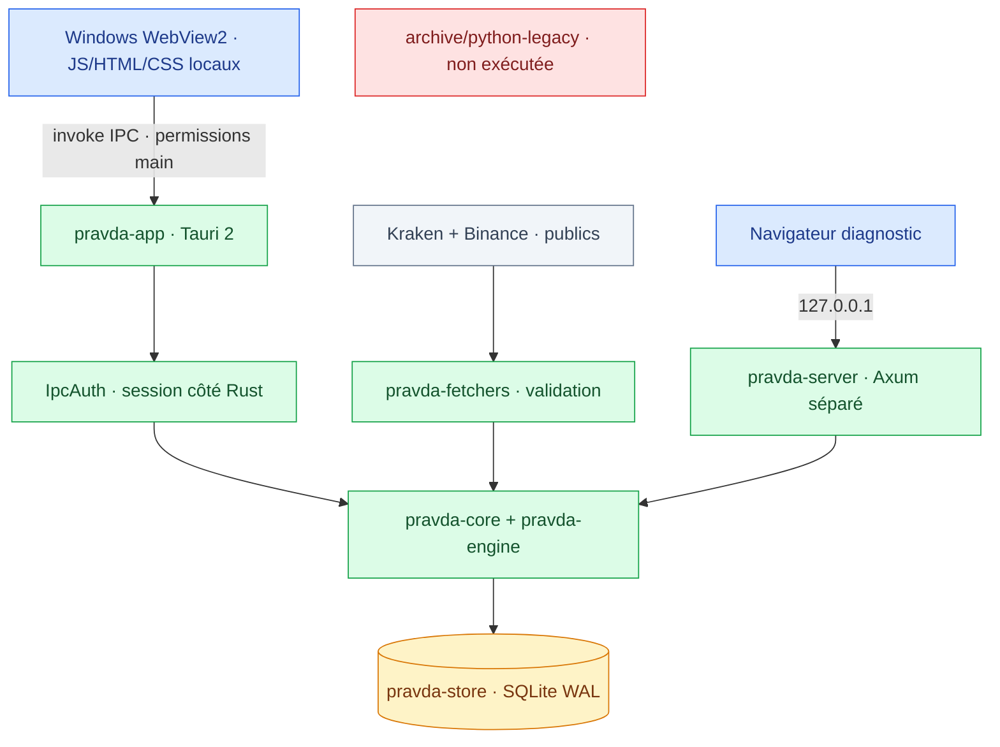
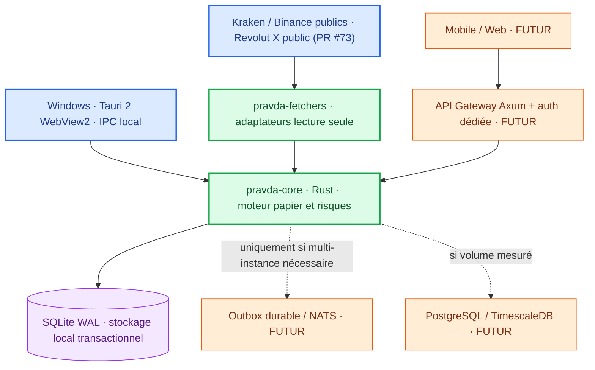

<div align="center">

# 🧭 PRAVDA-BOT · GUIDE CENTRAL
### Architecture · Migration Rust · Sécurité · Versions · Feuille de route


**[Accueil](../README.md)** · **[Politique de sécurité](../SECURITY.md)** · **[Progression](#-tableau-de-bord-priorisé)** · **[Architecture](#-architecture-et-composants-rust)** · **[Historique](#-historique-technique-et-versions)** · **[Livraison](#-preuves-ci-et-critères-de-publication)**

</div>

---

> [!IMPORTANT]
> **Document de référence consolidé au 2 novembre 2026**, fondé sur le dépôt `main@93f2775311ecf26bda0857ffc3523fb7f6318154` et la branche de préparation `migration/rust-production-boundary-20261102`. **Cette page n'est pas une attestation de release**. Les travaux non fusionnés sont signalés comme tels. Les anciens guides éliminés de l'arborescence restent consultables via l'[historique Git antérieur à la consolidation](https://github.com/suvorovpravda/Pravda-Bot/tree/93f2775311ecf26bda0857ffc3523fb7f6318154).

## 🎯 Doctrine : une production Rust, une archive Python

Pravda-Bot est une **application locale Windows** de surveillance de cotations publiques et de **simulation papier**. Le desktop est en **Tauri 2 avec backend Rust, front-end HTML/CSS/JS embarqué et commandes IPC typées**. Le serveur Axum est un **diagnostic navigateur distinct**, accessible en loopback ; il n'est **pas** le transport de l'interface desktop.

**Aucun ordre de marché réel**, échange de clés de trading, retrait de fonds ou rendement garanti n'est fourni.

### Convention de dépôt

| Répertoire / composant | Statut | Contrat |
|---|---|---|
| `crates/pravda-core/` | Production Rust | Types, logique métier, runtime |
| `crates/pravda-engine/` | Production Rust | Simulation et calculs papier |
| `crates/pravda-fetchers/` | Production Rust | Flux marché publics et sources optionnelles explicitement indisponibles |
| `crates/pravda-store/` | Production Rust | SQLite, historique, migration transactionnelle |
| `rust/market-core/` | Production Rust | Validations numériques et garde-fous de prix |
| `rust/pravda-server/` | Diagnostic Rust séparé | Auth et serveur Axum loopback + backend partagé |
| `crates/pravda-app/` | Desktop Windows | Tauri 2, WebView2, IPC et ressources locales |
| `crates/pravda-app/frontend/` | Frontend local | HTML/CSS/JS : **normal**, ce n'est pas du backend Python |
| `tools/` et `.github/workflows/` | Développement / CI | Node.js/PowerShell/Batch de test et maintenance ; pas de runtime Python |
| `archive/python-legacy/` | **Archives historiques** | Références et fixtures historiques **non exécutées** en production |
| `docs/PRAVDA-GUIDE.md` | **Guide unique** | Architecture, contrats, migration, versions et avancement |
| `README.md` / `SECURITY.md` | Pages essentielles | Accueil utilisateur et politique de sécurité |

Les anciens `pyproject.toml`, `requirements*.txt/.in`, `MANIFEST.in`, métadonnées `egg-info` et le `rust/market-core/pyproject.toml` ont été **déplacés dans l'archive**, dans la branche de nettoyage, pour éviter de présenter un package Python à la racine comme méthode de lancement actuelle. **Ils ne sont pas supprimés de l'historique Git.** L'exclusion `linguist-vendored` permet à GitHub d'ignorer cette archive dans ses statistiques **après fusion et recalcul**. Cela ne convertit pas magiquement les fonctionnalités Python historiques en Rust.

## 📊 Tableau de bord priorisé

Les pourcentages sont des **indicateurs de jalons techniques**, **pas** des mesures automatiques de lignes de code ni des promesses d'avancement fonctionnel. **Calcul :** jalons prouvés ou implémentés sur la branche explicitement indiquée ÷ total des jalons de la ligne, arrondi à l'unité. Une modification dans une PR non fusionnée peut compter comme *préparée* mais ne compte **pas** comme intégrée à `main`. Chaque révision doit indiquer sa base Git et ajuster numérateur, dénominateur et preuve.

| Priorité | Chantier | Progression des jalons | Livré / vérifié | Prochaine condition pour 100 % |
|:--|:--|--:|:--|:--|
| **P0** | **Séparation Python → Rust** | **3/6 · 50 % (branche PR)** | Python source archivé ; packaging racine déplacé sur branche ; Linguist configuré sur branche | CI de frontière validée, fusion, preuve que \`main\` ne dépend d'aucune entrée Python |
| **P0** | **Sécurité IPC Windows** | **2/4 · 50 %** | 22 assertions natives WebView2 validées ; test E2E permanent intégré via #69 | Deux fenêtres simultanées / même session, puis origine distante hostile (#70) |
| **P0** | **Parité des fonctions Rust** | **3/8 · 38 %** | Cours publics, auth/IPC, historique SQLite | FX, énergie, news/AIS, alertes configurables, intégrations optionnelles avec provenance prouvée |
| **P0** | **Vérifications CI et gouvernance** | **3/5 · 60 %** | Rust multi-OS, CodeQL, E2E WebView2 permanent | Contrôle CI « Python hors production » et check sur la tête de PR ; confirmation règles administratives enregistrées |
| **P1** | **Historique / migration SQLite** | **3/4 · 75 %** | Source legacy lecture seule, import transactionnel, tests de non-régression | Restauration réelle / interruption avec WAL sur Windows, preuve d'export CSV |
| **P1** | **Interface et robustesse desktop** | **2/4 · 50 %** | Fenêtre Tauri IPC et authentification persistante | Gestion complète des sources indisponibles et recette ergonomique multi-scénarios |
| **P1** | **Packaging Windows Enterprise** | **0/4 · 0 %** | Le binaire est compilable, **pas de paquet signé** | MSI/EXE signé, horodatage, SBOM/provenance, installation/rollback sur Windows propre |
| **P2** | **Observabilité et charge** | **1/4 · 25 %** | Uptime et statut runtime | CPU/RSS fiables, limitations disque/flux, diagnostics expurgés et tests saturation |
| **P2** | **Notifications / LLM / sources facultatives** | **0/4 · 0 %** | Archives de référence uniquement, pas de parité attestée | Contrats, adaptateurs réels, permissions/secrets, tests d'intégration reproductibles |

> [!WARNING]
> **Un 50 % n'est pas « moitié du produit fini ».** La progression reflète le nombre de jalons listés ; la complexité et l'effort restant peuvent être très différents. Pour la séparation Rust, **50 % désigne la branche de travail, pas `main`**. En cas de changement des critères, actualiser aussi le dénominateur.

### Vue d'ensemble des étapes


**Règle d'ordonnancement :** traiter les **P0 en premier** ; les P1 ne servent pas de prétexte pour assouplir les ACL ou publier une release non signée. L'issue [#70](https://github.com/suvorovpravda/Pravda-Bot/issues/70) peut être préparée en parallèle du nettoyage Rust, sans fusion automatique.

## 🏗️ Architecture et composants Rust



### Frontières et invariants

1. **Desktop** : ne démarre **pas** de serveur HTTP/WS pour son interface. Les assets sont embarqués et les IPC sont autorisées pour `windows: ["main"]` uniquement.
2. **Auth** : setup local, mot de passe de **15 caractères minimum**, vérificateur PBKDF2 salé, session en mémoire Rust, refus après logout ou expiration.
3. **Données** : SQLite dans `%LOCALAPPDATA%\Pravda-Bot` par défaut, WAL, opérations paramétrées, imports transactionnels depuis legacy **lecture seule**.
4. **Simulation** : ordres et soldes **fictifs** ; rejets de cotations invalides, fraîches/anciennes selon les seuils, frais estimatifs de **0,36 %**.
5. **Diagnostic serveur** : boucle locale 127.0.0.1, transport HTTP volontairement séparé, protections Host/Origin/Fetch Metadata et cookie d'authentification.
6. **Tests sécurité** : ne jamais ajouter une permission `fs`/`shell`, une origine externe ou un fallback HTTP au desktop pour faire réussir une CI.

### Correspondance HTTP diagnostic → IPC desktop

| Fonction | Desktop IPC | Diagnostic HTTP (séparé) | Limite |
|---|---|---|---|
| État authentification | `ipc_auth_status` / `ipc_session_check` | Setup/login/session | Contrats de cookies et jetons distincts |
| Initialisation / login / logout | `ipc_auth_setup` / `ipc_auth_login` / `ipc_auth_logout` | Routes auth serveur | Protection appliquée côté Rust |
| Marché | `ipc_market_snapshot` | Snapshot de marché | Les cours dépendent d'une source publique disponible |
| Historique | `ipc_history_recent`, `ipc_history_query` | Lecture filtrée JSON | Réponses bornées (10 000 lignes max) |
| Export | `ipc_history_export_csv` | Endpoint CSV | Contrôle téléchargement WebView à compléter |
| Alertes papier | `ipc_paper_alerts_snapshot` | Endpoints simulation | Pas de création d'alertes personnalisées prouvée |
| Métriques | `ipc_runtime_metrics` | Métriques serveur | CPU/RSS non fournis de façon fiable |
| FX | `ipc_fx_status` | Référence/route partielle | Retour « indisponible » si absence de fournisseur |

**Modules non encore portés avec preuve de parité :** alertes configurables, données énergétiques ENTSOG/TTF, GDELT/actualités, AIS/cartes, modules OSINT, moteur LLM local, notifications et analyses avancées des carnets d'ordres. Leurs anciens fichiers existent **uniquement à titre de référence** dans l'archive. Ne pas faire passer des stubs « unavailable » pour une intégration réelle.

## 🪟 Windows — installation, essais et sauvegardes

### Desktop natif Tauri 2

Prérequis : Windows x64, Rust MSVC/Cargo, outillage C++ et WebView2 Runtime.

```powershell
git clone https://github.com/suvorovpravda/Pravda-Bot.git
cd Pravda-Bot
cargo test --locked --workspace
cargo test --locked --manifest-path .\crates\pravda-app\Cargo.toml
cargo run --release --locked --manifest-path .\crates\pravda-app\Cargo.toml
```

Le premier lancement crée un mot de passe local de 15 caractères minimum ; les lancements suivants utilisent le même fichier vérificateur. **Ne jamais supprimer `pravda.db` ou `pravda_auth.json` pour corriger une erreur de connexion.** Le démarrage du desktop utilise IPC et **ne demande aucun navigateur ouvert**.

<details>
<summary><strong>Test Windows sans réseau dans un profil de données isolé</strong></summary>

```powershell
$dir = Join-Path $env:TEMP ("pravda-rust-test-" + (Get-Date -Format "yyyyMMdd-HHmmss"))
New-Item -ItemType Directory -Force -Path $dir | Out-Null
$env:PRAVDA_DB_PATH = Join-Path $dir "pravda.db"
$env:PRAVDA_AUTH_PATH = Join-Path $dir "pravda_auth.json"
$env:PRAVDA_MARKET_FEEDS_ENABLED = "false"
Remove-Item Env:PRAVDA_ADMIN_PASSWORD -ErrorAction SilentlyContinue
cargo run --release --locked --manifest-path .\crates\pravda-app\Cargo.toml
```

Reprendre **la même fenêtre PowerShell et les mêmes chemins** au redémarrage pour vérifier la persistance. Ne jamais employer la base ou un vrai mot de passe dans un rapport public.

</details>

### Diagnostic navigateur distinct

```powershell
$env:PRAVDA_DB_PATH = Join-Path $env:TEMP "pravda-diagnostic.db"
$env:PRAVDA_AUTH_PATH = Join-Path $env:TEMP "pravda-diagnostic-auth.json"
cargo run --locked -p pravda-server
```

Puis ouvrir `http://127.0.0.1:8080`. Ne pas publier le serveur par NAT, proxy ou tunnel. Le script `tools/Start-Pravda-Bot.ps1` est un **outil de lancement du serveur Rust diagnostic**, pas le runtime normal du desktop.

### Migration et sauvegarde SQLite

| Phase | Principe | Vérification |
|---|---|---|
| Préparer | Arrêter l'application et sauvegarder une base cohérente (base et WAL) + fichier auth | Sauvegarde restaurable sur copie |
| Détecter | Paramètres `PRAVDA_LEGACY_DB_PATH` ou `MARKET_HISTORY_DB` | Source existante, ouverte en lecture seule |
| Importer | Correspondance champs `market_ticks` → historique Rust | Transaction atomique, provenance traçable |
| Rejouer | Identité d'une source basée sur son chemin canonique | Même import : aucune nouvelle ligne |
| Échouer | Ligne malformée ou interruption | Rollback, pas de base « vide » créée silencieusement |

La copie d'un seul fichier `.db` pendant que WAL est actif **n'est pas une sauvegarde fiable**. Ne pas déclencher la migration en pointant une ancienne base réelle avant recette de restauration sur des données fictives.

## 🛡️ Sécurité et preuves

La référence normative en matière de vulnérabilités et de divulgation responsable reste **[SECURITY.md](../SECURITY.md)**. Ce guide central liste les preuves techniques et leurs limites.

| Preuve / contrôle | Situation au 02/11/2026 |
|---|---|
| [PR #64](https://github.com/suvorovpravda/Pravda-Bot/pull/64) — IPC desktop | Fusionnée, contrat IPC intégré |
| [PR #67](https://github.com/suvorovpravda/Pravda-Bot/pull/67) — WebView2 natif | 8 checks CI verts, 22 assertions de sécurité PASS |
| [PR #69](https://github.com/suvorovpravda/Pravda-Bot/pull/69) — E2E permanent | Fusionnée ; test sur PR et commits `main` pertinents |
| [Issue #70](https://github.com/suvorovpravda/Pravda-Bot/issues/70) | Multi-fenêtres dans **un même processus** et navigation origine distante **non attestées** |
| Protection de `main` | Capture montrant no-bypass coché ; lecture API des paramètres sauvegardés : **403**, non attestée par l'intégration |
| Revue externe obligatoire | **Supprimée par le propriétaire** (dépôt maintenu seul) ; cela n'est pas une revue externe effectuée |
| MSI signé / SBOM | **Non livrés / non attestés** |

### Test IPC Windows natif (concret)

Lancer la variante Debug opt-in `security-e2e` seulement pour les tests de sécurité. Le pilote `tools/test-ipc-security-windows.mjs` utilise réellement WebDriver/EdgeDriver sous Windows, jamais un mock de `invoke`. Il vérifie :

- `UNAUTHORIZED` avant setup/login pour les commandes protégées, puis après logout.
- Succès de `ipc_market_snapshot` **après** authentification depuis `main`.
- Refus par les capabilities de `security-probe` **sans capability**.
- Refus des commandes de plugins `fs` et `shell`, sans écriture d'un fichier témoin.
- Rapport JSON avec `passed=true`, 22 assertions, SHA exact du checkout, absence de secret.

**Limite essentielle :** deux WebViews ont été testées **dans deux processus natifs successifs**. Ce résultat **ne prouve pas** la coexistence dans la même session Rust ; le test des origines distantes reste ouvert. La sonde est **Debug-only**, sans nouvelle permission Tauri.

## 🧪 Preuves CI et critères de publication

```powershell
cargo fmt --all -- --check
cargo clippy --locked --workspace --all-targets -- -D warnings
cargo test --locked --workspace
cargo test --locked --manifest-path .\crates\pravda-app\Cargo.toml
node tools/test-desktop-ipc.mjs
node tools/test-dashboard.mjs
# Garde de frontière Rust / Python (sur branche de migration) :
node tools/test-rust-production-boundary.mjs
```

Les workflows testent Rust Ubuntu/Windows, MSRV, desktop Windows, mode navigateur, CodeQL et **E2E WebView2 permanent**. Un statut « vert » n'est significatif que si le job a **vraiment été exécuté** (et non `skipped`), sur le SHA approprié, avec un rapport de preuve exploitable.

### Barrières avant une distribution Windows Enterprise

1. **Rust/Tauri local** : création, login, logout, redémarrage, SQLite/WAL et mode hors ligne validés, sans port HTTP pour l'UI.
2. **Sécurité** : chemins/permissions Tauri minimaux, refus IPC, données de test, origine hostile explicitement vérifiée, logs expurgés.
3. **Supply chain** : builds reproductibles, artefacts SHA, SBOM, vérification des dépendances, absence de secrets dans l'archive.
4. **Distribution** : MSI/EXE signé Authenticode, horodatage conforme, test d'installation/mise à jour/désinstallation/rollback sur Windows propre.

**Ne pas appeler « Enterprise prêt » un binaire non signé, ni annoncer une date non étayée.**

## 🏛️ Architecture cible évolutive — lecture seule d'abord


> [!IMPORTANT]
> **Architecture envisagée, non livrée.** Ne pas confondre l'objectif « robuste/enterprise » et un système HFT. Pravda-Bot reste aujourd'hui un **desktop Windows local, mono-utilisateur, simulations papier**. Une API réseau et des identifiants d'exchange ne sont **pas** nécessaires pour ce mode. Les technologies supplémentaires doivent être justifiées par des besoins mesurés et validées séparément.

### Vue cible : frontières explicites, aucun contournement d'IPC



**Invariants :** le desktop ne passe **jamais** par un API Gateway distant pour appeler sa logique locale ; mobile/web ne réutilisent pas directement les capabilities Tauri. Le serveur Axum actuel est uniquement **diagnostique et loopback**, pas une API distante de production. Des accès distants futurs exigeraient une authentification distincte, TLS, droits minimaux, contrôle d'accès et audit. Les ordres réels restent désactivés.

### Priorités techniques : sous-jalons vérifiables

| Ordre | Chantier technique | Jalons préparés / total | Avancement | Critère suivant |
|:--|:--|--:|--:|:--|
| 1 · P0 | CI, séparation Rust/Python et preuves native Windows | 3/6 | **50 % (branche #72)** | CI complète verte, fusion validée, nouveaux tests Windows |
| 2 · P0 | Sécurité du poste et modèle de secrets | 0/5 | **0 %** | Inventaire secrets, coffre OS, effacement mémoire, rotation/backup, tests d'accès négatifs |
| 3 · P1 | Contrats exchange et Revolut X public | 2/4 | **50 %** | Adaptateur public fusionné et CI 8/8 sur #73 ; validation de réponses live et branchement explicite encore à faire |
| 4 · P1 | Résilience et outbox durable | 0/4 | **0 %** | Idempotence, journal local, reprise après crash, scénarios de rejouement |
| 5 · P1 | Backtesting/paper trading | 1/5 | **20 %** | Simulateur papier existant ; moteur reproductible, coûts, données historiques, tests de biais |
| 6 · P2 | Observabilité locale | 1/4 | **25 %** | Uptime existant ; métriques CPU/RSS, tracing expurgé, alertes pertinentes |
| 7 · P2 | Infrastructure multi-utilisateur | 0/5 | **0 %** | Besoin démontré, RBAC, migrations PostgreSQL, séparation des locataires, reprise |
| 8 · P2 | Exécution d'ordres réels | 0/7 | **0 % · DÉSACTIVÉ** | Autorisation explicite, spécification officielle, coffre clés, limites, idempotence, sandbox **si réellement disponible**, revue de sécurité |

*Ces sous-jalons sont des indicateurs de préparation et non des taux de couverture de code ou une attestation de production. Ils complètent les neuf chantiers généraux synchronisés dans README et SECURITY.*

### Secrets : distinguer mot de passe local et clés d'exchange

- **PBKDF2 salé** est destiné à vérifier un **mot de passe** ; ce n'est pas un coffre pour clés privées ou API. Ne pas déduire « insuffisant » sans préciser cet usage.
- Avant de stocker une clé d'exchange, isoler un composant Rust de secrets : **Windows Credential Manager / DPAPI** (via intégration OS contrôlée), droits utilisateurs, journaux expurgés, contrôle des erreurs et tests de restauration. Ne jamais garder des clés dans `config/production.yaml`, `.env` public, logs ni dans la WebView.
- Pour SQLite, les données sont aujourd'hui locales **non déclarées chiffrées**. Le chiffrement au repos exigera un choix documenté (p. ex. SQLCipher et gestion de clé dédiée), migrations/récupération testées et sauvegardes cohérentes avec WAL. « AES-256-GCM SQLite » n'est pas une option qu'on active sans bibliothèque, schéma et gestion du cycle des clés.
- **Windows Hello / YubiKey / HSM / rotation automatique** ne sont pas implémentés. Chaque option dépend de la disponibilité matérielle et du protocole d'exchange ; imposer un renouvellement arbitraire de 90 jours sans compatibilité API serait incorrect.

### Coffre Windows : procédures d'exploitation et restauration (#74)

Le coffre **n'est pas une API à appeler depuis la WebView**. Le seul contrat de service est `SecretStore::{put,get,remove}` dans `rust/pravda-server/src/secret_store.rs`. L'implémentation Win32 appartient au profil utilisateur Windows courant et ne remplace pas le vérificateur PBKDF2 du mot de passe local.

1. **Provisionnement :** la clé privée n'est saisie que dans un parcours Rust dédié à concevoir et auditer avant toute connexion privée ; pour l'instant, aucune UI ne l'accepte et aucune requête privée n'est lancée. La présence du coffre ne signifie pas que ce parcours existe.
2. **Rotation :** créer une nouvelle clé côté exchange, limiter les droits au strict nécessaire, remplacer l'identifiant de coffre avec `put`, vérifier côté service (jamais dans les logs), révoquer l'ancienne côté fournisseur. Le test Rust utilise de faux octets et une entrée nommée aléatoirement.
3. **Suppression :** révoquer la clé distante, exécuter `remove`, attester `NotFound` via `get`. Effacer une entrée Windows ne supprime pas automatiquement une clé encore active côté fournisseur.
4. **Sauvegarde/restauration :** ne jamais exporter les octets en clair dans JSON, SQLite/WAL, CSV, log, dump ni sauvegarde. Conserver uniquement les données métier et les références non sensibles. Sur un nouveau poste/profil, réapprovisionner une **nouvelle** clé, la précédente étant révoquée ; aucune restauration portable du Credential Manager n'est prévue.
5. **Incident :** bloquer les connexions privées, révoquer les clés exposées chez le fournisseur, renouveler les sessions, analyser l'historique Git, journaux et artefacts, et documenter une alerte sans révéler les octets. Un historique Git contenant une clé reste sensible même si la ligne est supprimée ultérieurement.

**Contrôles d'acceptation :** #75 fusionnée et 8/8 vérifications ; #77 en cours pour le mock, le test natif rotation/suppression, l'absence de fuite par signatures et l'historique Git *y compris commits de fusion*. Ces contrôles ne garantissent ni absence de secret sous un format inconnu ni résistance à un malware utilisant le même compte Windows. Pas d'ordre réel, pas d'API privée activée.

### Revolut X : schéma réel et barrières de sécurité

**Référence officielle :** [Revolut X Crypto Exchange API](https://developer.revolut.com/docs/api/revolut-x-crypto-exchange).

| Fonction | API officielle identifiée | Mode Pravda |
|---|---|---|
| Carnet public | `GET https://revx.revolut.com/api/2.0/public/order-book/BTC-USD` | Lecture publique **uniquement**, PR #73 fusionnée ; données non encore exposées dans l'UI |
| Authentification de compte | `X-Revx-API-Key`, `X-Revx-Timestamp`, `X-Revx-Signature` | Non implémentée |
| Signature | **Ed25519** avec clé privée utilisateur | Aucune clé ni signature actuellement |
| Ordres réels et soldes | Endpoints authentifiés distincts `/api/1.0/...` | **Interdits dans le connecteur public** |

La proposition HMAC / `X-Revolut-Api-*` / `https://api-sandbox.revolut.com` **ne correspond pas au contrat Revolut X vérifié** ; ne pas intégrer ce code. Les prix, tailles, et paires sont des données **en chaînes décimales**, et les chemins de paire utilisent le tiret (`BTC-USD`) — ne pas comparer silencieusement ces marchés avec `BTC/USDT`.

La **PR #73 a été fusionnée** avec le contrat `PublicMarketDataAdapter`, un client public limité au carnet et des tests de parsing. Les huit checks CI de la PR ont réussi. **Le module n'est pas branché au runtime/dashboard**, et aucune validation de cotations live n'est attestée. Il n'y a ni clé privée, ni accès à un compte, ni ordre réel.

### Évolution de l'infrastructure : déclencheurs plutôt qu'empilement

- **Local mono-instance :** conserver SQLite/WAL. Pour les opérations à rejouer, définir d'abord un **outbox durable SQLite**, clés d'idempotence, journal d'événements et tests d'interruption ; un simple broadcast mémoire n'est pas un bus persistant.
- **NATS/Redis Streams :** utiles **si** plusieurs services ou consommateurs réellement séparés existent. Ajouter un serveur de messages à un exécutable Tauri local augmenterait la surface d'attaque et les pannes possibles.
- **PostgreSQL/TimescaleDB/ClickHouse :** envisager après métriques de volume, concurrence et requêtes historiques. « HFT » n'est pas l'objectif établi et PostgreSQL n'est pas requis pour le desktop actuel.
- **Observabilité :** `tracing` structuré et redaction d'abord, puis OpenTelemetry/Prometheus seulement pour une architecture multi-services justifiée. Aucun endpoint métrique distant ni dashboard d'administration ne doit exposer des secrets ou des données sensibles.
- **CI/CD :** `cargo fmt`, Clippy, tests Rust, Windows Tauri natif, CodeQL, `cargo-audit` et fuzzing ciblé ; backtesting reproductible, fixtures de réponses externes, tests de reprise/crash, SBOM/signature Windows comme barrière de release.

---

## 🗃️ Historique technique et versions

Les anciens fichiers Markdown mêlaient **plans futurs**, **rapports historiques Python** et **affirmations de release parfois contradictoires**. Ils sont consolidés dans les repères ci-dessous, mais restent consultables via **[l'historique Git immuable du commit précédent](https://github.com/suvorovpravda/Pravda-Bot/tree/93f2775311ecf26bda0857ffc3523fb7f6318154)** pour l'exactitude documentaire.

| Période / version | Décision ou évolution historiquement décrite | Lecture actuelle |
|---|---|---|
| v0.1.2 | Pool SQLite Python, file bornée, modèles Pydantic, retry sur verrou | **Archive Python**, pas une fonction Rust attestée par cette note |
| v0.2 / v0.2.1 | Premiers calculs et garde-fous Rust, migration partielle | **Étape historique**, intégration Rust poursuivie ensuite |
| v0.3.0 / v0.3.1 | Authentification locale et préversions Windows | **Historique de préversions**, ne pas inférer un MSI Enterprise signé |
| v0.3.2 | Correctif de navigation HTTP WebView2 | Antérieur à la transition vers **IPC embarqué** |
| v0.3.3 | Persistance d'auth et chemins Windows AppData | Exigences maintenues dans le desktop actuel |
| v0.3.4 | Améliorations visuelles du dashboard, mode USDT, états FX indisponibles | Descriptions de version historique, indépendantes de l'IPC PR #64 |
| PR #64 (02/11) | Assets intégrés et transport desktop Tauri IPC | **Fusionnée**, pas de serveur HTTP d'interface |
| PR #67 (02/11) | Tests réels Windows de refus d'accès IPC | **Fusionnée**, 22 PASS E2E, portée bornée |
| PR #69 (02/11) | Test IPC Windows récurrent dans la CI | **Fusionnée**, contrôle permanent |

### Décisions d'architecture à conserver

Le RFC historique Windows a motivé la séparation **backend Rust pur / adaptateur Tauri / serveur diagnostic distinct**, l'utilisation de capacités IPC **explicitement nommées**, des fichiers SQLite locaux, de sauvegardes cohérentes et de la signature des distributions Windows. Ces règles sont conservées ici ; les anciens « à faire » du RFC ne doivent pas être interprétés comme une absence de code dans `main` actuel.

Les relevés HTTP → IPC de la phase de migration constituent un **historique de contrats**. Le référentiel exécutable aujourd'hui est `crates/pravda-app/src/ipc.rs`, la liste dans `build.rs` et les permissions de `capabilities/main.json`, pas le texte d'une RFC périmée.

L'ancien audit STRIDE v0.2 décrivait des risques et dépendances **de son commit daté**, y compris des CVE Python/PyO3, et utilisait un score historique qui **ne doit pas être présenté comme le niveau de sécurité actuel**. Les vulnérabilités doivent être réévaluées contre les versions installées dans les Cargo.lock actuels et les alertes CodeQL/RustSec réellement disponibles.

Les anciens rapports « GPT vs Gemini », kits de publication Python, promesses « release prête » et instructions de `git push` direct dans `main` décrivent **une autre génération du projet**. Ils ne sont pas des guides de déploiement en vigueur. Ne pas exécuter leur ancien packaging sans contexte.

## 🔁 Politique de mise à jour de la documentation

Pour **chaque PR de migration ou de sécurité** :

1. Actualiser **ensemble** `README.md`, `SECURITY.md` (si des frontières/garanties changent) et ce guide central.
2. Recalculer **tous les % impactés** sur les jalons définis ; indiquer les preuves (PR, checks, SHA) et distinguer branche de travail de code fusionné.
3. Conserver **la même direction artistique** : badges bleu/vert/orange, tableaux de statuts, Mermaid et avertissements sans masquer les limites.
4. Vérifier les liens relatifs, les titres, les versions et l'état des fonctionnalités ; ne pas annoncer de tests non exécutés.
5. Réduire les nouveaux fichiers de documentation : **pas de nouvelle note .md isolée** pour chaque version, PR ou RFC. Ajouter une section datée ici et conserver les informations contractuelles importantes dans les tests/code.
6. Garder la divulgation responsable, le modèle de menace synthétique et la confidentialité dans `SECURITY.md`, sans dupliquer toute la politique.

**Sources de vérité :** code Git sur la tête testée, checks GitHub, rapports E2E, réglages effectivement attestés. **Cette page ne remplace pas un rapport d'audit tiers.**

---

<details>
<summary><strong>English — short project guide</strong></summary>

The Rust production backend and Tauri 2 Windows desktop use bundled HTML/CSS/JS and typed IPC, while Axum is a separate loopback diagnostic application. All historical Python sources and packaging belong under `archive/python-legacy/`, excluded from language statistics after the migration branch merges. The priority table measures **completed milestones rather than engineering effort**. #67 validated 22 real Windows IPC assertions, #69 made the job permanent, and #70 still needs same-process multi-window and hostile-origin evidence. No signed MSI or real trading is delivered. See [README](../README.md) and [SECURITY](../SECURITY.md).

</details>

<details>
<summary><strong>Русский — краткое руководство</strong></summary>

Рабочий backend написан на Rust, приложение Windows использует Tauri 2 и встроенные HTML/CSS/JS с IPC. Отдельный Axum-сервер работает только для локальной диагностики. Старый Python находится в `archive/python-legacy/` и не запускается рабочим приложением. Проценты отражают **выполненные контрольные этапы**, а не общий объём завершённого продукта. #67 подтвердил 22 IPC-теста на Windows, #69 сделал проверку постоянной; тесты окон в одном процессе и удалённых источников (#70) остаются открытыми. Подписанного MSI и реальной торговли нет.

</details>
