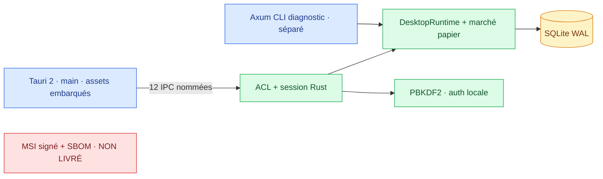

# 🏛️ Architecture — Pravda-Bot Windows

> **État au 2 novembre 2026.** La [PR #64](https://github.com/suvorovpravda/Pravda-Bot/pull/64) est **fusionnée dans `main`**. Le desktop intègre Tauri 2, les assets locaux et les commandes IPC, **sans lancer Axum**. Les documents RFC historiques restent des **instantanés de décision**, pas des constats de ce qui manque encore dans le code actuel.

## 🧭 Navigation documentaire

| Document | Nature | À lire pour |
|---|---|---|
| [README principal](../../README.md) | Guide utilisateur actualisé | Prérequis, installation, périmètre, roadmap |
| [Politique de sécurité](../../SECURITY.md) | État + menaces + remédiations | Permissions IPC, risques, divulgation |
| [Phase 2 — Tauri IPC](tauri-ipc-phase2.md) | Architecture implémentée | Commandes, tests, limites |
| [Tâche 3 — Migration SQLite legacy](sqlite-legacy-migration.md) | Contrat transactionnel | Import, idempotence, rollback |
| [RFC-0001 Windows Enterprise](RFC-0001-windows-enterprise.md) | **Référence historique** avant implémentation | Choix d'architecture et étapes futures |
| [Modèle de menace](threat-model.md) | Baseline de menaces | STRIDE et frontières |
| [Contrat HTTP → IPC](ui-ipc-contract.md) | **Inventaire historique** + différences | Migration des routes |
| [Critères d'acceptation](acceptance.md) | Exigences, **non certification** | Portes de publication Windows |
| [Suivi de migration](../../MIGRATION_STATUS.md) | Journal historique + état de reprise | Travail restant |

## 🧱 Vue cible, partiellement réalisée

**Implémenté :** une fenêtre Windows native sans port HTTP d'interface ; 12 commandes IPC explicitement autorisées pour `main` ; contrôle de session Rust ; moteur marché/SQLite partagé et migration legacy transactionnelle ; serveur CLI diagnostic distinct.

**À compléter :** tests négatifs IPC multi-fenêtres/origines, revue humaine indépendante, contrôle administratif « no bypass », modules de données non migrés, métriques CPU/RSS, limitations globales de charge, distribution Windows signée et SBOM.

## ⚖️ Invariants de livraison

1. Le desktop utilisateur démarre comme **EXE Tauri autonome**, sans `pravda-server.exe` enfant, serveur Axum ni fichier de script de lancement dans le paquet destiné à l'utilisateur.
2. L'interface embarquée communique via **IPC**, les handlers valident eux-mêmes l'autorisation ; pas d'origine distante, ni permissions générales shell/fs.
3. Auth/SQLite dans le profil Windows ; aucune réinitialisation silencieuse du vérificateur ou des données lors d'une mise à niveau.
4. Le serveur Axum reste **strictement séparé** et réservé au diagnostic local.
5. Toute distribution Enterprise exige **signature Authenticode EXE + MSI, horodatage RFC 3161, validation de la provenance et test Windows propre**. `bundle.active=false` à ce stade.
6. CI verte sur la **tête exacte du changement**, puis observation des checks post-fusion ; tests dynamiques Windows, approbation indépendante et protections GitHub sans bypass à démontrer, non à supposer.

## 🗂️ Feuille de route

- **Terminé en code :** PR-01 documentaire, migration SQLite transactionnelle, [PR #64 — Phase 2 IPC](https://github.com/suvorovpravda/Pravda-Bot/pull/64).
- **P0 :** prouver les protections de branche, examiner les jobs post-merge, réaliser l'audit IPC négatif et la revue de sécurité.
- **P1 :** migrer les sources et commandes fonctionnelles manquantes, contrôler historique/export avec fichiers fictifs, renforcer la résilience.
- **P2 :** produire et contrôler une distribution Windows Enterprise signée, SBOM, provenance, installation et rollback.

> Cette page documente la **situation du dépôt** ; les RFC peuvent contenir des captures antérieures à l'IPC et doivent être lues à leur date d'analyse, sans les appliquer comme état actuel.

## 📚 Références techniques

- [Tauri 2 : configuration et frontendDist](https://v2.tauri.app/reference/config/#frontenddist)
- [Tauri 2 : permissions et capabilities](https://v2.tauri.app/security/capabilities/)
- [Signature Windows Tauri](https://v2.tauri.app/distribute/sign/windows/)
- [NIST SP 800-207 — Zero Trust](https://csrc.nist.gov/pubs/sp/800/207/final)
