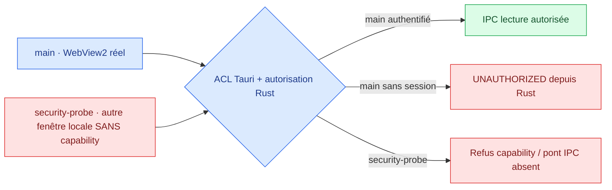

# Issue #66 — Preuves de sécurité IPC natives Windows

> [!WARNING]
> **Condition de gouvernance non démontrée.** La connexion GitHub du projet retourne HTTP **403** sur la lecture des protections détaillées de `main`. `protected=true` n'atteste **pas** « Do not allow bypassing ». **Aucune fusion de cette PR sécurité, ni clôture de #66, sans validation administrative ET preuves natives réussies.**

## 1. Confirmer la protection de `main` (administrateur GitHub)

Ouvrir les paramètres effectifs depuis **Settings → Branches** et, si applicables, **Settings → Rules → Rulesets**. Vérifier et capturer (sans jetons) :

- [ ] Require a pull request before merging.
- [ ] Require at least **one independent human approval** par un réviseur habilité. L'approbation de l'auteur ne compte pas.
- [ ] Dismiss stale reviews / réexamen après nouveaux commits.
- [ ] Require conversation resolution.
- [ ] Require status checks to pass (jobs Windows, Linux, MSRV et sécurité choisis).
- [ ] **Do not allow bypassing the above settings** actif ; aucun acteur de bypass ou admin exempté.
- [ ] Validation négative de l'interface GitHub : une PR **sans review indépendante** reste bloquée, sans essayer de la fusionner.

Consigner les preuves dans [#66](https://github.com/suvorovpravda/Pravda-Bot/issues/66).

## 2. Ce que le test Windows prouve réellement



Le projet contient déjà des tests unitaires Rust pour les gardes de session et des contrats JS statiques : ils ne prouvent pas le **comportement du vrai runtime WebView2**.

Ce lot ajoute un second WebView **uniquement** via `#[cfg(all(windows, debug_assertions, feature = "security-e2e"))]`. Il porte le label `security-probe`, absent de `capabilities/main.json`. Ce WebView est chargé depuis les mêmes assets locaux que `main` et partage le moteur d'authentification, mais doit être **incapable d'invoquer** les commandes Tauri.

**Sémantique importante :**
- `UNAUTHORIZED` dans `main` sans session valide prouve que le handler **Rust** refuse l'accès.
- Sur `security-probe`, le système de permissions Tauri peut refuser **avant même d'appeler le handler Rust** ; `ACL denied` ou pont Tauri absent constituent alors une preuve **du runtime ACL**, et non un `FORBIDDEN_WINDOW` émis par le handler.
- Une commande qui réussit depuis `security-probe` fait **échouer** la batterie, sans tolérance.

L'outil appelle réellement `window.__TAURI__.core.invoke` via WebDriver **dans les deux fenêtres**. Aucun mock JavaScript du backend n'est utilisé. Aucun nouveau privilège `shell` ou `fs`, ni commande personnalisée ni capability n'est ajouté.

## 3. Windows réel : prérequis et lancement

Windows 10/11 x64, WebView2, Rust/Cargo et outils C++ MSVC, Node.js 22+, `tauri-driver` et `msedgedriver.exe` Microsoft correspondant à la version du moteur Edge/WebView2.

Le pilote officiel est documenté dans [Tauri — WebDriver Manual Setup](https://tauri.app/develop/tests/webdriver/manual-setup/). Il peut présenter des incompatibilités selon les versions Edge/WebView2 ; dans ce cas **test NON CONCLU** (exit code non zéro), jamais validation implicite.

Exemple de travail dans une **copie indépendante** du dépôt :

```powershell
git clone https://github.com/suvorovpravda/Pravda-Bot.git Pravda-Bot-Security-E2E
cd Pravda-Bot-Security-E2E
git fetch origin
git switch --track origin/security/ipc-windows-native-e2e-20261102

# Requiert Rust MSVC + WebView2.
cargo build --locked --manifest-path .\crates\pravda-app\Cargo.toml --features security-e2e

# Pilote natif ; vérifier msedgedriver.exe fourni par Microsoft et ajouté au PATH.
cargo install tauri-driver --locked
Get-Command tauri-driver, msedgedriver, node

node .\tools\test-ipc-security-windows.mjs
```

**Pas d'accès au profil réel :** le script crée des chemins temporaires `PRAVDA_DB_PATH` et `PRAVDA_AUTH_PATH`, désactive les feeds et retire les chemins d'import legacy. Le mot de passe test est généré aléatoirement et **n'est jamais inscrit dans le rapport**. Les fichiers de test sont supprimés à la fin. Les échecs conservent uniquement un JSON de diagnostic sous `%TEMP%` (ou `PRAVDA_E2E_REPORT` si fourni).

### Matrice de vérification

| Test natif | Résultat attendu |
|---|---|
| Détecter `main` + `security-probe` | Deux fenêtres WebView2 réellement accessibles par WebDriver |
| 8 commandes protégées depuis `main` **avant setup/login** | **`UNAUTHORIZED` (Rust)** |
| Setup de mot de passe temporaire depuis `main` | Réussite (aucun secret loggé) |
| Snapshot depuis `main` authentifiée | Réussite |
| `ipc_auth_status` et `ipc_market_snapshot` depuis `security-probe` | Refus ACL Tauri ou absence de pont IPC |
| Invocation directe `plugin:fs|write_text_file` depuis `main` | Refus + **aucun fichier créé** |
| Invocation directe `plugin:shell|execute` depuis `main` | Refus (aucun plugin shell autorisé) |
| Logout puis nouveau snapshot depuis `main` | **`UNAUTHORIZED` (Rust)** |

L'outil doit rendre exit code `0` et `passed=true` **uniquement si tous les scénarios réussissent**. Le démarrage d'un pilote absent, une fenêtre manquante, une réponse inattendue, un échec sans verdict, une défaillance de setup ou un refus d'auth d'un type inattendu empêchent l'approbation.

**Limitations :** la navigation explicite depuis une origine distante, l'exploitabilité d'un XSS, les ACL Windows sur le disque, les scénarios d'expiration 12 h et le packaging Authenticode restent **hors périmètre de ce premier test natif**. Le deuxième WebView local sans capability vérifie la frontière fenêtre, pas toutes les origines hostiles.

## 4. Comment livrer une preuve vérifiable

Dans [#66](https://github.com/suvorovpravda/Pravda-Bot/issues/66), transmettre : SHA exact, version Windows, version WebView2/Edge, version tauri-driver, exécution et exit code, rapport JSON expurgé. Une revue humaine doit examiner aussi `crates/pravda-app/tauri.conf.json`, `capabilities/main.json`, `build.rs` et `src/ipc.rs`.

**Ne jamais transmettre de vraie base de production, de mot de passe, de token, ni de fichier `pravda_auth.json`.**

**Critère de sortie :** (A) protections GitHub vérifiées par administrateur, (B) batterie native réussie sur Windows, (C) revue de sécurité humaine. Cette PR reste Draft et non fusionnée tant que (A) et (B) et (C) ne sont pas remplis.
